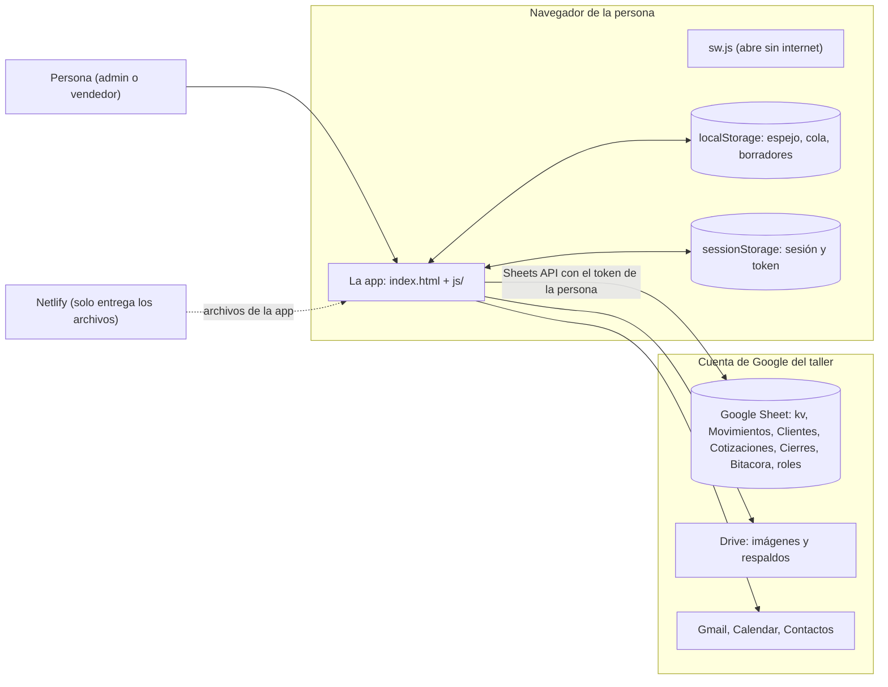
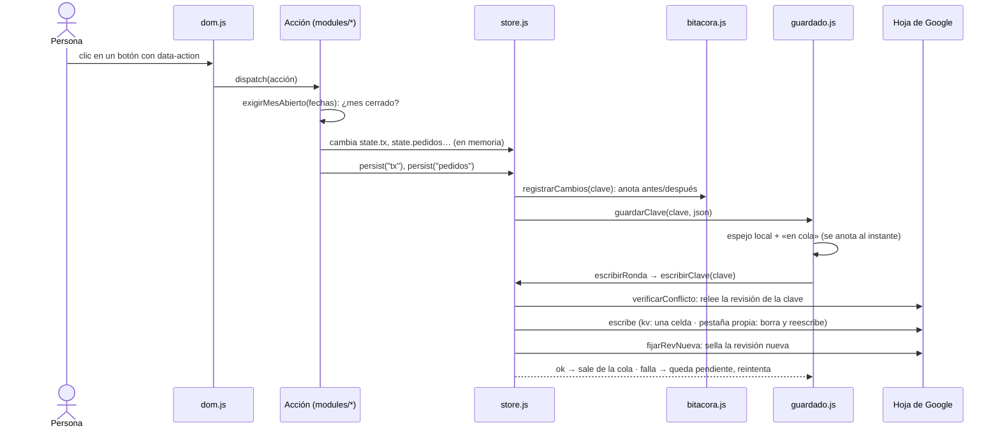

# Arquitectura del Panel del Taller

**Para quién es:** para el dueño del taller, y para un contador o un programador que llegue después. Explica **cómo está armada la app y por dónde viaja el dinero**, sin entrar al diseño de las pantallas. El objetivo: poder **detectar un riesgo leyendo este mapa, antes de leer o corregir el código**.

> Los bloques marcados `GENERADO` los escribe `tools/mapa.mjs` leyendo el código (`npm run mapa`); no se editan a mano. Todo lo demás está escrito a mano y **cada afirmación cita el archivo y la línea** donde se verificó (`archivo:línea`). Lo que no se pudo verificar dice «no verificado». Si el código cambia y una línea se mueve, `npm run mapa` reancla la cita sola (`tools/citas.mjs`); si la línea citada cambió de verdad, `test/arquitectura.mjs` avisa para revisarla a mano.

## Índice

1. [Cómo leer este mapa](#1-cómo-leer-este-mapa)
2. [Glosario](#2-glosario)
3. [Vista general](#3-vista-general)
4. [Capas y módulos](#4-capas-y-módulos)
5. [Cómo viaja un dato: de la pantalla a la hoja de Google](#5-cómo-viaja-un-dato-de-la-pantalla-a-la-hoja-de-google)
6. [Qué se guarda y dónde](#6-qué-se-guarda-y-dónde)
7. [Roles y permisos](#7-roles-y-permisos)
8. [Lo que esta arquitectura NO garantiza](#8-lo-que-esta-arquitectura-no-garantiza)
9. [Receta: cómo auditar una vulnerabilidad con este mapa](#9-receta-cómo-auditar-una-vulnerabilidad-con-este-mapa)
10. [Siguiente fase: lo que no está a fondo](#10-siguiente-fase-lo-que-no-está-a-fondo)

---

## 1. Cómo leer este mapa

Son cinco documentos y cada uno responde una pregunta:

| Documento | Pregunta que responde | Cómo se hace |
|---|---|---|
| **este** (`ARQUITECTURA.md`) | ¿Cómo está armada la app y por dónde viaja un dato? | A mano + 4 bloques generados |
| [`MAPA-DEL-CODIGO.md`](MAPA-DEL-CODIGO.md) | ¿Qué hace cada archivo y cada función, y quién la usa? | 100 % generado |
| [`MAPA-DEL-DINERO.md`](MAPA-DEL-DINERO.md) | ¿Quién crea, cambia o quita dinero, con qué candados, y cómo se deshace? | A mano + 4 bloques generados |
| [`ESCENARIOS-DE-FALLA.md`](ESCENARIOS-DE-FALLA.md) | ¿Qué pasa si…? (se cae la red, dos computadores, un mes cerrado…) y qué lo defiende | A mano |
| [`REGLAS-DE-ARQUITECTURA.md`](REGLAS-DE-ARQUITECTURA.md) | ¿Qué reglas vigila la CI sola, y qué casos conocidos hay? | A mano + 2 bloques generados |

**Orden de lectura recomendado:** este documento (10 minutos) → `ESCENARIOS-DE-FALLA.md` (para ver qué está defendido y qué no) → `MAPA-DEL-DINERO.md` (la tabla «quién escribe dinero»). `MAPA-DEL-CODIGO.md` es de consulta: se busca una función y se mira de qué depende.

**Convenciones:**
- `archivo:línea` = ruta dentro del proyecto y número de línea. Ejemplo: `js/core/store.js:2039` es la función `persist`.
- **✔ / ✘** en las tablas generadas: ✔ = tiene el candado; ✘ = no lo tiene.
- **SIN DEFENSA** = nadie lo vigila (ni el código ni una prueba). Siempre va con una **severidad** (alta / media / baja) según cuánta plata puede dañar.
- **Límites del análisis** (aplican a las tablas generadas): el mapa lee el texto del código, no lo ejecuta; no ve una función llamada por un nombre armado en tiempo de ejecución ni un cambio hecho a través de una variable que apunta a un movimiento. Esos casos se listan aparte, a mano, en `MAPA-DEL-DINERO.md`.

## 2. Glosario

Cada término técnico, una vez, en simple.

| Término | Qué es |
|---|---|
| **`state`** | La «memoria de trabajo» de la app: un objeto en el navegador con todos los datos mientras la app está abierta (`js/core/store.js:288`). Si se cierra la pestaña, lo que no se guardó en la hoja se pierde (por eso existe el *espejo local*). |
| **Clave** | El nombre de un grupo de datos dentro de `state`: `tx` (movimientos de dinero), `pedidos`, `cotizaciones`, `config`… Guardar siempre manda **la clave completa**, nunca un cambio suelto. |
| **`persist("clave")`** | La orden «guarda esta clave en la hoja de Google» (`js/core/store.js:2039`). Toda acción que cambia datos termina llamándola. |
| **Hoja / pestaña / celda** | La base de datos es una **Google Sheet** (hoja de cálculo). Tiene **pestañas** (Movimientos, Cotizaciones, kv…) y cada pestaña filas y celdas. |
| **`kv`** | Una pestaña de dos columnas (`key`, `value`): cada clave se guarda **entera como un texto JSON dentro de una sola celda** (`js/core/sheetsStorage.js:1`). |
| **Pestaña propia** | Movimientos, Clientes, Cotizaciones, Cierres y Bitácora tienen su propia pestaña con **una fila por registro y una columna por campo** (`js/core/sheetsTabular.js:1`). |
| **Movimiento (`tx`)** | Un hecho de dinero que **ya pasó**: un ingreso, un gasto, una nómina, una comisión. La Caja es la suma de todos (`js/core/calc.js:140`). |
| **Marca de origen** | Un campo del movimiento (`origenAbonoId`…) que dice «este movimiento lo creó la app a partir de tal cosa». Sirve para que nadie lo borre suelto mientras su origen exista (`js/core/calc.js:654`). |
| **Espejo local** | Una copia de cada clave guardada en el navegador (`localStorage`) cada vez que se intenta guardar (`js/core/guardado.js:133`). Es la segunda copia si falla la red. |
| **Cola de reintento** | La lista de claves que no se pudieron escribir; se reintenta sola cada 15 s y al volver la red (`js/core/guardado.js:306`). |
| **Conflicto** | Otro computador guardó la misma clave mientras tanto; la app **no sobrescribe** y avisa (`js/core/store.js:216`). |
| **Mes cerrado** | Un mes que el admin cerró: la app no deja crear, cambiar ni borrar dinero con fecha en él hasta que lo reabra con un motivo (`js/core/cierre.js:78`). |
| **Bitácora** | Pestaña `Bitacora` donde cada cambio de dinero queda con quién, cuándo y cómo estaba antes (`js/core/bitacora.js:300`). |
| **Salud de los datos** | Panel (solo admin) que **verifica y reporta** si algo de dinero dejó de cuadrar. No repara nada (`js/core/salud.js:1337`). |
| **Acción** | Lo que hace un botón o campo de la pantalla: tiene un nombre (`data-action="add-abono"`) y una función en `modules/*` (`js/core/dom.js:1271`). |
| **Token** | La «llave» temporal (≈ 1 hora) que Google da al iniciar sesión y que la app usa para leer y escribir la hoja (`js/core/auth.js:256`). |
| **Rol** | `admin` o `vendedor`, según la pestaña `roles` de la hoja (`js/core/auth.js:317`). |
| **Peso entero** | Todo monto que la app **calcula** (IVA, comisión, saldo, cuota) se redondea al peso con `redondearPesos` (`js/core/calc.js:993`) para que cuadre con el banco. |

## 3. Vista general

La app **no tiene servidor propio**. Es una página web (HTML + JavaScript plano, sin compilar) que se publica en Netlify y que habla **directo con las APIs de Google desde el navegador de cada persona**. La base de datos es la Google Sheet del taller.

Consecuencias que importan para el riesgo:

- **No hay un servidor que valide nada.** Todo candado (roles, mes cerrado, conflictos) vive en el navegador. Quien tenga acceso de edición a la hoja de Google puede saltárselo (`CONTINUIDAD.md`, punto D).
- **Cada persona usa su propio token de Google**: el acceso que tiene un vendedor sobre la hoja y el Drive es el que le dio el dueño en Google, no el que muestra la pantalla (`js/core/google-config.js:57`: los permisos pedidos son hoja, Drive completo, enviar correo, eventos de Calendar y contactos).
- **Netlify no guarda datos**: solo entrega los archivos con `Cache-Control: no-cache` (`_headers:1-2`). Los datos viven únicamente en la hoja y, de copia, en el navegador.
- El `sw.js` (service worker) solo permite que el cascarón de la app abra sin internet; no guarda pedidos ni movimientos (`sw.js:1-25`).
- Las librerías externas (PDF, Excel, gráficas, ordenar arrastrando, el login de Google) se cargan desde CDN al abrir la página (`index.html:54-83`). **No verificado:** que la app siga funcionando si alguna de ellas no carga.

## 4. Capas y módulos

<!-- GENERADO:inicio capas -->

| Capa | Archivos | Líneas de JavaScript |
| --- | --- | --- |
| `js/app.js` | 1 | 123 |
| `js/core/` | 28 | 16776 |
| `js/modules/` | 16 | 15338 |
| **Total** | 45 | 32237 |

<!-- GENERADO:fin capas -->

La app son tres capas (detalle archivo por archivo en [`MAPA-DEL-CODIGO.md`](MAPA-DEL-CODIGO.md)):

1. **`js/app.js` — el arranque** (`js/app.js:1`). Primero exige login con Google y resuelve el rol; **solo después** carga el resto con `import()` dinámico (`js/app.js:46-48`). Es a propósito: `store.js` decide una sola vez, al cargarse, si hay dónde guardar (`STORAGE_OK`, `js/core/store.js:37`), así que tiene que cargarse después de poner `window.storage`.
2. **`js/core/` — el núcleo.** Estado, guardado, cálculos, conexión con Google. Los archivos que más importan para el dinero:

| Archivo | Responsabilidad | Por qué importa |
|---|---|---|
| `store.js` | El `state`, `persist`, la carga (`loadAll`), conflictos entre dispositivos, recuperación | Es la única puerta de salida de los datos (`js/core/store.js:2039`) |
| `guardado.js` | Espejo local, cola de reintento, aviso al cerrar la pestaña | Lo que evita perder trabajo si falla la red (`js/core/guardado.js:382`) |
| `calc.js` | **Toda** fórmula (caja, IVA, saldos, comisiones, descuentos, cuentas, nómina, deudas) | «Una sola fuente por fórmula»: ninguna pantalla calcula por su cuenta |
| `sheetsStorage.js`, `sheetsTabular.js`, `sheetsEsquemas.js`, `googleRest.js` | Cómo se lee y se escribe la hoja: pestaña `kv`, pestañas propias, esquemas de columnas | Aquí se decide qué se pierde si algo falla a mitad de camino (§5) |
| `cierre.js`, `bitacora.js`, `salud.js` | Mes cerrado, historial de cambios y verificación de los datos | Los tres «candados blandos» del dinero (§5.6 a §5.8) |
| `auth.js` | Login con Google, rol, renovación del token | Lo único que sabe quién es la persona (§7) |
| `backup.js` | Copia diaria de toda la hoja en el Drive del admin | La última red de seguridad (§5.9) |
| `dom.js` | Arma la pantalla y **reparte cada clic a su acción** | `js/core/dom.js:1271` |
| `pdf.js`, `gmail.js`, `drive.js`, `calendar.js`, `contacts.js`, `components.js`, `graficas.js`, `utils.js`, `constants.js`, … | Documentos, correo, imágenes, agenda, piezas de pantalla | Ver «Siguiente fase» (§10) |

3. **`js/modules/` — una pantalla por pestaña.** Cada módulo exporta `render()` (dibuja) y `actions` (lo que hacen sus botones). Todo el dinero se escribe desde cinco: `pedidos.js` (abonos, reembolsos, comisiones, consignación), `pendientes.js` (nómina, gastos fijos, deudas), `cotizaciones.js` (compras, estimado, comisión de cotización, recibos), `finanzas.js` (movimientos a mano, papelera, recibos), `resumen.js` (Colchón); además `cuentas.js` (transferencias y conciliación) y `cierres.js` (cerrar/reabrir mes).

**Ciclos de importación.** Tres pares de archivos se importan mutuamente (`auth ↔ googleRest`, `store ↔ calc ↔ bitacora`, `cotizaciones ↔ pedidos`; lista generada en [`MAPA-DEL-CODIGO.md`](MAPA-DEL-CODIGO.md), §2.4). Funcionan porque lo importado solo se usa **cuando se ejecuta una función**, nunca mientras el archivo se está leyendo (ver el comentario de `js/core/store.js:15-22`). **Un ciclo nuevo es una señal de alerta**: puede dejar una función sin definir en el arranque.

**Cómo se junta todo.** `dom.js` importa las 16 pantallas y arma el *registro de acciones* con todas sus `actions` en un solo objeto (`js/core/dom.js:485`); un clic en cualquier botón con `data-action="nombre"` termina en `dispatch` (`js/core/dom.js:1271`). **Si dos módulos definen la misma acción, gana la última sin avisar**: la regla `R8` lo vigila (hoy no hay ninguna repetida).

## 5. Cómo viaja un dato: de la pantalla a la hoja de Google

### 5.1 El recorrido de un guardado

Paso a paso, con dónde está cada uno:

1. **El clic llega a `dispatch`** y se busca la acción por su nombre; **no se comprueba el rol** (`js/core/dom.js:1271-1274`).
2. **La acción cambia `state` en memoria** y, si toca dinero con fecha, **antes de escribir** llama a `exigirMesAbierto` (`js/core/cierre.js:78`). La regla `R1` vigila que toda acción que escribe movimientos lo haga.
3. **`persist(clave)`** (`js/core/store.js:2039`): le pone cuenta a los movimientos nuevos (`asegurarCuentaEnMovimientos`, `js/core/calc.js:247`), **anota el cambio en la bitácora** antes de cualquier espera, desvía a «propuesta» si es un vendedor tocando el catálogo, y llama a `guardarClave`.
4. **`guardarClave`** (`js/core/guardado.js:382`) hace **dos cosas al instante**: copia el JSON en el *espejo local* y marca la clave «en cola» (también en disco). Solo la escritura por red se agrupa: si ya hay una escritura de esa clave en vuelo, los clics siguientes comparten **una sola** ronda posterior.
5. **`escribirRonda`** (`js/core/guardado.js:334`) llama a `escribirClave` (`js/core/store.js:2028`), que:
   - **`verificarConflicto`** (`js/core/store.js:216`): relee la «revisión» de esa clave en la hoja y la compara con la que esta pestaña recuerda. Si es distinta, **aborta antes de tocar el dato real**.
   - **Escribe**: si la clave tiene pestaña propia (`tx`, `clientes`, `cotizaciones`, `cierres`; `js/core/store.js:35`), `escribir` **borra todo el rango de datos y lo reescribe completo** (`js/core/sheetsTabular.js:141-151`); si no, `set` reemplaza **una celda** de `kv` (`js/core/sheetsStorage.js:67-79`).
   - **`fijarRevNueva`** (`js/core/store.js:236`): sella una revisión nueva (`uid():hora`) en la fila `__rev__:<clave>` de `kv`.
   - Avisa a las otras pestañas del mismo navegador por `BroadcastChannel` (`js/core/store.js:49-60`, `:2033`).
6. **Si algo falla**, la clave pasa a «pendiente» (lo que ve el dueño en la barra: chip rojo), se reintenta cada 15 s, al volver la red y al volver a la pestaña (`js/core/guardado.js:306-312`, `:265-303`). **Un conflicto no se reintenta solo**: pide recargar (`js/core/guardado.js:349-355`).

**Dos propiedades de diseño que explican casi todo lo demás:**
- **Cada escritura manda la clave completa**, no un cambio. Reintentar es volver a escribir el estado de AHORA; una sola escritura buena arregla las anteriores que fallaron (`js/core/guardado.js:24-29`).
- **Cada `persist` es una escritura independiente.** Un hecho que toca dos o más claves (un abono toca `tx` **y** `pedidos`; eliminar un pedido toca cuatro) se escribe en **pasos separados, sin transacción**. Ver [`ESCENARIOS-DE-FALLA.md`](ESCENARIOS-DE-FALLA.md), escenarios 2 y 3.

### 5.2 Espejo local

Cada intento de guardado deja el JSON de esa clave en `localStorage` bajo `taller_espejo_v1:<clave>` (`js/core/guardado.js:38`, `:133`). Además de ser la segunda copia, es de donde sale la app cuando **no puede leer la hoja al abrir**: `loadAll` cae a la última copia local de **esa** clave (`js/core/store.js:1243-1258`) y avisa con un toast (`:1606`). Si la cuota del navegador se llena, el espejo se omite en silencio y el guardado real sigue (`js/core/guardado.js:136-138`).

### 5.3 Cola de reintento y aviso al cerrar

Hay **dos listas**: `enCola` (hay una escritura en curso o fallida; se anota en disco, no se muestra) y `pendientes` (ya falló; esto sí se muestra y se reintenta) (`js/core/guardado.js:53-54`). Un cartel «Guardando…» solo aparece si el guardado tarda más de 0,9 s (`js/core/guardado.js:96`). Al cerrar o recargar la pestaña, el navegador pregunta si hay un guardado fallido, una edición sin guardar o **una escritura en vuelo** (`js/core/guardado.js:270-297`).

### 5.4 Conflicto entre dispositivos

Control optimista: cada clave tiene una fila `__rev__:<clave>` en la pestaña kv (`js/core/store.js:91`); la pestaña recuerda la última que vio (`revConocida`, `:89`). **No es un merge**: si dos computadores editan lo mismo, el segundo en guardar **no pierde nada de la hoja** pero tampoco guarda; debe recargar y rehacer. Quedan dos huecos documentados (escenarios 3 y 4): entre el chequeo y la escritura hay una ventana angosta, y una clave **sin revisión conocida no se chequea** (`js/core/store.js:217`).

### 5.5 Dos pestañas del mismo navegador

Cuando una pestaña guarda, las demás recargan esa clave de la hoja antes de volver a guardar (`js/core/store.js:54-60`, `reloadKey` en `:245`). No sincroniza entre computadores.

### 5.6 Bitácora

`persist` compara el estado nuevo con una **foto** del anterior y anota la diferencia (quién, cuándo, antes, después) en la pestaña llamada Bitacora (`js/core/bitacora.js:300`, llamado desde `js/core/store.js:2054`). Solo **agrega** filas al final (`js/core/sheetsTabular.js:165-177`). Si no hay red, la acción **sigue** y la anotación espera en una cola en disco que se reintenta (`js/core/bitacora.js:436-495`). Las claves que se anotan son `CLAVES_BITACORA`: movimientos, papelera, pedidos, cotizaciones, transferencias, deudas y la parte de dinero de `config` (`js/core/bitacora.js:146-154`).

### 5.7 Cierre de mes

El admin cierra un mes ya terminado (`cerrarMes`, `js/core/cierre.js:129`): se guarda una fila en `Cierres` con quién, cuándo y un **resumen** (ingresos, gastos, Caja al final, saldo por cuenta). Desde ahí, `exigirMesAbierto([fechas], "qué haría")` rechaza cualquier escritura con fecha en ese mes (`js/core/cierre.js:78-83`). La pregunta única es `periodoCerrado` (`js/core/calc.js:341`). **Un movimiento cuya fecha no empieza con `AAAA-MM` no pertenece a ningún mes y escapa al candado** (`js/core/calc.js:333-336`); lo detecta después «Salud de los datos» (`js/core/salud.js:436`), no lo impide. El cierre solo vigila el dinero **con fecha** (movimientos, abonos, reembolsos, ventas de consignación, transferencias): **no** bloquea pedidos y cotizaciones (totales, descuentos), conciliaciones, deudas ni cuentas (Hallazgo #65, «Qué NO cubre»; la lista de acciones que lo evitan está en `MAPA-DEL-DINERO.md`, §4 y §7).

### 5.8 Salud de los datos

Es solo de lectura: recorre `state` y devuelve hallazgos con severidad (error / aviso) y un enlace al caso (`js/core/salud.js:728`, `:1337`). **Compara la app contra sí misma**, no contra la hoja ni contra el banco. Se calcula en cada pintado para la insignia roja del menú.

### 5.9 Respaldo

Una copia completa de la hoja en el Drive del admin, una vez cada 24 h **si el admin abre la app** (`js/core/backup.js:87-110`). No hay tarea programada: si nadie abre la app, no hay copia nueva. **No se borran copias viejas** (no verificado que exista limpieza: no hay código que las borre).

### 5.10 Al abrir la app: lectura y reparaciones

`loadAll` (`js/core/store.js:1155`): congela una foto del espejo; lee **todas las claves** de la hoja; lo que falla cae al espejo; fija la revisión conocida de lo que sí se leyó; y corre **doce reparaciones automáticas** de datos viejos (`REPARACIONES_AL_CARGAR`, `js/core/store.js:721-734`) que se anotan en la bitácora como «automático» y se muestran en Salud. Solo corren **con lectura completa de la red** (`!huboFalloDeRed`). Luego `detectarRecuperacion` ofrece (nunca restaura sola) recuperar lo que quedó sin guardar en la sesión anterior (`js/core/store.js:1754`).

## 6. Qué se guarda y dónde

<!-- GENERADO:inicio claves -->

| Clave de `state` | Dónde vive en la hoja de Google | Cómo se llama en los avisos | Quién la guarda (archivo ×llamadas a persist) |
| --- | --- | --- | --- |
| `catalogoCategorias` | Pestaña `kv` — una fila, clave `cotizaciones:catalogo-categorias`, todo el contenido como un texto JSON en una celda | categorías de insumos | modules/catalogo.js ×5 |
| `catalogoInsumos` | Pestaña `kv` — una fila, clave `cotizaciones:catalogo`, todo el contenido como un texto JSON en una celda | catálogo de insumos | modules/catalogo.js ×7, modules/clientes.js |
| `catalogoPropuestas` | Pestaña `kv` — una fila, clave `cotizaciones:catalogo-propuestas`, todo el contenido como un texto JSON en una celda | cambios propuestos del catálogo | core/store.js ×3 |
| `cierres` | Pestaña `Cierres` — una fila por registro, 7 columnas | cierres de mes | core/cierre.js ×2 |
| `clientes` | Pestaña `Clientes` — una fila por registro, 22 columnas | contactos | modules/clientes.js ×12 |
| `config` | Pestaña `kv` — una fila, clave `config:datos`, todo el contenido como un texto JSON en una celda | configuración del taller | core/backup.js ×3, core/dom.js ×2, core/drive.js ×2, modules/config.js ×5, modules/cuentas.js ×5, modules/pendientes.js ×11, modules/resumen.js ×2 |
| `configNombreLegacy` | Pestaña `kv` — una fila, clave `config:nombre`, todo el contenido como un texto JSON en una celda | — | — |
| `cotizaciones` | Pestaña `Cotizaciones` — una fila por registro, 20 columnas | cotizaciones | core/store.js ×7, modules/cotizaciones.js ×5, modules/pedidos.js ×3 |
| `deudas` | Pestaña `kv` — una fila, clave `pendientes:deudas`, todo el contenido como un texto JSON en una celda | deudas | modules/pendientes.js ×8 |
| `deudasHistorial` | Pestaña `kv` — una fila, clave `pendientes:deudas-historial`, todo el contenido como un texto JSON en una celda | historial de deudas | modules/pendientes.js ×4 |
| `pdfContador` | Pestaña `kv` — una fila, clave `cotizaciones:pdf-contador`, todo el contenido como un texto JSON en una celda | — | — |
| `pedidos` | Pestaña `kv` — una fila, clave `pedidos:lista`, todo el contenido como un texto JSON en una celda | pedidos | core/store.js ×2, modules/cotizaciones.js ×4, modules/pedidos.js ×25 |
| `pedidosPapelera` | Pestaña `kv` — una fila, clave `pedidos:papelera`, todo el contenido como un texto JSON en una celda | papelera de pedidos | modules/pedidos.js ×3 |
| `pendientes` | Pestaña `kv` — una fila, clave `pendientes:lista`, todo el contenido como un texto JSON en una celda | notas | modules/notas.js ×6 |
| `plantillasEstados` | Pestaña `kv` — una fila, clave `cotizaciones:plantillas-estados`, todo el contenido como un texto JSON en una celda | flujos de producción | modules/plantillas.js ×3 |
| `plantillasPrendas` | Pestaña `kv` — una fila, clave `cotizaciones:plantillas`, todo el contenido como un texto JSON en una celda | plantillas de prendas | core/store.js ×3, modules/plantillas.js ×6 |
| `productoPropuestas` | Pestaña `kv` — una fila, clave `productos:propuestas`, todo el contenido como un texto JSON en una celda | cambios propuestos de productos | core/stock.js ×3 |
| `productos` | Pestaña `kv` — una fila, clave `productos:lista`, todo el contenido como un texto JSON en una celda | catálogo de productos | core/stock.js ×2, core/store.js ×3, modules/productos.js ×4 |
| `transferencias` | Pestaña `kv` — una fila, clave `finanzas:transferencias`, todo el contenido como un texto JSON en una celda | transferencias entre cuentas | modules/cuentas.js ×3 |
| `tx` | Pestaña `Movimientos` — una fila por registro, 34 columnas | movimientos de Finanzas | core/store.js ×5, modules/cotizaciones.js ×11, modules/cuentas.js ×2, modules/finanzas.js ×4, modules/pedidos.js ×12, modules/pendientes.js ×6, modules/resumen.js ×2 |
| `txPapelera` | Pestaña `kv` — una fila, clave `finanzas:papelera`, todo el contenido como un texto JSON en una celda | papelera de movimientos | modules/cotizaciones.js ×2, modules/finanzas.js ×3, modules/pedidos.js ×3 |
| `ui` | Pestaña `kv` — una fila, clave `ui:preferencias`, todo el contenido como un texto JSON en una celda | preferencias de interfaz | core/dom.js ×4, core/teclado.js |

<!-- GENERADO:fin claves -->

**Qué quiere decir cada tipo de lugar:**

- **Una celda de `kv`** (todo menos Movimientos, Clientes, Cotizaciones y Cierres): el contenido completo de la clave es **un solo texto de hasta 50.000 caracteres** (límite de Google, `js/core/sheetsEsquemas.js:166-171`). Si crece más, **todo guardado de esa clave falla** (Hallazgo #42). Nada vigila el tamaño (escenario 8).
- **Una pestaña propia**: una fila por registro. Se **lee por posición de columna**, no por el nombre del encabezado (`js/core/sheetsEsquemas.js:11-24`): por eso las columnas nuevas **solo van al final** (regla `R5`, Hallazgos #15–#19).
- Aparte de la lista de arriba: la pestaña `roles` (correo, rol, nombre de vendedor; la lee `js/core/auth.js:313`), la pestaña Bitacora (definida en `js/core/sheetsEsquemas.js:233`) y las filas `__rev__:*` y `borrador:*` de la pestaña kv (`js/core/store.js:91` y `:1674`).

<!-- GENERADO:inicio esquemas -->

Las 5 hojas con columnas propias y el orden de cada una

**`Bitacora`** — 17 columnas, en este orden (la posición es lo que importa: la app lee por posición, no por el nombre del encabezado):

1. `id`  
2. `fecha`  
3. `usuario`  
4. `nombre`  
5. `rol`  
6. `origen`  
7. `clave`  
8. `registroId`  
9. `subId`  
10. `aspecto`  
11. `accion`  
12. `etiqueta`  
13. `cambios`  
14. `antes` _(json)_  
15. `despues` _(json)_  
16. `meses`  
17. `enMesCerrado`

**`Cierres`** — 7 columnas, en este orden (la posición es lo que importa: la app lee por posición, no por el nombre del encabezado):

1. `mes`  
2. `estado`  
3. `cerradoPor`  
4. `cerradoPorNombre`  
5. `cerradoEn`  
6. `resumen` _(json)_  
7. `historial` _(json)_

**`Clientes`** — 22 columnas, en este orden (la posición es lo que importa: la app lee por posición, no por el nombre del encabezado):

1. `id`  
2. `nombre`  
3. `cedula`  
4. `direccion`  
5. `ciudad`  
6. `cp`  
7. `cuenta`  
8. `entidad`  
9. `telefono`  
10. `correo`  
11. `usuarioWhatsapp`  
12. `contactResourceName`  
13. `contactResourceNames` _(json)_  
14. `tipoRelacion`  
15. `comisionDefaultTipo`  
16. `comisionDefaultValor` _(numero)_  
17. `roster` _(json)_  
18. `categoriasInsumo` _(json)_  
19. `descripcion`  
20. `puntuacion` _(numero)_  
21. `preciosPorInsumo` _(json)_  
22. `fechaCreacion`

**`Cotizaciones`** — 20 columnas, en este orden (la posición es lo que importa: la app lee por posición, no por el nombre del encabezado):

1. `id`  
2. `clienteId`  
3. `cliente`  
4. `descripcion`  
5. `fecha`  
6. `fechaEntrega`  
7. `marca`  
8. `estado`  
9. `pedidoId`  
10. `pedidoOrigenId`  
11. `codigoPublico`  
12. `estimadoTxId`  
13. `iva` _(json)_  
14. `vendedor` _(json)_  
15. `referencias` _(json)_  
16. `costosGlobales` _(json)_  
17. `serviciosCobrados` _(json)_  
18. `gastosReales` _(json)_  
19. `compras` _(json)_  
20. `descuento` _(json)_

**`Movimientos`** — 34 columnas, en este orden (la posición es lo que importa: la app lee por posición, no por el nombre del encabezado):

1. `id`  
2. `fecha`  
3. `tipo`  
4. `concepto`  
5. `monto` _(numero)_  
6. `contraparte`  
7. `pedidoId`  
8. `cotizacionId`  
9. `gastoFijoId`  
10. `deudaId`  
11. `origenAbonoId`  
12. `origenReembolsoId`  
13. `origenVentaConsignacionId`  
14. `origenComisionConsignacionId`  
15. `origenCompraClave`  
16. `origenGastoFijoPeriodo`  
17. `origenComisionCotId`  
18. `origenComisionPedidoId`  
19. `origenGastoId`  
20. `origenDeudaIngresoId`  
21. `origenColchonId`  
22. `esInsumo`  
23. `proveedorId`  
24. `insumoNombre`  
25. `cantidad` _(numero)_  
26. `unidad`  
27. `serviciosDescuento` _(json)_  
28. `empleadoId`  
29. `origenCompraExcedenteClave`  
30. `reciboCompraId`  
31. `reciboCompraRol`  
32. `reciboCompraLinea`  
33. `cuenta`  
34. `conciliadoEn`

<!-- GENERADO:fin esquemas -->

## 7. Roles y permisos

**Quién es la persona.** Inicia sesión con Google; la app busca su correo en la pestaña `roles` (`js/core/auth.js:317-329`): si no está, «Acceso no autorizado» (`js/app.js:37-43`); si dice `admin`, es admin; **cualquier otro valor es vendedor**. La sesión (correo, rol, token) se guarda en `sessionStorage` (`js/core/auth.js:141-149`) y **al recargar se confía en lo guardado ahí sin volver a consultar `roles`** (`js/core/auth.js:155-168`).

**Qué se hace cumplir de verdad y qué es solo de pantalla.** Verificado en el código:

| Qué | Dónde se decide | Tipo |
|---|---|---|
| Un vendedor ve solo Mis ventas, Pedidos, Cotizaciones, Catálogo, Contactos, Insumos y Plantillas | `NAV_GROUPS_VENDEDOR`, `js/core/dom.js:79-87` | **Solo pantalla** (el botón no se dibuja; la acción sigue existiendo) |
| Despachar una acción | `dispatch`, `js/core/dom.js:1271` | **Sin comprobación de rol** |
| Cerrar / reabrir un mes | la comprobación `esAdmin()` está en `js/core/cierre.js:122` (cerrar) y `:156` (reabrir) | Se comprueba, pero con el rol de `sessionStorage` |
| Bitácora y Cierre de mes: solo admin | `js/modules/bitacora.js:87`, `js/modules/cierres.js:80` | Solo pantalla |
| Cambios del vendedor a catálogo (insumos y categorías) | `persist` los desvía a «propuesta» (`js/core/store.js:2061`, claves en `js/core/constants.js:71`); precio y movimiento de stock de Catálogo: `js/modules/productos.js:522`, `:752` | Se comprueba al guardar, **no se comprueba al aprobar** (escenario 17) |
| Respaldo, carpeta de imágenes, sincronizar con Calendar | `js/core/backup.js:89`, `js/core/drive.js:49`, `:160`, `js/modules/pendientes.js:524`, `:555` | Decide **quién usa su Google**, no un permiso sobre el dinero |
| Todo el dinero: abonos, movimientos a mano, nómina, deudas… | — | **Sin ninguna comprobación de rol en la acción** |

**Fail-open.** Varias pantallas tratan «no hay sesión» como admin: `!session || session.rol !== "vendedor"` (por ejemplo `js/core/dom.js:785`, `:1074`, `js/modules/config.js:25`). En el uso normal siempre hay sesión; es la razón por la que `test/smoke.mjs` (que nunca hace login) ve todo como admin (`js/core/dom.js:66-71`).

**La protección real** de los datos es **a quién se le da acceso de edición a la Google Sheet** y a la cuenta de Drive: con ese acceso, cualquiera puede leer o editar todo, incluida la bitácora, los cierres y la pestaña `roles`. Es el «punto D» de `CONTINUIDAD.md` (base de datos con permisos por rol), un proyecto grande aparte.

<!-- GENERADO:inicio roles -->

El código mira el rol del usuario en **25 sitios** (`esAdmin()` o `session.rol`). Casi todos deciden **qué se dibuja**; solo unos pocos deciden **qué se permite hacer**. `persist` además desvía a «propuesta» los cambios de un vendedor a `catalogoInsumos` y `catalogoCategorias` (`APPROVAL_REQUIRED_KEYS`).

Los 25 sitios donde se mira el rol

| Dónde | En |
| --- | --- |
| app.js:49 | `entrarConSesion` |
| app.js:56 | `entrarConSesion` |
| core/backup.js:89 | `respaldarSiCorresponde` |
| core/cierre.js:30 | `esAdmin` |
| core/cierre.js:32 | `esAdmin` |
| core/cierre.js:68 | `bloqueoMesCerrado` |
| core/cierre.js:122 | `puedeCerrarMes` |
| core/cierre.js:156 | `reabrirMes` |
| core/dom.js:86 | `navGroupsActivo` |
| core/dom.js:456 | `toggle-notificaciones` |
| core/dom.js:785 | `renderSidebar` |
| core/dom.js:1074 | `renderCampanita` |
| core/drive.js:49 | `obtenerCarpetaCompartida` |
| core/drive.js:160 | `subirImagenReferencia` |
| core/store.js:2061 | `persist` |
| modules/bitacora.js:87 | `renderBitacora` |
| modules/catalogo.js:24 | `renderPropuestasPendientes` |
| modules/cierres.js:80 | `renderCierre` |
| modules/config.js:25 | `render` |
| modules/pendientes.js:524 | `sincronizarEventoDeuda` |
| modules/pendientes.js:555 | `sincronizarEventoGastoFijo` |
| modules/productos.js:48 | `renderPropuestasPendientesProducto` |
| modules/productos.js:522 | `set-pro-campo` |
| modules/productos.js:752 | `add-pro-stock` |
| modules/resumen.js:175 | `renderAvisoPropuestasPendientes` |

<!-- GENERADO:fin roles -->

## 8. Lo que esta arquitectura NO garantiza

Dicho sin adornos, para no dar por resuelto lo que no lo está (cada punto tiene su escenario):

1. **No hay transacciones.** Un hecho de dinero que toca varias claves se escribe en pasos separados; si el segundo falla o choca, queda a medias hasta el reintento (escenarios 2 y 3).
2. **Reescribir una pestaña es «borrar y escribir»**, no atómico (`js/core/sheetsTabular.js:144-150`): si falla entre los dos pasos, la pestaña queda vacía en la hoja hasta el próximo guardado bueno (escenario 1).
3. **Abrir sin red y editar** sobre la copia local no pasa por el chequeo de conflicto (escenario 4).
4. **El tamaño de una celda de `kv` no se vigila** (escenario 8).
5. **Los candados (rol, mes cerrado, bitácora, salud) viven en el navegador.** Protegen contra errores y descuidos, no contra alguien con acceso a la hoja (escenarios 9, 12, 16).
6. **Nada compara la app contra el banco.** La conciliación la escribe el dueño a mano.
7. **Salud de los datos compara la app consigo misma.** Que lo que ve la app sea lo que hay en la hoja no lo verifica nadie (`CONTABILIDAD.md`, #64, «Qué NO verifica»).

## 9. Receta: cómo auditar una vulnerabilidad con este mapa

Sirve para cualquier pregunta del tipo «¿puede pasar X?». Ejemplo resuelto: **«¿puede un vendedor cambiar un abono de un mes que ya cerré?»**

1. **Ubica la acción.** Busca en el registro de acciones de [`MAPA-DEL-CODIGO.md`](MAPA-DEL-CODIGO.md) (§4) o en la tabla de [`MAPA-DEL-DINERO.md`](MAPA-DEL-DINERO.md). Editar un abono es `guardar-abono-edit` (`js/modules/pedidos.js:2546`).
2. **Mira sus columnas:** ¿qué guarda?, ¿tiene candado de mes?, ¿mira el rol? `guardar-abono-edit` guarda `pedidos` y `tx`; tiene ✔ de mes cerrado; **no mira el rol**.
3. **Sigue el candado hasta su fuente.** `exigirMesAbierto` (`js/core/cierre.js:78`) llama a `periodoCerrado` (`js/core/calc.js:341`), que solo mira `state.cierres`. En la acción, la guarda va **antes** de escribir y recibe la fecha vieja **y** la nueva (`js/modules/pedidos.js:2555`). Respuesta por la pantalla: **no puede**; la prueba que lo cubre es `test/bitacora.mjs`, «un mes cerrado bloquea CADA tipo de escritura» (`test/bitacora.mjs:426`).
4. **Busca el camino que salta el candado.** Las preguntas fijas:
   - ¿Hay otra acción que cambie el mismo dato sin la guarda? → `R1` en [`REGLAS-DE-ARQUITECTURA.md`](REGLAS-DE-ARQUITECTURA.md) y la tabla «Acciones que guardan dinero».
   - ¿Hay un cambio por referencia que el mapa no ve? → la tabla «por referencia» de [`MAPA-DEL-DINERO.md`](MAPA-DEL-DINERO.md).
   - ¿La fecha puede venir vacía o mal escrita? → sí: `mesDeFecha` devuelve `""` y el mes «no existe» (escenario 15).
   - ¿Lo puede hacer quien no pasa por la pantalla? → sí: abrir la consola del navegador o editar la hoja (escenarios 9 y 12). **Respuesta por otras vías: sí puede.**
5. **Anota el veredicto** con las tres piezas del formato de [`ESCENARIOS-DE-FALLA.md`](ESCENARIOS-DE-FALLA.md): qué lo defiende (función y línea), qué prueba lo cubre, o **SIN DEFENSA** con su severidad.
6. **Si es un riesgo nuevo,** NO se arregla de pasada: se documenta como Hallazgo en `CONTABILIDAD.md` y se agrega a `docs/reglas-baseline.json` (o, si se puede vigilar con una regla, a `tools/reglas.mjs`).

## 10. Siguiente fase: lo que no está a fondo

El alcance acordado fue **«primero todo lo que toca dinero a fondo»**. Lo siguiente está descrito solo a nivel de resumen y **no tiene mapa de funciones propio** (sí aparece archivo por archivo en [`MAPA-DEL-CODIGO.md`](MAPA-DEL-CODIGO.md)):

| Área | Dónde vive | Qué hace, en una línea | Cuándo tocarla a fondo |
|---|---|---|---|
| **Producción** (etapas de un pedido, avance de referencias) | `modules/pedidos.js` (`advance`, `retreat`), `core/constants.js` | Mueve un pedido por sus etapas; no mueve dinero | Siguiente fase |
| **Catálogo de insumos y de prendas** (stock) | `modules/catalogo.js`, `modules/productos.js`, `core/stock.js` | Costos de insumos y stock de prendas hechas; el catálogo alimenta el costo de las cotizaciones (por eso un vendedor solo puede *proponer*) | Siguiente fase |
| **Plantillas** | `modules/plantillas.js` | Moldes de prendas con insumos y flujo | Siguiente fase |
| **PDF y correo** | `core/pdf.js`, `core/gmail.js` | Cotización, cuenta de cobro, recibo y remisión; salen de `calc.js`, no recalculan. **No verificado** que cada PDF imprima el mismo número que la pantalla (solo lo cubre `test/descuentos.mjs`, secciones 3 y 5) | Siguiente fase |
| **Clientes / Contactos** | `modules/clientes.js`, `core/contacts.js` | Directorio de clientes, proveedores y puntos de consignación; sincroniza con Google Contactos | Siguiente fase |
| **Notas, Calendar, atajos, íconos, temas** | `modules/notas.js`, `core/calendar.js`, `core/teclado.js`, `core/appIcon.js` | Comodidad; el Calendar escribe `deudas`/`config` por detrás al sincronizar (`js/modules/pendientes.js:524-560`) | Baja prioridad |

Lo que tienen en común y sí se vigila: todo pasa por `persist`, por lo tanto por la bitácora y por la cola de reintento, y sus claves aparecen en las tablas de arriba.
