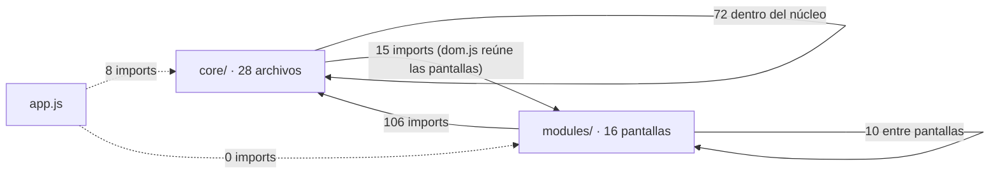
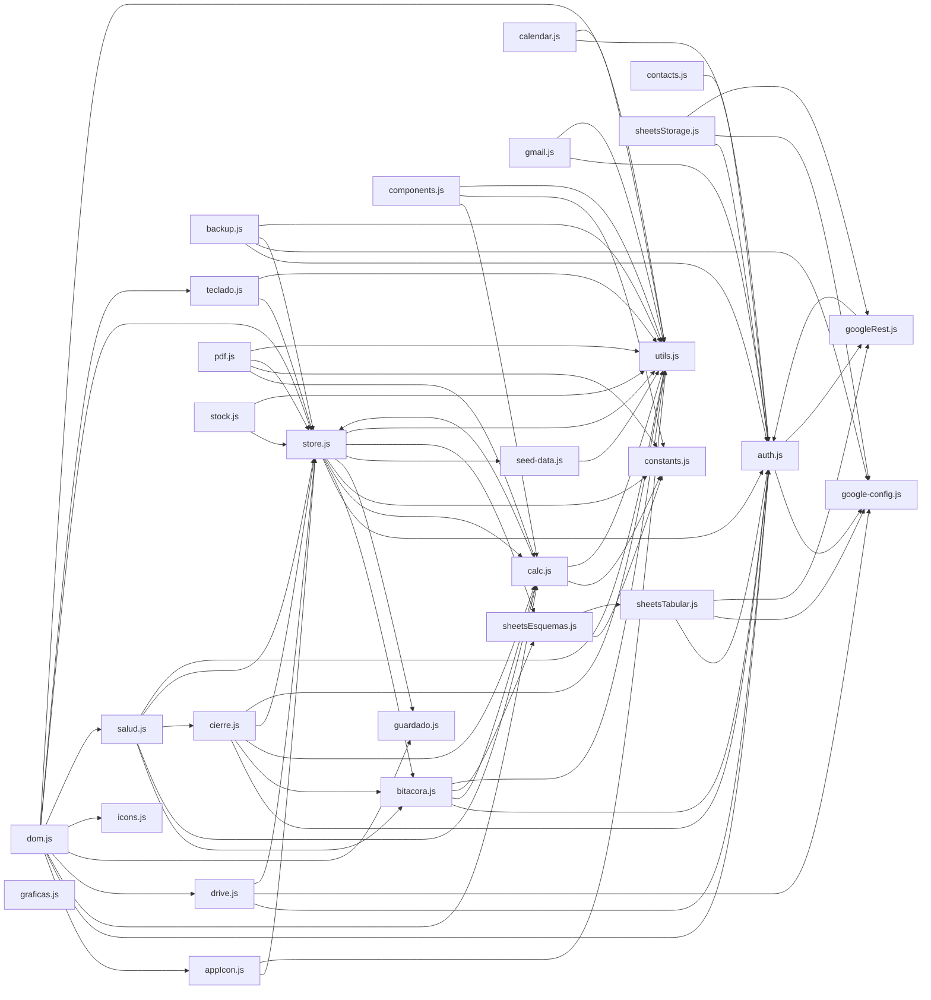

# Mapa del código

> **GENERADO — no se edita a mano.** Lo escribe `tools/mapa.mjs` leyendo `js/` (sin ejecutar nada). Para ponerlo al día: `npm run mapa`. `test/arquitectura.mjs` falla si quedó viejo.
> Cómo leerlo: [ARQUITECTURA.md](ARQUITECTURA.md) → «Cómo leer este mapa». El mapa del dinero: [MAPA-DEL-DINERO.md](MAPA-DEL-DINERO.md).

## Contenido

1. [En números](#1-en-números)
2. [Quién depende de quién](#2-quién-depende-de-quién)
3. [Archivo por archivo](#3-archivo-por-archivo)
4. [Registro de acciones de la interfaz](#4-registro-de-acciones-de-la-interfaz)
5. [Qué se guarda y quién lo guarda (persist)](#5-qué-se-guarda-y-quién-lo-guarda-persist)

**Límites del análisis** (dicho una vez, vale para todo el documento): el mapa lee el texto del código, no lo ejecuta. No ve una función llamada por un nombre armado en tiempo de ejecución ni un cambio hecho por referencia (`var p = state.pedidos[0]; p.abono = 1`). Por eso cruza lo que el código escribe en `state` con los `persist("clave")`, que son la intención de guardar y no dependen de alias. «Lo usan» cuenta archivos que importan el nombre o lo llaman con su espacio (`calc.fn()`).

## 1. En números

| Capa | Archivos | Líneas | Funciones de nivel superior | Exportadas | Acciones de la interfaz | Llamadas a persist |
| --- | --- | --- | --- | --- | --- | --- |
| app | 1 | 123 | 6 | 0 | 0 | 0 |
| core | 28 | 16564 | 607 | 368 | 37 | 45 |
| modules | 16 | 15338 | 347 | 34 | 368 | 167 |
| **Total** | 45 | 32025 | 960 | 402 | 405 | 212 |

## 2. Quién depende de quién

Una flecha `A → B` quiere decir «A importa algo de B». Línea punteada = import dinámico (`import()`, solo `app.js`: carga el resto después de iniciar sesión, ver [ARQUITECTURA.md](ARQUITECTURA.md)).

### 2.1 Las tres capas

### 2.2 Dentro de `js/core`

### 2.3 De las pantallas hacia el núcleo (solo los archivos que usan 5 o más)

```mermaid
flowchart LR
  modules_bitacora_js["bitacora.js"]
  modules_catalogo_js["catalogo.js"]
  modules_cierres_js["cierres.js"]
  modules_clientes_js["clientes.js"]
  modules_config_js["config.js"]
  modules_cotizaciones_js["cotizaciones.js"]
  modules_cuentas_js["cuentas.js"]
  modules_finanzas_js["finanzas.js"]
  modules_mis_ventas_js["mis-ventas.js"]
  modules_notas_js["notas.js"]
  modules_pedidos_js["pedidos.js"]
  modules_pendientes_js["pendientes.js"]
  modules_plantillas_js["plantillas.js"]
  modules_productos_js["productos.js"]
  modules_resumen_js["resumen.js"]
  modules_salud_js["salud.js"]
  core_auth_js(["auth.js"])
  core_calc_js(["calc.js"])
  core_cierre_js(["cierre.js"])
  core_components_js(["components.js"])
  core_constants_js(["constants.js"])
  core_drive_js(["drive.js"])
  core_store_js(["store.js"])
  core_utils_js(["utils.js"])
  modules_bitacora_js --> core_cierre_js
  modules_bitacora_js --> core_components_js
  modules_bitacora_js --> core_store_js
  modules_bitacora_js --> core_utils_js
  modules_catalogo_js --> core_auth_js
  modules_catalogo_js --> core_calc_js
  modules_catalogo_js --> core_components_js
  modules_catalogo_js --> core_constants_js
  modules_catalogo_js --> core_store_js
  modules_catalogo_js --> core_utils_js
  modules_cierres_js --> core_cierre_js
  modules_cierres_js --> core_components_js
  modules_cierres_js --> core_store_js
  modules_cierres_js --> core_utils_js
  modules_clientes_js --> core_auth_js
  modules_clientes_js --> core_calc_js
  modules_clientes_js --> core_components_js
  modules_clientes_js --> core_constants_js
  modules_clientes_js --> core_store_js
  modules_clientes_js --> core_utils_js
  modules_config_js --> core_auth_js
  modules_config_js --> core_calc_js
  modules_config_js --> core_components_js
  modules_config_js --> core_drive_js
  modules_config_js --> core_store_js
  modules_config_js --> core_utils_js
  modules_cotizaciones_js --> core_calc_js
  modules_cotizaciones_js --> core_cierre_js
  modules_cotizaciones_js --> core_components_js
  modules_cotizaciones_js --> core_constants_js
  modules_cotizaciones_js --> core_drive_js
  modules_cotizaciones_js --> core_store_js
  modules_cotizaciones_js --> core_utils_js
  modules_cuentas_js --> core_calc_js
  modules_cuentas_js --> core_cierre_js
  modules_cuentas_js --> core_components_js
  modules_cuentas_js --> core_store_js
  modules_cuentas_js --> core_utils_js
  modules_finanzas_js --> core_calc_js
  modules_finanzas_js --> core_cierre_js
  modules_finanzas_js --> core_components_js
  modules_finanzas_js --> core_store_js
  modules_finanzas_js --> core_utils_js
  modules_mis_ventas_js --> core_auth_js
  modules_mis_ventas_js --> core_calc_js
  modules_mis_ventas_js --> core_components_js
  modules_mis_ventas_js --> core_utils_js
  modules_notas_js --> core_auth_js
  modules_notas_js --> core_store_js
  modules_notas_js --> core_utils_js
  modules_pedidos_js --> core_auth_js
  modules_pedidos_js --> core_calc_js
  modules_pedidos_js --> core_cierre_js
  modules_pedidos_js --> core_components_js
  modules_pedidos_js --> core_constants_js
  modules_pedidos_js --> core_drive_js
  modules_pedidos_js --> core_store_js
  modules_pedidos_js --> core_utils_js
  modules_pendientes_js --> core_auth_js
  modules_pendientes_js --> core_calc_js
  modules_pendientes_js --> core_cierre_js
  modules_pendientes_js --> core_components_js
  modules_pendientes_js --> core_constants_js
  modules_pendientes_js --> core_store_js
  modules_pendientes_js --> core_utils_js
  modules_plantillas_js --> core_calc_js
  modules_plantillas_js --> core_components_js
  modules_plantillas_js --> core_constants_js
  modules_plantillas_js --> core_drive_js
  modules_plantillas_js --> core_store_js
  modules_plantillas_js --> core_utils_js
  modules_productos_js --> core_auth_js
  modules_productos_js --> core_calc_js
  modules_productos_js --> core_components_js
  modules_productos_js --> core_constants_js
  modules_productos_js --> core_drive_js
  modules_productos_js --> core_store_js
  modules_productos_js --> core_utils_js
  modules_resumen_js --> core_auth_js
  modules_resumen_js --> core_calc_js
  modules_resumen_js --> core_cierre_js
  modules_resumen_js --> core_components_js
  modules_resumen_js --> core_store_js
  modules_resumen_js --> core_utils_js
  modules_salud_js --> core_components_js
  modules_salud_js --> core_store_js
  modules_salud_js --> core_utils_js
```

### 2.4 Ciclos de importación

Archivos que se importan unos a otros. Funcionan porque lo que se importa solo se usa **en tiempo de ejecución**, nunca mientras el archivo se está evaluando (cada ciclo está explicado en el comentario del archivo). Un ciclo nuevo es una señal de alerta: ver [ARQUITECTURA.md](ARQUITECTURA.md).

- `core/auth.js` ↔ `core/googleRest.js`
- `core/bitacora.js` ↔ `core/calc.js` ↔ `core/store.js`
- `modules/cotizaciones.js` ↔ `modules/pedidos.js`

## 3. Archivo por archivo

### Punto de entrada

[app.js](#f-app_js)

#### `app.js` — 123 líneas

**Para qué sirve:** Punto de entrada. A diferencia de antes, ya no carga los datos de una vez: primero exige login con Google y resuelve el rol (ver core/auth.js) contra la pestaña "roles" de la Google Sheet configurada en core/google-config.js.

- **Depende de:** `core/auth.js`, `core/backup.js`, `core/bitacora.js`, `core/dom.js`, `core/google-config.js`, `core/sheetsStorage.js`, `core/store.js`, `core/utils.js`
- **Lo usan:** nadie (se carga directo desde `index.html`)
- **Claves de `state` que escribe:** ninguna
- **Claves de `state` que solo lee:** ninguna
- **`persist(...)`:** ninguno

Funciones internas (no exportadas): 6.

### Núcleo (js/core): estado, guardado, cálculos, hojas, PDF

[core/appIcon.js](#f-core_appIcon_js) · [core/auth.js](#f-core_auth_js) · [core/backup.js](#f-core_backup_js) · [core/bitacora.js](#f-core_bitacora_js) · [core/calc.js](#f-core_calc_js) · [core/calendar.js](#f-core_calendar_js) · [core/cierre.js](#f-core_cierre_js) · [core/components.js](#f-core_components_js) · [core/constants.js](#f-core_constants_js) · [core/contacts.js](#f-core_contacts_js) · [core/dom.js](#f-core_dom_js) · [core/drive.js](#f-core_drive_js) · [core/gmail.js](#f-core_gmail_js) · [core/google-config.js](#f-core_google_config_js) · [core/googleRest.js](#f-core_googleRest_js) · [core/graficas.js](#f-core_graficas_js) · [core/guardado.js](#f-core_guardado_js) · [core/icons.js](#f-core_icons_js) · [core/pdf.js](#f-core_pdf_js) · [core/salud.js](#f-core_salud_js) · [core/seed-data.js](#f-core_seed_data_js) · [core/sheetsEsquemas.js](#f-core_sheetsEsquemas_js) · [core/sheetsStorage.js](#f-core_sheetsStorage_js) · [core/sheetsTabular.js](#f-core_sheetsTabular_js) · [core/stock.js](#f-core_stock_js) · [core/store.js](#f-core_store_js) · [core/teclado.js](#f-core_teclado_js) · [core/utils.js](#f-core_utils_js)

#### `core/appIcon.js` — 129 líneas

**Para qué sirve:** Sincroniza el ícono DE VERDAD (la pestaña del navegador y el que queda al "Instalar app"/"Agregar a inicio") con lo que el usuario ya configuró como "Icono del taller" en Configuración → Marca — o directo desde el logo de la barra lateral (ver renderSidebar/"edit-logo" en este mismo archivo). Antes esos dos íconos vivían totalmente separados: subir un logo o poner un emoji ahí adentro no movía un pelo al favicon.png…

- **Depende de:** `core/store.js`, `core/utils.js`
- **Lo usan:** `core/dom.js`
- **Claves de `state` que escribe:** ninguna
- **Claves de `state` que solo lee:** `config.logoUrl`, `config.nombre`
- **`persist(...)`:** ninguno

Exportado (1)

| Nombre | Dónde | Qué hace (1.ª línea de su comentario) | Guarda | Lo usan |
| --- | --- | --- | --- | --- |
| `actualizarIconoApp()` | core/appIcon.js:63 | (sin comentario) | — | core/dom.js |

Funciones internas (no exportadas): 3.

#### `core/auth.js` — 360 líneas

**Para qué sirve:** Login con Google (Google Identity Services, cargado como script clásico en index.html) + resolución de rol contra la pestaña "roles" de la Google Sheet configurada en google-config.js.

- **Depende de:** `core/google-config.js`, `core/googleRest.js`
- **Lo usan:** `app.js`, `core/backup.js`, `core/bitacora.js`, `core/calendar.js`, `core/cierre.js`, `core/contacts.js`, `core/dom.js`, `core/drive.js`, `core/gmail.js`, `core/googleRest.js`, `core/sheetsStorage.js`, `core/sheetsTabular.js`, `core/store.js`, `modules/catalogo.js`, `modules/clientes.js`, `modules/config.js`, `modules/mis-ventas.js`, `modules/notas.js`, `modules/pedidos.js`, `modules/pendientes.js`, `modules/productos.js`, `modules/resumen.js`
- **Claves de `state` que escribe:** ninguna
- **Claves de `state` que solo lee:** ninguna
- **`persist(...)`:** ninguno

Exportado (12)

| Nombre | Dónde | Qué hace (1.ª línea de su comentario) | Guarda | Lo usan |
| --- | --- | --- | --- | --- |
| `getSession()` | core/auth.js:32 | (sin comentario) | — | core/backup.js, core/bitacora.js, core/cierre.js, core/dom.js, core/drive.js (+10) |
| `getAccessToken()` | core/auth.js:33 | (sin comentario) | — | core/sheetsStorage.js, core/sheetsTabular.js |
| `haySesionPorVencer()` | core/auth.js:64 | (sin comentario) | — | core/dom.js |
| `renovarSesionAhora()` | core/auth.js:126 | Renovación manual (botón "Sesión por vencer" en la topbar): mismo refresco | — | core/dom.js |
| `restaurarSesion()` | core/auth.js:155 | Se llama al arrancar la app, ANTES de mostrar la pantalla de login: si hay | — | app.js |
| `login()` | core/auth.js:189 | Pide el consentimiento (o lo renueva en silencio si ya fue otorgado antes) | — | app.js |
| `loginSilencioso()` | core/auth.js:224 | Intento de login SIN mostrar ninguna pantalla, para "entrar directo si ya | — | app.js |
| `refrescarToken()` | core/auth.js:256 | Pide un token nuevo SIN mostrar ninguna pantalla: como el consentimiento ya | — | solo este archivo |
| `fetchGoogleConReintento(url, options, tokenInicial)` | core/auth.js:282 | Punto único por el que pasa TODA llamada de la app a una API de Google | — | core/backup.js, core/calendar.js, core/contacts.js, core/drive.js, core/gmail.js (+1) |
| `logout()` | core/auth.js:303 | (sin comentario) | — | core/dom.js |
| `listarEquipoEmail()` | core/auth.js:336 | Correos de TODOS los demás con acceso a la app (admin o vendedor, salvo | — | core/drive.js |
| `agregarMiembroEquipo(correo, rol, vendedorNombre)` | core/auth.js:352 | Agrega un correo a la pestaña "roles" — antes esto se hacía a mano editando | — | modules/config.js |

Funciones internas (no exportadas): 9.

#### `core/backup.js` — 111 líneas

**Para qué sirve:** Respaldo de seguridad de la Google Sheet que actúa como base de datos (ver core/sheetsStorage.js): una copia COMPLETA del archivo, hecha con Drive API ("files.copy"), cae en una carpeta aparte del Drive del admin — "Panel del Taller — respaldos". No reemplaza la Sheet en uso (esa sigue siendo la fuente real): es solo una foto de seguridad.

- **Depende de:** `core/auth.js`, `core/google-config.js`, `core/store.js`, `core/utils.js`
- **Lo usan:** `app.js`, `modules/config.js`
- **Claves de `state` que escribe:** `config.backupFolderId`, `config.ultimoBackupISO`
- **Claves de `state` que solo lee:** ninguna
- **`persist(...)`:** config ×3

Exportado (1)

| Nombre | Dónde | Qué hace (1.ª línea de su comentario) | Guarda | Lo usan |
| --- | --- | --- | --- | --- |
| `respaldarSiCorresponde(forzar)` | core/backup.js:87 | forzar=true ignora el chequeo de 24h (lo usa el botón "Respaldar ahora" en | config | app.js, modules/config.js |

Funciones internas (no exportadas): 4.

#### `core/bitacora.js` — 567 líneas

**Para qué sirve:** Bitácora de cambios del dinero (Hallazgo #65): quién cambió qué, cuándo, y cómo estaba antes. Solo se AGREGA; nada la edita ni la borra desde la app.

- **Depende de:** `core/auth.js`, `core/calc.js`, `core/sheetsEsquemas.js`, `core/utils.js`
- **Lo usan:** `app.js`, `core/cierre.js`, `core/salud.js`, `core/store.js`, `modules/bitacora.js`, `modules/salud.js`
- **Claves de `state` que escribe:** ninguna
- **Claves de `state` que solo lee:** ninguna
- **`persist(...)`:** ninguno

Exportado (16)

| Nombre | Dónde | Qué hace (1.ª línea de su comentario) | Guarda | Lo usan |
| --- | --- | --- | --- | --- |
| `tomarFoto(clave, datos)` | core/bitacora.js:241 | Fija el punto de partida de una clave: lo que hay AHORA es el "antes" del | — | core/store.js |
| `tomarFotos(datos)` | core/bitacora.js:248 | (sin comentario) | — | core/store.js |
| `modoAutomatico(valor)` | core/bitacora.js:256 | Mientras es true, lo que se guarda lo hace la app sola (las reparaciones que | — | core/store.js |
| `registrarCambios(clave, datos)` | core/bitacora.js:300 | Compara `datos[clave]` con la foto anterior, anota la diferencia y deja la | — | core/store.js |
| `anotarEvento(e)` | core/bitacora.js:371 | Un evento que no sale de comparar listas: cerrar o reabrir un mes. Queda con | — | core/cierre.js |
| `_configurarParaPruebas(o)` | core/bitacora.js:401 | (sin comentario) | — | nadie |
| `_reiniciarParaPruebas()` | core/bitacora.js:405 | (sin comentario) | — | nadie |
| `programarVolcado()` | core/bitacora.js:444 | (sin comentario) | — | app.js |
| `volcar()` | core/bitacora.js:462 | Escribe en la Sheet lo que esté en cola. Devuelve cuántas entradas quedan sin | — | solo este archivo |
| `reintentarBitacora()` | core/bitacora.js:496 | (sin comentario) | — | modules/bitacora.js |
| `estadoBitacora()` | core/bitacora.js:505 | (sin comentario) | — | modules/bitacora.js |
| `cargarBitacora(forzar)` | core/bitacora.js:517 | Lee toda la bitácora de la Sheet (una vez por sesión, o de nuevo con | — | app.js, modules/bitacora.js, modules/salud.js |
| `estadoLecturaBitacora()` | core/bitacora.js:535 | (sin comentario) | — | core/salud.js, modules/bitacora.js, modules/salud.js |
| `entradasBitacora()` | core/bitacora.js:539 | Todo lo que se sabe: lo leído de la Sheet y lo que aún espera en la cola, | — | core/salud.js, modules/bitacora.js |
| `tocadasDespuesDelCierre(cierre, entradas)` | core/bitacora.js:552 | De las entradas, las que tocaron la plata de un mes cerrado DESPUÉS de que se | — | core/salud.js |
| `CLAVES_BITACORA` _(valor)_ | core/bitacora.js:154 | (dato exportado) | — | core/store.js |

Funciones internas (no exportadas): 30.

#### `core/calc.js` — 5072 líneas

**Para qué sirve:** Todo lo que se "calcula" a partir del estado vive aquí, separado del render. Ventaja para el futuro: se pueden probar estas funciones de forma aislada (son puras salvo por leer `state`) y reutilizarlas en reportes/exportaciones sin arrastrar código de HTML.

- **Depende de:** `core/constants.js`, `core/store.js`, `core/utils.js`
- **Lo usan:** `core/bitacora.js`, `core/cierre.js`, `core/components.js`, `core/dom.js`, `core/pdf.js`, `core/salud.js`, `core/store.js`, `modules/catalogo.js`, `modules/clientes.js`, `modules/config.js`, `modules/cotizaciones.js`, `modules/cuentas.js`, `modules/finanzas.js`, `modules/mis-ventas.js`, `modules/pedidos.js`, `modules/pendientes.js`, `modules/plantillas.js`, `modules/productos.js`, `modules/resumen.js`
- **Claves de `state` que escribe:** ninguna
- **Claves de `state` que solo lee:** `catalogoCategorias`, `catalogoInsumos`, `catalogoPropuestas`, `cierres`, `clientes`, `config`, `config.colchonMovimientos`, `config.cuentaPredeterminada`, `config.cuentas`, `config.diaPagoNomina`, `config.diasPagoNomina`, `config.gastosFijos`, `config.nomina`, `config.periodoPago` y 13 más
- **`persist(...)`:** ninguno

Exportado (211)

| Nombre | Dónde | Qué hace (1.ª línea de su comentario) | Guarda | Lo usan |
| --- | --- | --- | --- | --- |
| `etapasDe(entidad)` | core/calc.js:46 | POR QUÉ ESTA FUNCIÓN EXISTE (no borrar ni volver a repartir): la misma | — | modules/cotizaciones.js, modules/pedidos.js |
| `estadosDefDe(p)` | core/calc.js:53 | Alias históricos: se mantienen porque medio proyecto los importa, pero los | — | nadie |
| `estadosDefDeRef(ref)` | core/calc.js:54 | (sin comentario) | — | nadie |
| `estadoIdx(entidad)` | core/calc.js:57 | En qué etapa va algo (pedido o referencia), como índice dentro de SU flujo. | — | solo este archivo |
| `estadoIdxRef(ref)` | core/calc.js:62 | (sin comentario) | — | nadie |
| `estadoLabelDe(p)` | core/calc.js:64 | (sin comentario) | — | modules/pedidos.js, modules/resumen.js |
| `pedidoTerminado(p)` | core/calc.js:78 | ¿Terminó? Es la ÚLTIMA etapa del flujo que sea, se llame como se llame. | — | modules/pedidos.js, modules/resumen.js |
| `siguienteEtapa(etapas, estadoActual, dir)` | core/calc.js:86 | Mover una etapa hacia adelante o atrás, acotado al flujo. Es aritmética | — | modules/pedidos.js |
| `estadoAgregadoDeCot(cot)` | core/calc.js:100 | El pedido en sí sigue guardando un solo `estado`/`estadosDef` (de eso | — | modules/cotizaciones.js, modules/pedidos.js |
| `calcCaja()` | core/calc.js:140 | Un movimiento registrado en Finanzas SIEMPRE es dinero que ya se movió: no | — | core/salud.js, modules/cotizaciones.js, modules/resumen.js |
| `montoConSigno(t)` | core/calc.js:147 | LA regla de signo de un movimiento (ingreso suma, todo lo demás resta). Es la | — | solo este archivo |
| `calcCuentasConfig()` | core/calc.js:171 | Las cuentas que el dueño configuró (sin "Sin asignar"), ya depuradas: sin id | — | core/components.js, modules/cuentas.js |
| `existeCuenta(id)` | core/calc.js:183 | (sin comentario) | — | core/components.js, core/salud.js, modules/cuentas.js, modules/finanzas.js |
| `nombreCuenta(id)` | core/calc.js:186 | (sin comentario) | — | core/bitacora.js, core/salud.js, modules/cuentas.js, modules/finanzas.js |
| `cuentaDeTx(t)` | core/calc.js:193 | La cuenta de un movimiento. Sin dato = "Sin asignar" (nunca otra cosa): así | — | core/salud.js, modules/cuentas.js, modules/finanzas.js |
| `cuentaParaMovimientoNuevo(elegida)` | core/calc.js:198 | La cuenta para un movimiento nuevo: la que se eligió (si existe), si no la | — | modules/pedidos.js |
| `cuentaSugerida(elegida)` | core/calc.js:208 | La cuenta que un formulario de alta (movimiento, abono, reembolso) muestra | — | modules/finanzas.js, modules/pedidos.js |
| `cuentaDeMetodoPago(metodo)` | core/calc.js:218 | El medio de pago de un abono es, desde las cuentas, el id de la cuenta donde | — | modules/pedidos.js |
| `nombreMetodoPago(metodo)` | core/calc.js:221 | (sin comentario) | — | core/bitacora.js, core/pdf.js, modules/pedidos.js |
| `migrarCuentasMovimientos(lista)` | core/calc.js:233 | Pasa los movimientos de antes de las cuentas a "Sin asignar". Solo escribe | — | core/store.js |
| `asegurarCuentaEnMovimientos(lista)` | core/calc.js:247 | Los movimientos que la app registra sola (nómina, gasto fijo, cuota de | — | core/store.js |
| `transferenciasVigentes()` | core/calc.js:259 | (sin comentario) | — | core/salud.js |
| `calcAsientos()` | core/calc.js:267 | TODO lo que mueve una cuenta, en una sola lista: los movimientos de Finanzas | — | solo este archivo |
| `calcSaldosPorCuenta(hastaMes)` | core/calc.js:295 | Saldo de cada cuenta + la comprobación contra la Caja. `cuadra` es la | — | core/salud.js, modules/cuentas.js |
| `mesDeFecha(fecha)` | core/calc.js:332 | "AAAA-MM" de una fecha "AAAA-MM-DD" ("" si no es una fecha). | — | core/bitacora.js, core/cierre.js |
| `periodoCerrado(fecha, cierres)` | core/calc.js:341 | LA pregunta única: ¿el mes de esta fecha está cerrado? Devuelve el cierre | — | core/bitacora.js, core/cierre.js |
| `calcCajaHastaMes(mes)` | core/calc.js:353 | La Caja al final de un mes: el mismo cálculo que calcCaja (la misma regla de | — | solo este archivo |
| `calcResumenMes(mes)` | core/calc.js:364 | Lo que un mes vale HOY (y lo que se guarda al cerrarlo). Sale de las mismas | — | core/cierre.js |
| `calcDiferenciasCierre(cierre)` | core/calc.js:379 | Qué números de un mes cerrado ya no son los que se guardaron al cerrarlo. | — | core/cierre.js, core/salud.js |
| `calcUsoCuenta(id)` | core/calc.js:406 | Cuánto se usa una cuenta (para saber si se puede borrar): movimientos, | — | modules/cuentas.js |
| `calcConciliacion(cuentaId, fecha, saldoExtracto)` | core/calc.js:422 | Conciliación de UNA cuenta contra su extracto, a una fecha: lo que dice el | — | modules/cuentas.js |
| `calcIngresosTotales()` | core/calc.js:444 | (sin comentario) | — | nadie |
| `calcGastosTotales()` | core/calc.js:449 | (sin comentario) | — | nadie |
| `calcNominaPagada()` | core/calc.js:454 | (sin comentario) | — | nadie |
| `calcResumenMovimientos(movimientos)` | core/calc.js:463 | Mismo criterio de categorización que usaba (por separado, con su propia | — | core/pdf.js, core/salud.js, modules/resumen.js |
| `calcSerieMovimientos(movimientos, desde, hasta)` | core/calc.js:485 | Agrupa los movimientos de un rango en puntos para graficar ingresos vs. | — | modules/resumen.js |
| `origenDeTx(t)` | core/calc.js:580 | Un movimiento generado POR el sistema (abono, comisión, pago de gasto | — | modules/finanzas.js |
| `origenSistemaDeTx(t)` | core/calc.js:781 | Movimiento generado por la app cuyo origen SIGUE existiendo: ese es el que | — | modules/finanzas.js |
| `origenSistemaHuerfano(t)` | core/calc.js:792 | Movimiento que la app generó pero cuyo origen ya NO existe (se borró el | — | core/salud.js, modules/finanzas.js |
| `movimientosGeneradosPorCotizacion(cot)` | core/calc.js:808 | Los movimientos que generó una COTIZACIÓN: la comisión de su vendedor, las | — | modules/cotizaciones.js |
| `estimadoTxDeCot(cot, tx)` | core/calc.js:843 | El movimiento del "estimado completo" de ESTA cotización, si sigue en la | — | core/salud.js, modules/cotizaciones.js, modules/finanzas.js |
| `comprasEnFinanzas(cot, tx, clave)` | core/calc.js:862 | Cuánto de lo que compró ESTA cotización ya está en Finanzas, por las dos | — | core/salud.js, modules/cotizaciones.js, modules/finanzas.js |
| `calcComprasDesfasadasConFinanzas(cot, tx)` | core/calc.js:893 | Las compras de una cotización cuya plata en Finanzas no coincide con lo que | — | core/salud.js, modules/cotizaciones.js |
| `calcDifTotalesCotizacionPedido(cot, ped)` | core/calc.js:911 | Cuánto se separan el TOTAL (y el descuento al total) de un pedido de lo que | — | core/salud.js, modules/cotizaciones.js |
| `pedidoCancelado(p)` | core/calc.js:939 | "Por cobrar": el saldo pendiente de TODOS los pedidos (total - abono, cuando | — | core/bitacora.js, modules/finanzas.js, modules/pedidos.js, modules/resumen.js |
| `movimientosGeneradosPorPedido(pedidoId)` | core/calc.js:953 | Los movimientos de Finanzas que este pedido GENERÓ por sí mismo: abonos, | — | modules/pedidos.js |
| `redondearPesos(n)` | core/calc.js:993 | LA REGLA, en una frase: el IVA NO es plata del taller. Se le cobra al | — | modules/pendientes.js |
| `calcIvaDeBase(base, iva)` | core/calc.js:998 | IVA de una base, según el { activo, porcentaje } de un pedido o cotización. | — | core/pdf.js |
| `calcIvaPedido(p)` | core/calc.js:1002 | (sin comentario) | — | modules/pedidos.js |
| `calcTotalConIvaPedido(p)` | core/calc.js:1006 | Lo que dice la cuenta de cobro: es el número contra el que se cobra. | — | modules/pedidos.js |
| `calcSaldoPedido(p)` | core/calc.js:1010 | (sin comentario) | — | core/pdf.js, modules/pedidos.js, modules/resumen.js |
| `calcIvaCobrado(p)` | core/calc.js:1020 | Del dinero YA cobrado de un pedido, cuánto es IVA. Proporcional: si te | — | modules/pedidos.js |
| `calcIvaCobradoTotal()` | core/calc.js:1030 | IVA cobrado en TODA la app: plata que está en la caja pero es del Estado. | — | modules/resumen.js |
| `calcAbonadoDeLista(abonos)` | core/calc.js:1043 | Total realmente abonado de un pedido a partir de su lista de abonos. Los | — | core/salud.js, modules/pedidos.js |
| `calcPorCobrarPedidos()` | core/calc.js:1048 | (sin comentario) | — | solo este archivo |
| `calcPorCobrar()` | core/calc.js:1055 | (sin comentario) | — | modules/resumen.js |
| `listaDeudores()` | core/calc.js:1059 | Lista consolidada de "quién debe": pedidos con saldo. Se usa en el panel Resumen. | — | modules/resumen.js |
| `listaSaldosAFavorClientes()` | core/calc.js:1077 | El espejo de listaDeudores: pedidos donde calcSaldoPedido(p) es NEGATIVO | — | core/salud.js |
| `calcSaldosAFavorClientes()` | core/calc.js:1086 | (sin comentario) | — | modules/resumen.js |
| `calcPorPagar()` | core/calc.js:1094 | "Por pagar": todo lo que el taller debe — gastos fijos sin pagar en su | — | modules/pendientes.js |
| `calcServiciosPorCategoriaRango(desde, hasta)` | core/calc.js:1192 | (sin comentario) | — | solo este archivo |
| `calcHistorialServicio(nombre)` | core/calc.js:1209 | Historial completo de un servicio — cada ENTRADA (una cotización que lo | — | core/components.js |
| `calcServiciosDisponibles()` | core/calc.js:1249 | Cuánto queda "disponible" de cada servicio, de SIEMPRE (sin filtro de | — | core/components.js, core/salud.js, modules/finanzas.js, modules/pendientes.js, modules/resumen.js |
| `serviciosQueQuedanNegativosSiSeBorra(cot)` | core/calc.js:1272 | Antes de eliminar una cotización, hay que saber si borrarla dejaría | — | modules/cotizaciones.js |
| `calcServiciosPendientesPorCategoriaRango(desde, hasta)` | core/calc.js:1336 | (sin comentario) | — | modules/resumen.js |
| `calcAbonosPendientesPorPedido(desde, hasta)` | core/calc.js:1368 | Abonos que "todavía no son Ganancia": el dinero que un cliente abonó de un | — | modules/resumen.js |
| `validarServiciosAsignados(filas, montoTotal)` | core/calc.js:1398 | Valida las filas de "asignar a servicio(s)" de un formulario de gasto o | — | modules/finanzas.js, modules/pendientes.js |
| `calcPorPagarDesglose()` | core/calc.js:1437 | Desglose de "Por pagar" por categoría, con el detalle de cada obligación | — | modules/pendientes.js |
| `calcFechaVencimientoPeriodo(periodo, diasPago)` | core/calc.js:1516 | Fecha de vencimiento MÁS PRÓXIMA de una obligación periódica (gasto fijo o | — | modules/pendientes.js |
| `calcResumenPorPagar()` | core/calc.js:1571 | Indicador inteligente para el KPI "Por pagar": en vez del total acumulado, | — | modules/resumen.js |
| `calcSaldosVendedores()` | core/calc.js:1655 | Saldo agrupado por vendedor (comisiones pendientes de TODOS los pedidos y | — | solo este archivo |
| `calcDetalleComisionesVendedor(nombre)` | core/calc.js:1676 | El detalle (pedido por pedido / cotización por cotización) detrás del | — | modules/pendientes.js |
| `periodoKey(fechaStr, periodo)` | core/calc.js:1694 | "¿ya se pagó en ESTE periodo?" sin importar si el periodo es mensual, | — | modules/finanzas.js, modules/pendientes.js |
| `factorPeriodo(periodo)` | core/calc.js:1727 | Los salarios en Configuración siempre se definen en valor MENSUAL; este | — | solo este archivo |
| `calcBalancePeriodo(periodo)` | core/calc.js:1736 | Balance neto (ingresos - gastos - nómina, ya pagados) dentro del periodo | — | modules/config.js, modules/pendientes.js |
| `periodoDeEmpleado(e)` | core/calc.js:1748 | Cada persona puede tener su propio periodo de pago (mensual/quincenal/ | — | core/salud.js, modules/pendientes.js |
| `diasPagoDeEmpleado(e)` | core/calc.js:1751 | (sin comentario) | — | modules/pendientes.js |
| `calcNominaPendienteEmpleado(e)` | core/calc.js:1759 | Cuánto le falta pagar a UNA persona en su periodo actual (a su propio | — | solo este archivo |
| `calcNominaPendiente()` | core/calc.js:1769 | (sin comentario) | — | solo este archivo |
| `calcPedidosActivos()` | core/calc.js:1774 | (sin comentario) | — | modules/resumen.js |
| `salarioBaseDe(e)` | core/calc.js:1784 | El salario de cada persona se guarda EN LA BASE que se eligió al cargarlo | — | modules/pendientes.js |
| `calcSalarioMensual(e)` | core/calc.js:1789 | Equivalente MENSUAL del salario de una persona — para sumarlo con otros que | — | solo este archivo |
| `calcSalarioPorPeriodo(e, periodoPago)` | core/calc.js:1795 | Lo que se le paga a esa persona en UN periodo de pago del taller (el que | — | core/salud.js, modules/pendientes.js |
| `rangoPeriodoActual(periodo)` | core/calc.js:1806 | Rango de fechas del periodo de pago que está corriendo AHORA — lo que | — | modules/pendientes.js |
| `calcNominaPagadaEmpleado(e, periodo)` | core/calc.js:1834 | Cuánto de la nómina de UNA persona ya se registró como pagado (tx tipo | — | modules/pendientes.js |
| `calcPagosNominaEmpleado(e, periodo)` | core/calc.js:1840 | Los movimientos de nómina de UNA persona dentro de su periodo actual: la | — | core/salud.js |
| `calcGastoFijoPendiente(g)` | core/calc.js:1850 | Cada gasto fijo tiene su propio periodo (mensual/quincenal/semanal) y guarda | — | modules/pendientes.js |
| `calcGastosFijosPendientes()` | core/calc.js:1855 | (sin comentario) | — | solo este archivo |
| `calcGastosFijosMensuales()` | core/calc.js:1860 | Total de gastos fijos "mensualizado" (para reportes): normaliza cada gasto a | — | nadie |
| `calcBaseComision(p)` | core/calc.js:1883 | El vendedor puede definirse por % (sobre el total) o por valor fijo. Los | — | solo este archivo |
| `calcComisionValor(p)` | core/calc.js:1891 | (sin comentario) | — | core/salud.js, modules/pedidos.js |
| `estadoComisionPedido(p)` | core/calc.js:1912 | "pagada" \| "pendiente" \| "anulada" \| "" (sin vendedor). | — | core/salud.js, modules/pedidos.js |
| `cotizacionAceptada(c)` | core/calc.js:1924 | ¿El cliente ya aceptó esta cotización? Sí, si ya es un pedido | — | modules/cotizaciones.js |
| `cotConPedidoEliminado(c)` | core/calc.js:1938 | ¿El pedido real que tiene detrás una cotización sin convertir (el de | — | modules/cotizaciones.js |
| `cotSobrePedidoCancelado(c)` | core/calc.js:1942 | (sin comentario) | — | modules/cotizaciones.js |
| `estadoComisionCot(c)` | core/calc.js:1954 | Igual para una cotización sin convertir: queda anulada si el pedido real | — | core/pdf.js, core/salud.js, modules/cotizaciones.js, modules/pedidos.js |
| `calcComisionesPendientes()` | core/calc.js:1961 | (sin comentario) | — | solo este archivo |
| `calcComisionValorCot(cot)` | core/calc.js:1974 | Comisión definida directamente en una cotización (antes de convertirse en | — | core/pdf.js, core/salud.js, modules/cotizaciones.js, modules/pedidos.js |
| `calcComisionesPendientesCot()` | core/calc.js:1985 | Solo cuenta cotizaciones aún NO convertidas: una vez convertida, la comisión | — | solo este archivo |
| `calcFilasVentasVendedor(nombre)` | core/calc.js:1999 | Las filas de "Mis ventas" de UN vendedor (su panel y su PDF, ver | — | modules/mis-ventas.js |
| `etiquetaComisionVendedor(f)` | core/calc.js:2015 | Cómo se nombra el estado de la comisión de una fila de "Mis ventas" — lo | — | core/pdf.js, modules/mis-ventas.js |
| `calcVentasVendedor(nombre)` | core/calc.js:2025 | Totales de "Mis ventas": la suma de esas mismas filas, así la tabla y los | — | modules/mis-ventas.js |
| `calcConsignacionVendida(p)` | core/calc.js:2049 | Un pedido en consignación no tiene "saldo por cobrar" tradicional: el | — | modules/pedidos.js |
| `calcConsignacionRetirada(p)` | core/calc.js:2053 | (sin comentario) | — | modules/pedidos.js |
| `calcConsignacionEnviadoTotal(p)` | core/calc.js:2062 | Cuánto se ha enviado en total al punto: lo viejo (cantidadEnviada, un solo | — | solo este archivo |
| `calcConsignacionDisponible(p)` | core/calc.js:2069 | (sin comentario) | — | modules/pedidos.js |
| `calcConsignacionDisponiblePorTalla(p)` | core/calc.js:2078 | Desglose por producto+talla de lo que hay en el punto (solo para | — | modules/pedidos.js |
| `calcConsignacionComision(consignacion, cantidad, montoTotal)` | core/calc.js:2105 | La comisión se calcula en el momento de CADA venta (no del pedido | — | modules/pedidos.js |
| `calcComisionesConsignacionPendientes()` | core/calc.js:2110 | (sin comentario) | — | solo este archivo |
| `calcSaldosConsignacion()` | core/calc.js:2118 | Agrupado por punto de consignación, mismo patrón que calcSaldosVendedores. | — | solo este archivo |
| `calcNotificaciones(esAdmin)` | core/calc.js:2147 | Lo que hay que mirar HOY, en una sola lista. Son cosas de naturaleza muy | — | core/dom.js |
| `calcHistorialCliente(clienteId)` | core/calc.js:2228 | Resumen de relación con UN cliente puntual, para mostrar en su ficha | — | modules/clientes.js |
| `calcDeudaValorCuota(d)` | core/calc.js:2249 | Valor de cada cuota (monto total repartido entre el número de cuotas, 1 si | — | modules/pendientes.js |
| `calcDeudaSaldoPendiente(d)` | core/calc.js:2257 | Saldo restante de una deuda: si se han ido pagando cuotas una por una | — | modules/pendientes.js |
| `calcDeudasPendientes()` | core/calc.js:2274 | state.deudas ya solo contiene deudas AÚN pendientes: en cuanto una queda | — | solo este archivo |
| `clienteById(id)` | core/calc.js:2279 | (sin comentario) | — | core/components.js, core/pdf.js, modules/cotizaciones.js, modules/finanzas.js, modules/pedidos.js |
| `proveedoresDeContactos()` | core/calc.js:2285 | Contactos marcados como proveedor (tipoRelacion === "proveedor") — se usa | — | modules/catalogo.js, modules/cotizaciones.js, modules/finanzas.js, modules/productos.js |
| `productoById(id)` | core/calc.js:2290 | (sin comentario) | — | modules/cotizaciones.js, modules/pedidos.js |
| `stockTalla(producto, talla)` | core/calc.js:2293 | (sin comentario) | — | modules/pedidos.js |
| `stockTotalProducto(producto)` | core/calc.js:2298 | (sin comentario) | — | modules/productos.js |
| `validarStockLineas(lineas)` | core/calc.js:2311 | Validación ATÓMICA antes de descontar stock de verdad: agrupa varias | — | modules/cotizaciones.js, modules/pedidos.js |
| `clientesFiltrados()` | core/calc.js:2329 | (sin comentario) | — | modules/clientes.js |
| `cantidadEfectivaInsumo(insumo, contenedor)` | core/calc.js:2401 | Cada insumo tiene un `tipo` (ver TIPOS_COSTO en constants.js) que cambia cómo | — | core/components.js, modules/cotizaciones.js, modules/plantillas.js, modules/productos.js |
| `calcCostoPrenda(insumo, ref)` | core/calc.js:2428 | (sin comentario) | — | modules/cotizaciones.js |
| `esInsumoServicio(ins)` | core/calc.js:2461 | Una referencia COMPRADA A PROVEEDOR no se arma con insumos: llega hecha, y | — | modules/catalogo.js, modules/cotizaciones.js, modules/plantillas.js, modules/productos.js |
| `subcategoriasDe(categorias, padreId)` | core/calc.js:2482 | Categorías de insumos: dos niveles (una categoría "madre" y sus | — | core/components.js, modules/catalogo.js |
| `categoriasMadre(categorias)` | core/calc.js:2486 | (sin comentario) | — | core/components.js, modules/catalogo.js |
| `categoriasAplanadas(categorias)` | core/calc.js:2493 | El árbol aplanado en el mismo orden en que se muestra: cada madre seguida | — | core/components.js, modules/catalogo.js |
| `idsConSubcategorias(categorias, categoriaId)` | core/calc.js:2506 | Ids de una categoría Y de todas sus subcategorías — filtrar por la madre | — | core/components.js, modules/catalogo.js |
| `categoriasUsadasPorInsumos(categorias, insumos)` | core/calc.js:2523 | Recorta la lista de categorías del panel de Enlace (ver renderEnlacePanel | — | modules/cotizaciones.js |
| `unidadesConocidas()` | core/calc.js:2552 | Todas las unidades de medida que ya se han escrito en algún lugar de la | — | core/components.js |
| `marcasConocidas()` | core/calc.js:2571 | Mismo criterio que unidadesConocidas: sin lista fija de base, solo lo que | — | modules/cotizaciones.js |
| `insumoCambioDeCatalogo(linea)` | core/calc.js:2595 | Un insumo agregado a una referencia desde el catálogo (ver "Insumos | — | modules/cotizaciones.js |
| `descuentoVigente(d)` | core/calc.js:2620 | Un descuento es { tipo: "porcentaje" \| "fijo", valor, motivo? }. Puede | — | modules/cotizaciones.js, modules/pedidos.js |
| `calcMontoDescuento(d, base)` | core/calc.js:2623 | (sin comentario) | — | core/pdf.js, modules/cotizaciones.js, modules/pedidos.js |
| `textoDescuento(d)` | core/calc.js:2630 | Texto corto de un descuento para pantallas y PDFs: "10 %" o "$5.000". | — | modules/cotizaciones.js, modules/pedidos.js |
| `descuentoDesdeForm(tipo, valor, motivo)` | core/calc.js:2637 | El descuento que el usuario escribió en un formulario (texto) → objeto | — | modules/cotizaciones.js, modules/pedidos.js |
| `calcDesgloseDescuentos(items, descuentoOrden)` | core/calc.js:2662 | El corazón: dado un conjunto de ítems [{ bruto, descuento, esServicio }] y el | — | solo este archivo |
| `parchearDescuento(d, campo, valor)` | core/calc.js:2688 | Cambia UN campo (tipo o valor) de un descuento que se está editando en un | — | modules/cotizaciones.js, modules/pedidos.js |
| `calcDesglosePedido(p)` | core/calc.js:2711 | De dónde sale el total de UN pedido. El total guardado (`p.total`) manda | — | core/pdf.js, core/salud.js, modules/cotizaciones.js, modules/pedidos.js |
| `calcNetoLineasPedido(p)` | core/calc.js:2729 | Lo que cada línea del pedido VALE de verdad: su total rebajado, menos la | — | solo este archivo |
| `calcTotalConDescuentos(p, lineas, descuentoOrden)` | core/calc.js:2741 | El nuevo total de un pedido ya creado si sus líneas/orden pasan a tener | — | modules/pedidos.js |
| `calcUnidadesCotizacion(cot)` | core/calc.js:2749 | Total de prendas del pedido, sumando todas las referencias. Es el divisor | — | modules/cotizaciones.js |
| `calcCostoPrendaGlobal(cot, global)` | core/calc.js:2756 | Cuánto le toca por prenda a un costo global — el promedio sobre todas las | — | modules/cotizaciones.js |
| `calcCostoGlobalPorPrenda(cot)` | core/calc.js:2762 | Lo que le toca a CADA prenda del pedido de TODOS los costos globales juntos. | — | modules/cotizaciones.js |
| `calcRefTotalesConGlobales(cot, ref)` | core/calc.js:2779 | Totales de una referencia CON la parte que le toca de los costos globales | — | modules/cotizaciones.js |
| `calcCostoUnitarioRef(ref)` | core/calc.js:2812 | Una REFERENCIA de cotización siempre se costea sumando sus insumos —desde | — | modules/plantillas.js |
| `calcRefTotales(ref)` | core/calc.js:2817 | (sin comentario) | — | core/pdf.js, modules/cotizaciones.js |
| `calcCostosGlobales(cot)` | core/calc.js:2841 | Costos que se pagan UNA vez por pedido, sin importar cuántas referencias | — | modules/cotizaciones.js |
| `calcPrecioServicio(s)` | core/calc.js:2862 | Servicios que se le COBRAN aparte al cliente: el diseño, un arreglo, un | — | core/pdf.js, modules/cotizaciones.js |
| `calcServiciosCobrados(cot)` | core/calc.js:2866 | (sin comentario) | — | modules/cotizaciones.js |
| `calcCotizacionTotales(cot)` | core/calc.js:2875 | (sin comentario) | — | core/bitacora.js, core/pdf.js, modules/cotizaciones.js, modules/resumen.js |
| `calcCotGastoEstimadoBase(cot, gasto)` | core/calc.js:2924 | Cada "costo real" registrado (gastosReales) representa lo que en verdad se | — | modules/cotizaciones.js |
| `calcCotGastoVariacion(cot, gasto)` | core/calc.js:2932 | (sin comentario) | — | core/pdf.js, modules/cotizaciones.js |
| `compraDeLinea(cot, clave)` | core/calc.js:2940 | La compra real registrada sobre UNA línea de la lista de compras (cantidad | — | core/pdf.js, modules/cotizaciones.js |
| `cantidadExcedenteCompra(compra)` | core/calc.js:2950 | A veces se compra más de lo que el pedido necesita a propósito (mínimo del | — | core/pdf.js, modules/cotizaciones.js |
| `costoExcedenteCompra(compra)` | core/calc.js:2960 | Costo del excedente, al mismo costo unitario real de la compra (costoReal | — | core/pdf.js, modules/cotizaciones.js |
| `costoRealPedido(compra)` | core/calc.js:2973 | Lo que de verdad le corresponde al PEDIDO de una compra registrada, | — | core/pdf.js, modules/cotizaciones.js |
| `cantidadRealPedido(compra)` | core/calc.js:2976 | (sin comentario) | — | core/pdf.js, modules/cotizaciones.js |
| `faltanteVigenteCompra(compra, cot)` | core/calc.js:3000 | Cuando un pedido sube su "Cant. real" y la reserva del recibo no alcanza, | — | core/pdf.js |
| `costoFaltanteCompra(compra, linea, cot)` | core/calc.js:3014 | Valor de ese faltante mientras no se compra: al costo unitario ESTIMADO de | — | core/pdf.js |
| `calcReservaCompraConjunta(grupoId, clave)` | core/calc.js:3039 | El excedente de una compra conjunta (ver compra.compartida, escrito en | — | modules/cotizaciones.js |
| `estadoCompra(compra)` | core/calc.js:3061 | Estado de una compra: "no" (nada registrado), "si" (se pagó de verdad y | — | core/salud.js, modules/cotizaciones.js |
| `estadoLineaCompra(cot, linea)` | core/calc.js:3085 | Estado de una LÍNEA de la lista de compras (no de un registro de compra | — | core/pdf.js, modules/cotizaciones.js |
| `variacionCompra(c, lineas, cot)` | core/calc.js:3103 | Suma de variaciones (real vs. estimado) de lo que ya se compró. | — | solo este archivo |
| `calcCotGastosReales(cot)` | core/calc.js:3152 | (sin comentario) | — | solo este archivo |
| `calcResumenCompras(cot)` | core/calc.js:3167 | Resumen de avance de compras: cuántas líneas ya se compraron (con plata que | — | modules/cotizaciones.js |
| `calcCotResultadoReal(cot)` | core/calc.js:3206 | Resultado REAL de la cotización: lo estimado ajustado por la diferencia entre | — | core/pdf.js, modules/cotizaciones.js |
| `calcListaCompras(cot)` | core/calc.js:3267 | Consolida en una sola lista TODO lo que hay que comprar para una cotización: | — | core/pdf.js, modules/cotizaciones.js, modules/finanzas.js |
| `repararComprasSinSeguimiento(tx, cotizaciones)` | core/calc.js:3319 | Repara, mutando en el sitio, una compra que perdió su seguimiento en | — | core/store.js |
| `calcGruposCompraCompartida(pedidoIds)` | core/calc.js:3360 | Cuando dos (o más) pedidos se producen a la vez y comparten un insumo —la | — | nadie |
| `calcGruposCostoCompartido(pedidoIds)` | core/calc.js:3411 | Lo mismo que calcGruposCompraCompartida, pero para un COSTO FIJO del | — | nadie |
| `repartirProporcional(total, pesos, decimales)` | core/calc.js:3453 | Reparte `total` entre `pesos` a PRORRATA (proporcional a cada peso) sin | — | modules/cotizaciones.js, modules/finanzas.js |
| `esFilaRecibo(t)` | core/calc.js:3497 | Una fila de Finanzas que el sistema reconoce como de un recibo: las TRES | — | core/salud.js, modules/finanzas.js |
| `esMiembroRecibo(compra)` | core/calc.js:3501 | (sin comentario) | — | core/salud.js, modules/cotizaciones.js, modules/finanzas.js |
| `desperdicioCompra(compra)` | core/calc.js:3509 | Cuánto de lo que una compra tiene en sus recibos es desperdicio (Hallazgo | — | core/pdf.js, modules/cotizaciones.js, modules/finanzas.js |
| `pedidoIdDeCotParaTx(cot)` | core/calc.js:3537 | El pedido al que va un movimiento generado desde una cotización (compra | — | core/salud.js, modules/cotizaciones.js, modules/finanzas.js, modules/pedidos.js |
| `totalesDesdePartes(compra)` | core/calc.js:3546 | `cantidadReal`/`costoReal` de una compra miembro se guardan de forma | — | modules/finanzas.js |
| `calcRecibo(reciboId, cotizaciones, tx)` | core/calc.js:3558 | Todo lo que se sabe de un recibo, armado desde las partes de las | — | core/salud.js, modules/cotizaciones.js, modules/finanzas.js |
| `calcIdsRecibos(cotizaciones, tx)` | core/calc.js:3671 | Todos los recibos que existen (en alguna cotización o en alguna fila de | — | core/salud.js, modules/finanzas.js |
| `calcFilasRecibo(reciboId, cotizaciones, tx)` | core/calc.js:3690 | Las filas que un recibo DEBE tener en Finanzas — cada peso una sola vez: | — | solo este archivo |
| `reconciliarTxRecibo(tx, reciboId, cotizaciones)` | core/calc.js:3790 | Deja las filas de UN recibo en Finanzas exactamente como deben ser | — | modules/cotizaciones.js, modules/finanzas.js |
| `verificarRecibo(reciboId, cotizaciones, tx)` | core/calc.js:3818 | Lista de problemas de un recibo (vacía = cuadra al peso). Tolerancia cero. | — | core/salud.js, modules/cotizaciones.js, modules/finanzas.js |
| `calcTomaReserva(reserva, cantidad, dec)` | core/calc.js:3842 | Cuánto sale de la reserva cuando un pedido del recibo toma `cantidad`: la | — | modules/finanzas.js |
| `calcDevolucionParte(parte, cantidad, dec)` | core/calc.js:3847 | Lo mismo al revés: cuánto costo devuelve una parte al soltar `cantidad` | — | solo este archivo |
| `calcRepartoLineaRecibo(grupo, draft)` | core/calc.js:3898 | Reparto de UNA línea al registrar un recibo — la MISMA función para la | — | modules/finanzas.js |
| `lineaSinCantidad(linea)` | core/calc.js:4039 | Una línea de la lista de compras que en un recibo va SIN cantidad: un | — | modules/cotizaciones.js |
| `claveLineaRecibo(linea)` | core/calc.js:4049 | Clave de la línea DENTRO de un recibo. Un insumo de referencia usa su | — | solo este archivo |
| `calcLineasParaRecibo(pedidoIds)` | core/calc.js:4066 | Lo que se puede meter en un recibo nuevo para los pedidos elegidos, una | — | modules/finanzas.js |
| `reservasDeCompra(compra, cotizaciones, tx)` | core/calc.js:4119 | Cuánto hay libre en las reservas de los recibos donde participa UNA | — | modules/cotizaciones.js |
| `ajustarCantidadMiembro(compra, nuevaCantidad, cotizaciones, tx)` | core/calc.js:4151 | "Cant. real" de una compra que está en uno o más recibos = cuánto usa de | — | modules/cotizaciones.js |
| `devolverPartesPorEliminar(cot, pedidoId)` | core/calc.js:4211 | Un pedido que se ELIMINA (no debió existir) devuelve toda su parte de | — | modules/cotizaciones.js |
| `devolverParte(p, pedidoId)` | core/calc.js:4232 | Una parte que vuelve entera a la reserva (pedido eliminado o cancelado): | — | modules/finanzas.js |
| `retomarPartesPorRestaurar(cot, pedidoId, cotizaciones, tx)` | core/calc.js:4244 | Al restaurar ese pedido, vuelve a tomar lo que tenía — hasta donde la | — | modules/cotizaciones.js |
| `quitarReciboDeCotizaciones(cotizaciones, reciboId)` | core/calc.js:4318 | Quita un recibo entero de las compras (Anular): cada compra pierde su | — | modules/finanzas.js |
| `migrarComprasARecibos(tx, cotizaciones, opts)` | core/calc.js:4377 | Decisión del usuario 2026-09-23: las compras conjuntas ya registradas se | — | core/store.js, modules/cotizaciones.js |
| `aplicarReciboACotizaciones(cotizaciones, reciboId, cabecera, repar…)` | core/calc.js:4549 | Escribe un recibo nuevo en las compras de sus pedidos (sin tocar | — | modules/finanzas.js |
| `calcTotalesProducto(p)` | core/calc.js:4602 | Un producto del catálogo se costea con la MISMA fórmula que una referencia | — | modules/productos.js |
| `calcCostoUnitarioProducto(p)` | core/calc.js:4610 | (sin comentario) | — | modules/pedidos.js |
| `calcTotalesLineasPedido(lineas, descuentoOrden)` | core/calc.js:4620 | Toda línea de pedido (venga del catálogo o escrita a mano) guarda su propio | — | modules/pedidos.js |
| `fechaPedido(p)` | core/calc.js:4666 | Fecha en que se vendió un pedido. Los pedidos creados desde ahora guardan | — | solo este archivo |
| `calcProductosVendidosRango(desde, hasta)` | core/calc.js:4685 | Filas de "qué productos se vendieron" en un rango, con el detalle que hace | — | modules/resumen.js |
| `costoRealDePedido(p)` | core/calc.js:4924 | (sin comentario) | — | modules/pedidos.js |
| `calcPedidosRango(desde, hasta)` | core/calc.js:4933 | Pedidos cuya venta cae en el rango, con lo que hace falta para leerlos de | — | modules/resumen.js |
| `calcPrendasTerminadasPorDia(desde, hasta)` | core/calc.js:4990 | Cuántas prendas llegaron a su ÚLTIMA etapa de producción cada día — lo que | — | modules/resumen.js |
| `calcResumenPedidos(filas)` | core/calc.js:5012 | Los totales del reporte cuentan solo lo que de verdad se vendió: un pedido | — | modules/resumen.js |
| `calcVentasPorVendedorRango(desde, hasta)` | core/calc.js:5026 | Ventas por vendedor DENTRO del rango — distinto de calcVentasVendedor(), | — | modules/resumen.js |
| `calcResumenProductosVendidos(filas)` | core/calc.js:5043 | (sin comentario) | — | modules/resumen.js |
| `calcComprasInsumoRango(movimientos)` | core/calc.js:5058 | Compras de insumo REALES de un rango (nunca estimaciones): son los | — | modules/resumen.js |
| `MARCAS_ORIGEN_SISTEMA` _(arreglo)_ | core/calc.js:654 | (dato exportado) | — | core/salud.js |
| `CUENTA_SIN_ASIGNAR` _(re-exportado)_ | core/calc.js:163 | (se vuelve a exportar) | — | — |

Funciones internas (no exportadas): 19.

#### `core/calendar.js` — 61 líneas

**Para qué sirve:** Envoltorio genérico contra la Google Calendar API (scope "calendar.events"), usado por modules/pendientes.js para sincronizar los vencimientos de deudas y gastos fijos con el Calendar de quien esté logueado (en la práctica, siempre el admin: es el único rol que ve la pestaña Pendientes). Este archivo no sabe nada de deudas/gastos fijos — solo sabe crear, actualizar y borrar eventos de un día en el calendario "primar…

- **Depende de:** `core/auth.js`, `core/utils.js`
- **Lo usan:** `modules/notas.js`, `modules/pedidos.js`, `modules/pendientes.js`
- **Claves de `state` que escribe:** ninguna
- **Claves de `state` que solo lee:** ninguna
- **`persist(...)`:** ninguno

Exportado (3)

| Nombre | Dónde | Qué hace (1.ª línea de su comentario) | Guarda | Lo usan |
| --- | --- | --- | --- | --- |
| `sincronizarEvento(eventId, payload)` | core/calendar.js:30 | Crea (o actualiza, si ya existía eventId) un evento en el calendario | — | modules/notas.js, modules/pedidos.js, modules/pendientes.js |
| `eliminarEvento(eventId)` | core/calendar.js:47 | (sin comentario) | — | modules/notas.js, modules/pedidos.js, modules/pendientes.js |
| `eventoUnDia(titulo, descripcion, fecha)` | core/calendar.js:56 | Arma el payload de un evento de UN día (recordatorio de vencimiento/ | — | modules/notas.js, modules/pedidos.js, modules/pendientes.js |

Funciones internas (no exportadas): 1.

#### `core/cierre.js` — 194 líneas

**Para qué sirve:** Cierre de mes del dinero (Hallazgo #65). El admin cierra un mes que ya terminó: la app guarda quién, cuándo y un resumen de lo que ese mes valía (ingresos, gastos, Caja al final del mes, saldo de cada cuenta), y desde ese momento no deja crear, editar, borrar ni restaurar nada de dinero con fecha en él. Reabrirlo exige un motivo y queda en la bitácora.

- **Depende de:** `core/auth.js`, `core/bitacora.js`, `core/calc.js`, `core/store.js`, `core/utils.js`
- **Lo usan:** `core/salud.js`, `modules/bitacora.js`, `modules/cierres.js`, `modules/cotizaciones.js`, `modules/cuentas.js`, `modules/finanzas.js`, `modules/pedidos.js`, `modules/pendientes.js`, `modules/resumen.js`
- **Claves de `state` que escribe:** `cierres`
- **Claves de `state` que solo lee:** `transferencias`, `tx`
- **`persist(...)`:** cierres ×2

Exportado (13)

| Nombre | Dónde | Qué hace (1.ª línea de su comentario) | Guarda | Lo usan |
| --- | --- | --- | --- | --- |
| `nombreMes(mes)` | core/cierre.js:24 | (sin comentario) | — | core/salud.js, modules/cierres.js |
| `esAdmin()` | core/cierre.js:30 | (sin comentario) | — | modules/bitacora.js, modules/cierres.js |
| `mesesCerradosEn(fechas)` | core/cierre.js:43 | Los cierres vigentes que tocan estas fechas (sin repetir mes). Vacío = todas | — | solo este archivo |
| `textoMesCerrado(cierre)` | core/cierre.js:54 | El mensaje de un mes cerrado: cuál es y quién lo cerró. | — | solo este archivo |
| `bloqueoMesCerrado(fechas, queHaria)` | core/cierre.js:63 | El texto de por qué no se puede ("" si todas las fechas están en meses | — | modules/cotizaciones.js |
| `exigirMesAbierto(fechas, queHaria)` | core/cierre.js:78 | EL helper que llaman las acciones antes de escribir dinero: `fechas` son las | — | modules/cotizaciones.js, modules/cuentas.js, modules/finanzas.js, modules/pedidos.js, modules/pendientes.js (+1) |
| `fechasCambiadas(antesJson, ahora)` | core/cierre.js:89 | Las fechas de los registros que NO son iguales entre una foto (el JSON de la | — | modules/cotizaciones.js |
| `estadoMes(mes)` | core/cierre.js:116 | "abierto" (nunca se cerró), "cerrado" o "reabierto" (se cerró y se volvió a abrir). | — | solo este archivo |
| `puedeCerrarMes(mes)` | core/cierre.js:121 | (sin comentario) | — | solo este archivo |
| `cerrarMes(mes)` | core/cierre.js:129 | (sin comentario) | cierres | modules/cierres.js |
| `reabrirMes(mes, motivo)` | core/cierre.js:155 | (sin comentario) | cierres | modules/cierres.js |
| `listaMesesCierre()` | core/cierre.js:179 | Los meses que la pantalla de cierre muestra, del más nuevo al más viejo: todos | — | modules/cierres.js |
| `MOTIVO_MINIMO` _(valor)_ | core/cierre.js:153 | (dato exportado) | — | nadie |

Funciones internas (no exportadas): 2.

#### `core/components.js` — 796 líneas

**Para qué sirve:** Piezas de HTML reutilizadas por más de un módulo de pestaña. Si mañana un tercer módulo necesita buscar/crear un cliente, se reutiliza esto en vez de duplicar el combobox.

- **Depende de:** `core/calc.js`, `core/constants.js`, `core/utils.js`
- **Lo usan:** `modules/bitacora.js`, `modules/catalogo.js`, `modules/cierres.js`, `modules/clientes.js`, `modules/config.js`, `modules/cotizaciones.js`, `modules/cuentas.js`, `modules/finanzas.js`, `modules/mis-ventas.js`, `modules/pedidos.js`, `modules/pendientes.js`, `modules/plantillas.js`, `modules/productos.js`, `modules/resumen.js`, `modules/salud.js`
- **Claves de `state` que escribe:** ninguna
- **Claves de `state` que solo lee:** ninguna
- **`persist(...)`:** ninguno

Exportado (17)

| Nombre | Dónde | Qué hace (1.ª línea de su comentario) | Guarda | Lo usan |
| --- | --- | --- | --- | --- |
| `renderHelp(texto, alinear)` | core/components.js:16 | <option> de los 3 tipos de costo (tela / fijo por pedido / fijo por prenda). | — | modules/bitacora.js, modules/catalogo.js, modules/cierres.js, modules/clientes.js, modules/config.js (+10) |
| `renderToggleSeccion(o)` | core/components.js:38 | `enCotizacion` habilita los tipos que solo tienen sentido dentro de una | — | modules/cotizaciones.js, modules/pedidos.js, modules/productos.js |
| `renderCuentaSelectOptions(valorActual, o)` | core/components.js:54 | <option> de las cuentas del taller (Hallazgo #63). Es LA lista de cuentas de | — | modules/cuentas.js, modules/finanzas.js, modules/pedidos.js |
| `renderDescuentoCampo(o)` | core/components.js:74 | Campo de descuento (Hallazgo #61): "% \| $" + el valor. Es EL campo de | — | modules/cotizaciones.js, modules/pedidos.js |
| `renderComboUnidad(o)` | core/components.js:112 | Botón "▾" + panel de sugerencias para un campo "Unidad" (insumo, costo | — | modules/catalogo.js, modules/cotizaciones.js, modules/finanzas.js |
| `renderTipoCostoOptions(current, enCotizacion)` | core/components.js:121 | (sin comentario) | — | modules/catalogo.js, modules/cotizaciones.js, modules/plantillas.js, modules/productos.js |
| `renderCategoriaSelectOptions(categorias, valorActual)` | core/components.js:158 | <option> del enlace de cantidad (ver TIPOS_ENLAZABLES en core/constants.js | — | modules/catalogo.js |
| `renderEnlacePanel(insumo, candidatos, categorias, o)` | core/components.js:208 | `o`: { abierto, busqueda, toggleAction, catAction, insAction, | — | modules/catalogo.js, modules/cotizaciones.js, modules/plantillas.js, modules/productos.js |
| `renderCeldaCantidadInsumo(insumo, contenedor, attrs)` | core/components.js:290 | Celda "Cant." de un insumo dentro de una referencia/plantilla/producto — | — | modules/cotizaciones.js, modules/plantillas.js, modules/productos.js |
| `renderBuscador(o)` | core/components.js:333 | Barra de búsqueda — ÚNICA para toda la app. | — | modules/bitacora.js, modules/catalogo.js, modules/cierres.js, modules/clientes.js, modules/finanzas.js (+3) |
| `renderTarjetaMini(o)` | core/components.js:390 | Tarjeta de índice visual — ÚNICA para toda la app. | — | modules/plantillas.js, modules/productos.js |
| `renderProgresoEtapas(o)` | core/components.js:434 | Progreso de producción — ÚNICO para los dos caminos de un pedido. | — | modules/pedidos.js |
| `renderClienteSeleccionCampo(opts)` | core/components.js:477 | form: "pedido" \| "cotizacion" — debe existir state.form<Form> con {cliente, clienteId}. | — | modules/cotizaciones.js, modules/pedidos.js |
| `renderClientePicker(opts)` | core/components.js:511 | Explorador de Contactos para elegir un cliente — mismo "chrome" de modal | — | modules/cotizaciones.js, modules/pedidos.js |
| `renderExploradorInsumos(opts)` | core/components.js:579 | Explorador de insumos (modal): categorías a la izquierda, búsqueda arriba, | — | modules/cotizaciones.js, modules/plantillas.js, modules/productos.js |
| `renderAsignarServicios(opts)` | core/components.js:698 | "Asignar a servicio(s)" un gasto o un pago de nómina — descontarlo de la | — | modules/finanzas.js, modules/pendientes.js |
| `renderHistorialServicio(nombre)` | core/components.js:758 | Historial de entradas y salidas de UN servicio — el usuario pidió que | — | modules/finanzas.js, modules/pendientes.js, modules/resumen.js |

Funciones internas (no exportadas): 3.

#### `core/constants.js` — 256 líneas

**Para qué sirve:** Constantes globales de la aplicación. Cambiar aquí (ej. agregar un nuevo estado de producción) se refleja en toda la app.

- **Depende de:** nada de este proyecto
- **Lo usan:** `core/calc.js`, `core/components.js`, `core/pdf.js`, `core/sheetsEsquemas.js`, `core/store.js`, `modules/catalogo.js`, `modules/clientes.js`, `modules/cotizaciones.js`, `modules/pedidos.js`, `modules/pendientes.js`, `modules/plantillas.js`, `modules/productos.js`
- **Claves de `state` que escribe:** ninguna
- **Claves de `state` que solo lee:** ninguna
- **`persist(...)`:** ninguno

Exportado (15)

| Nombre | Dónde | Qué hace (1.ª línea de su comentario) | Guarda | Lo usan |
| --- | --- | --- | --- | --- |
| `ESTADOS_DEFAULT` _(arreglo)_ | core/constants.js:9 | (dato exportado) | — | core/calc.js, modules/pedidos.js |
| `ESTADOS` _(valor)_ | core/constants.js:17 | (dato exportado) | — | modules/pedidos.js |
| `ESTADO_LABEL` _(valor)_ | core/constants.js:19 | (dato exportado) | — | core/pdf.js, modules/pedidos.js |
| `PERIODOS_PAGO` _(objeto)_ | core/constants.js:23 | (dato exportado) | — | modules/pendientes.js |
| `DIAS_SEMANA` _(objeto)_ | core/constants.js:31 | (dato exportado) | — | modules/pendientes.js |
| `CUENTA_SIN_ASIGNAR` _(valor)_ | core/constants.js:39 | (dato exportado) | — | core/calc.js, core/components.js, core/sheetsEsquemas.js |
| `KEYS` _(objeto)_ | core/constants.js:41 | (dato exportado) | — | core/pdf.js, core/store.js |
| `APPROVAL_REQUIRED_KEYS` _(arreglo)_ | core/constants.js:71 | (dato exportado) | — | core/store.js |
| `DEFAULT_UI` _(objeto)_ | core/constants.js:75 | (dato exportado) | — | core/store.js |
| `DEFAULT_CONFIG` _(objeto)_ | core/constants.js:88 | (dato exportado) | — | core/store.js |
| `TIPOS_COSTO` _(objeto)_ | core/constants.js:168 | (dato exportado) | — | core/components.js, modules/catalogo.js, modules/cotizaciones.js, modules/productos.js |
| `TIPOS_ENLAZABLES` _(arreglo)_ | core/constants.js:212 | (dato exportado) | — | modules/catalogo.js, modules/cotizaciones.js, modules/plantillas.js, modules/productos.js |
| `UNIDAD_SERVICIO` _(valor)_ | core/constants.js:235 | (dato exportado) | — | core/calc.js |
| `ORIGEN_PRODUCCION` _(objeto)_ | core/constants.js:242 | (dato exportado) | — | modules/productos.js |
| `TIPOS_RELACION_CONTACTO` _(objeto)_ | core/constants.js:251 | (dato exportado) | — | modules/clientes.js |

#### `core/contacts.js` — 128 líneas

**Para qué sirve:** Sincroniza los Clientes registrados con los Contactos de Google de quien esté logueado (People API, scope "contacts") — igual que Calendar con Pedidos: cada quien (admin o vendedor) ve en SU propio celular/Contactos los clientes que él mismo gestiona, no hay una lista "compartida" (Google People API no tiene equivalente a una carpeta de Drive compartida entre cuentas distintas).

- **Depende de:** `core/auth.js`
- **Lo usan:** `modules/clientes.js`
- **Claves de `state` que escribe:** ninguna
- **Claves de `state` que solo lee:** ninguna
- **`persist(...)`:** ninguno

Exportado (3)

| Nombre | Dónde | Qué hace (1.ª línea de su comentario) | Guarda | Lo usan |
| --- | --- | --- | --- | --- |
| `sincronizarContacto(cliente, resourceNamePrevio)` | core/contacts.js:60 | Crea (o actualiza, si el cliente ya tenía un resourceName guardado) el | — | modules/clientes.js |
| `eliminarContacto(resourceName)` | core/contacts.js:92 | (sin comentario) | — | modules/clientes.js |
| `listarContactosGoogle()` | core/contacts.js:106 | (sin comentario) | — | modules/clientes.js |

Funciones internas (no exportadas): 2.

#### `core/dom.js` — 1301 líneas

**Para qué sirve:** Este es el único archivo que conoce a la vez el estado y el DOM. Ensambla el layout fijo (sidebar categorizada + topbar + KPIs) + el contenido de la pestaña activa, y arma un "registro de acciones" combinando lo que cada módulo expone en `actions`.

- **Depende de:** `core/appIcon.js`, `core/auth.js`, `core/calc.js`, `core/drive.js`, `core/guardado.js`, `core/icons.js`, `core/salud.js`, `core/store.js`, `core/teclado.js`, `core/utils.js`, `modules/bitacora.js`, `modules/catalogo.js`, `modules/cierres.js`, `modules/clientes.js`, `modules/config.js`, `modules/cotizaciones.js`, `modules/cuentas.js`, `modules/finanzas.js`, `modules/mis-ventas.js`, `modules/notas.js`, `modules/pedidos.js`, `modules/pendientes.js`, `modules/plantillas.js`, `modules/productos.js`, `modules/resumen.js`
- **Lo usan:** `app.js`
- **Claves de `state` que escribe:** `config.logoUrl`, `config.nombre`, `configLogoSubiendo`, `cotizacionesVista`, `enlaceBusqueda`, `enlacePanelAbierto`, `filtroPedidosSoloSaldo`, `filtroPedidosVista`, `filtroTx`, `filtroTxVista`, `finanzasVista`, `formAbono`, `historialServicioAbierto`, `imagenPreview`, `insumoPickerAbierto`, `insumoPickerBusqueda`, `insumoPickerCategoria`, `insumoPickerCotId`, `insumoPickerPlantillaId`, `insumoPickerProductoId`, `insumoPickerRefId`, `insumoPickerSeleccion`, `lastError`, `notificacionesAbiertas`, `pdfPreview`, `pedidosVista`, `sidebarMobileOpen`, `tab`, `txEditando`, `txEnfocados`, `ui`
- **Claves de `state` que solo lee:** `avisoTablaSheetFallo`, `recuperacion`, `toast`
- **`persist(...)`:** config ×2, ui ×4
- **Acciones de la interfaz:** 35 (tabla en la sección 4)

Exportado (1)

| Nombre | Dónde | Qué hace (1.ª línea de su comentario) | Guarda | Lo usan |
| --- | --- | --- | --- | --- |
| `render()` | core/dom.js:635 | (sin comentario) | — | app.js |

Funciones internas (no exportadas): 33.

#### `core/drive.js` — 172 líneas

**Para qué sirve:** Sube imágenes de referencia (Cotizaciones → miniatura de cada referencia) a UNA carpeta compartida en el Drive del admin — no en el Drive de quien las suba — para que todo quede centralizado en la cuenta del taller. Cada archivo se deja con permiso "cualquiera con el link puede ver" — así la miniatura () y el PDF (que las descarga con fetch simple, sin token) las pueden mostrar exactamente igual que antes,…

- **Depende de:** `core/auth.js`, `core/google-config.js`, `core/store.js`
- **Lo usan:** `core/dom.js`, `modules/config.js`, `modules/cotizaciones.js`, `modules/pedidos.js`, `modules/plantillas.js`, `modules/productos.js`
- **Claves de `state` que escribe:** `config.driveFolderId`
- **Claves de `state` que solo lee:** ninguna
- **`persist(...)`:** config ×2

Exportado (2)

| Nombre | Dónde | Qué hace (1.ª línea de su comentario) | Guarda | Lo usan |
| --- | --- | --- | --- | --- |
| `compartirRecursosConNuevoMiembro(email)` | core/drive.js:96 | Comparte la Google Sheet (base de datos) y, si ya existe, la carpeta de | — | modules/config.js |
| `subirImagenReferencia(file)` | core/drive.js:153 | Sube un File (del input) y devuelve la URL lista para usar como imagenUrl. | config | core/dom.js, modules/config.js, modules/cotizaciones.js, modules/pedidos.js, modules/plantillas.js (+1) |

Funciones internas (no exportadas): 7.

#### `core/gmail.js` — 87 líneas

**Para qué sirve:** Envía un correo con un PDF adjunto usando la cuenta de Gmail de quien esté logueado (Cotizaciones/Pedidos → "Enviar por correo"). El PDF nunca se sube a ningún lado: se arma en el momento con jsPDF (ver core/pdf.js, opts.enviarPorCorreo) y se adjunta directo al mensaje.

- **Depende de:** `core/auth.js`, `core/utils.js`
- **Lo usan:** `modules/cotizaciones.js`, `modules/pedidos.js`
- **Claves de `state` que escribe:** ninguna
- **Claves de `state` que solo lee:** ninguna
- **`persist(...)`:** ninguno

Exportado (2)

| Nombre | Dónde | Qué hace (1.ª línea de su comentario) | Guarda | Lo usan |
| --- | --- | --- | --- | --- |
| `enviarCorreoConAdjunto(opts)` | core/gmail.js:26 | opts: { to, subject, bodyHtml, filename, bytes (ArrayBuffer del PDF) } | — | modules/cotizaciones.js, modules/pedidos.js |
| `plantillaCorreoHtml(opts)` | core/gmail.js:64 | Arma un correo HTML "de empresa" (encabezado con el nombre/color del | — | modules/cotizaciones.js, modules/pedidos.js |

Funciones internas (no exportadas): 3.

#### `core/google-config.js` — 58 líneas

**Para qué sirve:** Configuración de la integración con Google (login + Sheets como base de datos). Ninguno de estos dos valores es secreto: el Client ID de una app web siempre queda visible en el navegador, y el ID de la spreadsheet no da acceso por sí solo (lo controla a quién se le compartió la hoja en Google Drive). Completa ambos después de hacer el setup en Google Cloud Console + crear la Google Sheet (ver README para los pasos e…

- **Depende de:** nada de este proyecto
- **Lo usan:** `app.js`, `core/auth.js`, `core/backup.js`, `core/drive.js`, `core/sheetsStorage.js`, `core/sheetsTabular.js`
- **Claves de `state` que escribe:** ninguna
- **Claves de `state` que solo lee:** ninguna
- **`persist(...)`:** ninguno

Exportado (3)

| Nombre | Dónde | Qué hace (1.ª línea de su comentario) | Guarda | Lo usan |
| --- | --- | --- | --- | --- |
| `GOOGLE_CLIENT_ID` _(valor)_ | core/google-config.js:11 | (dato exportado) | — | app.js, core/auth.js |
| `SPREADSHEET_ID` _(valor)_ | core/google-config.js:33 | (dato exportado) | — | app.js, core/auth.js, core/backup.js, core/drive.js, core/sheetsStorage.js (+1) |
| `GOOGLE_SCOPES` _(valor)_ | core/google-config.js:57 | (dato exportado) | — | core/auth.js |

#### `core/googleRest.js` — 117 líneas

**Para qué sirve:** Helpers genéricos y sin estado para hablar con la API REST de Google Sheets (v4) usando fetch + un access token ya obtenido. No sabe nada de sesión ni de storage: eso lo resuelven auth.js y sheetsStorage.js, que lo importan (evita una dependencia circular entre ellos dos).

- **Depende de:** `core/auth.js`
- **Lo usan:** `core/auth.js`, `core/sheetsStorage.js`, `core/sheetsTabular.js`
- **Claves de `state` que escribe:** ninguna
- **Claves de `state` que solo lee:** ninguna
- **`persist(...)`:** ninguno

Exportado (7)

| Nombre | Dónde | Qué hace (1.ª línea de su comentario) | Guarda | Lo usan |
| --- | --- | --- | --- | --- |
| `sheetsValuesGet(accessToken, spreadsheetId, range)` | core/googleRest.js:37 | Lee un rango (ej. "roles!A2:C200") y devuelve values: string[][] (filas x columnas). | — | core/auth.js, core/sheetsStorage.js, core/sheetsTabular.js |
| `sheetsValuesUpdate(accessToken, spreadsheetId, range, valu…)` | core/googleRest.js:43 | Sobrescribe un rango exacto (ej. "kv!A5:B5") con las filas dadas. | — | core/sheetsStorage.js, core/sheetsTabular.js |
| `sheetsValuesAppend(accessToken, spreadsheetId, range, valu…)` | core/googleRest.js:52 | Agrega filas al final de la tabla que empieza en el rango dado (ej. "kv!A:B"). | — | core/auth.js, core/sheetsStorage.js, core/sheetsTabular.js |
| `sheetsValuesClear(accessToken, spreadsheetId, range)` | core/googleRest.js:64 | Borra el contenido de un rango sin borrar la pestaña ni las celdas de | — | core/sheetsTabular.js |
| `sheetsGetSheetsInfo(accessToken, spreadsheetId)` | core/googleRest.js:76 | Nombre, id NUMÉRICO (el que pide updateSheetProperties, distinto del | — | core/sheetsTabular.js |
| `sheetsAddSheet(accessToken, spreadsheetId, title, colu…)` | core/googleRest.js:87 | Crea una pestaña nueva (vacía) con el nombre dado. `columnCount` opcional | — | core/sheetsTabular.js |
| `sheetsAgrandarColumnas(accessToken, spreadsheetId, sheetId, co…)` | core/googleRest.js:103 | Agranda (NUNCA achica — quien llama debe pasar ya el máximo entre lo | — | core/sheetsTabular.js |

Funciones internas (no exportadas): 1.

#### `core/graficas.js` — 313 líneas

**Para qué sirve:** Configuración COMPARTIDA de las gráficas del panel (Chart.js, cargado por CDN como window.Chart — ver index.html).

- **Depende de:** nada de este proyecto
- **Lo usan:** `modules/resumen.js`
- **Claves de `state` que escribe:** ninguna
- **Claves de `state` que solo lee:** ninguna
- **`persist(...)`:** ninguno

Exportado (7)

| Nombre | Dónde | Qué hace (1.ª línea de su comentario) | Guarda | Lo usan |
| --- | --- | --- | --- | --- |
| `paletaGrafica(paraImpresion)` | core/graficas.js:42 | (sin comentario) | — | solo este archivo |
| `configurarDefaults()` | core/graficas.js:65 | Todo lo que Chart.js pinta "por su cuenta" (tipografías, color base del | — | modules/resumen.js |
| `opcionesBase(opc)` | core/graficas.js:123 | Objeto de opciones COMPLETO, parametrizado. Es el único lugar donde se | — | solo este archivo |
| `crearBarrasIngresosGastos(canvas, cfg)` | core/graficas.js:192 | Barras de ingresos vs. gastos. Es LA gráfica de dinero del panel: la usan | — | modules/resumen.js |
| `crearLinea(canvas, cfg)` | core/graficas.js:232 | Línea con relleno degradado. Se usa para conteos en el tiempo (prendas | — | modules/resumen.js |
| `conAlpha(color, alpha)` | core/graficas.js:288 | Los tokens del tema son hex (#5b9dff). Chart.js necesita un color con alpha | — | solo este archivo |
| `destruirGrafica(instancia)` | core/graficas.js:307 | Destruir una instancia sin repetir el mismo `if (x) { x.destroy(); x = null; }` | — | modules/resumen.js |

Funciones internas (no exportadas): 3.

#### `core/guardado.js` — 426 líneas

**Para qué sirve:** Red de seguridad del guardado.

- **Depende de:** nada de este proyecto
- **Lo usan:** `core/dom.js`, `core/store.js`
- **Claves de `state` que escribe:** ninguna
- **Claves de `state` que solo lee:** ninguna
- **`persist(...)`:** ninguno

Exportado (13)

| Nombre | Dónde | Qué hace (1.ª línea de su comentario) | Guarda | Lo usan |
| --- | --- | --- | --- | --- |
| `espejar(clave, json)` | core/guardado.js:133 | (sin comentario) | — | core/store.js |
| `leerEspejo(clave)` | core/guardado.js:140 | (sin comentario) | — | core/store.js |
| `marcarBorrador(clave, obtenerJson)` | core/guardado.js:182 | `obtenerJson` es una FUNCIÓN, no el JSON ya armado: como esto se llama en | — | core/store.js |
| `olvidarBorrador(clave)` | core/guardado.js:192 | (sin comentario) | — | core/store.js |
| `borradoresDeSesionAnterior()` | core/guardado.js:204 | Claves con un borrador anotado en disco de una sesión ANTERIOR — mismo | — | core/store.js |
| `hayBorradores()` | core/guardado.js:213 | (sin comentario) | — | solo este archivo |
| `pendientesDeSesionAnterior()` | core/guardado.js:228 | Claves que quedaron sin guardar en una sesión ANTERIOR (la pestaña se cerró, | — | core/store.js |
| `olvidarPendientesDeSesionAnterior()` | core/guardado.js:237 | (sin comentario) | — | core/store.js |
| `estadoGuardado()` | core/guardado.js:244 | (sin comentario) | — | core/dom.js |
| `hayPendientes()` | core/guardado.js:255 | (sin comentario) | — | solo este archivo |
| `configurarGuardado(opts)` | core/guardado.js:261 | (sin comentario) | — | core/store.js |
| `guardarClave(clave, json)` | core/guardado.js:371 | Intenta escribir una clave, dejándola encolada si falla. `json` es solo para | — | core/store.js |
| `reintentarPendientes()` | core/guardado.js:395 | Vuelve a intentar TODO lo pendiente QUE NO sea un conflicto (ver | — | core/dom.js |

Funciones internas (no exportadas): 10.

#### `core/icons.js` — 23 líneas

**Para qué sirve:** Íconos de línea, minimalistas, en SVG inline (sin dependencias externas). Todos comparten viewBox 24x24 y usan currentColor para heredar el color del elemento padre (así el ícono se colorea solo al activar/hover el ítem).

- **Depende de:** nada de este proyecto
- **Lo usan:** `core/dom.js`, `modules/clientes.js`
- **Claves de `state` que escribe:** ninguna
- **Claves de `state` que solo lee:** ninguna
- **`persist(...)`:** ninguno

Exportado (1)

| Nombre | Dónde | Qué hace (1.ª línea de su comentario) | Guarda | Lo usan |
| --- | --- | --- | --- | --- |
| `ICONS` _(objeto)_ | core/icons.js:7 | (dato exportado) | — | core/dom.js, modules/clientes.js |

#### `core/pdf.js` — 1647 líneas

**Para qué sirve:** jsPDF y su plugin autotable se cargan como <script> clásicos en index.html (no como módulo ES) y quedan disponibles en window.jspdf. Este archivo solo arma el documento a partir de una cotización ya calculada por core/calc.js.

- **Depende de:** `core/calc.js`, `core/constants.js`, `core/store.js`, `core/utils.js`
- **Lo usan:** `modules/cotizaciones.js`, `modules/mis-ventas.js`, `modules/pedidos.js`, `modules/resumen.js`
- **Claves de `state` que escribe:** `pdfPreview`
- **Claves de `state` que solo lee:** `config`, `config.colorAcento`, `config.nombre`, `config.pdfPiePagina`, `config.pdfPiePaginaImagenUrl`, `cotizaciones`
- **`persist(...)`:** (persistKey)

Exportado (9)

| Nombre | Dónde | Qué hace (1.ª línea de su comentario) | Guarda | Lo usan |
| --- | --- | --- | --- | --- |
| `generarPDFCotizacion(cot, opts)` | core/pdf.js:310 | (sin comentario) | — | modules/cotizaciones.js |
| `generarPDFReporteFinanciero(movimientos, etiquetaPeriodo, desgloses)` | core/pdf.js:509 | Reporte financiero en PDF para un rango de fechas (fechas de corte, igual | — | modules/resumen.js |
| `generarPDFReporteProductos(filas, etiquetaPeriodo)` | core/pdf.js:770 | Reporte solo de productos, con el detalle que en el financiero | — | modules/resumen.js |
| `generarPDFReporteVendedor(nombreVendedor, filas, resumen)` | core/pdf.js:866 | Reporte en PDF para UN vendedor (pestaña "Mis ventas"): sus pedidos y | — | modules/mis-ventas.js |
| `generarPDFInternoCotizacion(cot, opts)` | core/pdf.js:923 | (sin comentario) | — | modules/cotizaciones.js |
| `generarPDFPedido(p)` | core/pdf.js:1274 | (sin comentario) | — | modules/pedidos.js |
| `generarPDFRecibo(p, abono, opts)` | core/pdf.js:1379 | PDF de RECIBO DE ABONO: uno por cada abono registrado, para claridad con el cliente. | — | modules/pedidos.js |
| `generarPDFCuentaCobro(p, opts)` | core/pdf.js:1426 | PDF de CUENTA DE COBRO: documento final, con desglose (si viene de una | — | modules/pedidos.js |
| `generarPDFRemision(p, remision, opts)` | core/pdf.js:1587 | PDF de REMISIÓN: sustento de qué se entregó/recibió en UNA entrega puntual | — | modules/pedidos.js |

Funciones internas (no exportadas): 31.

#### `core/salud.js` — 1380 líneas

**Para qué sirve:** Salud de los datos: un chequeo de integridad que VERIFICA Y REPORTA. No repara nada y no escribe nada: solo lee `state` y dice cuándo algo de dinero deja de cuadrar. Es el espejo de verificarRecibo (core/calc.js), que hasta ahora era la única verificación que avisaba: el resto se arreglaba en silencio al cargar (ver REPARACIONES_AL_CARGAR en core/store.js) o no se miraba nunca.

- **Depende de:** `core/bitacora.js`, `core/calc.js`, `core/cierre.js`, `core/store.js`, `core/utils.js`
- **Lo usan:** `core/dom.js`, `modules/salud.js`
- **Claves de `state` que escribe:** ninguna
- **Claves de `state` que solo lee:** `cierres`, `clientes`, `config.nomina`, `cotSucia`, `cotizaciones`, `deudas`, `deudasHistorial`, `pedidos`, `pedidosPapelera`, `reparacionesAlCargar`, `reparacionesOmitidas`, `tx`, `txPapelera`
- **`persist(...)`:** ninguno

Exportado (8)

| Nombre | Dónde | Qué hace (1.ª línea de su comentario) | Guarda | Lo usan |
| --- | --- | --- | --- | --- |
| `registrarVerificacion(v)` | core/salud.js:713 | Para sumar una verificación nueva sin tocar nada de lo demás. Si el id ya | — | nadie |
| `calcSaludDatos()` | core/salud.js:1311 | La lista de hallazgos: errores primero, avisos después, y dentro de cada | — | solo este archivo |
| `calcResumenSalud()` | core/salud.js:1322 | Lo que necesita la pantalla y el informe: los hallazgos ya contados y qué se | — | core/dom.js, modules/salud.js |
| `calcReparacionesAlCargar()` | core/salud.js:1341 | Lo que las reparaciones de loadAll() corrigieron en silencio en esta carga, | — | modules/salud.js |
| `textoInformeSalud(fecha)` | core/salud.js:1355 | El informe como texto plano, para pegarlo en un mensaje o un correo. | — | modules/salud.js |
| `MARCAS_UNICAS` _(objeto)_ | core/salud.js:253 | (dato exportado) | — | nadie |
| `MARCAS_REPETIBLES` _(arreglo)_ | core/salud.js:260 | (dato exportado) | — | nadie |
| `VERIFICACIONES_SALUD` _(arreglo)_ | core/salud.js:636 | (dato exportado) | — | nadie |

Funciones internas (no exportadas): 41.

#### `core/seed-data.js` — 55 líneas

**Para qué sirve:** Datos de ejemplo con los que arrancan el Catálogo de insumos y las Plantillas de prendas la primera vez (si no hay nada guardado todavía en storage). Son un punto de partida editable, no valores fijos del sistema.

- **Depende de:** `core/utils.js`
- **Lo usan:** `core/store.js`
- **Claves de `state` que escribe:** ninguna
- **Claves de `state` que solo lee:** ninguna
- **`persist(...)`:** ninguno

Exportado (2)

| Nombre | Dónde | Qué hace (1.ª línea de su comentario) | Guarda | Lo usan |
| --- | --- | --- | --- | --- |
| `catalogoInsumosDefault()` | core/seed-data.js:7 | (sin comentario) | — | core/store.js |
| `plantillasPrendasDefault()` | core/seed-data.js:27 | (sin comentario) | — | core/store.js |

Funciones internas (no exportadas): 1.

#### `core/sheetsEsquemas.js` — 284 líneas

**Para qué sirve:** Esquemas de columnas para las entidades ya migradas a hojas propias con columnas reales (ver core/sheetsTabular.js) — hoy: Movimientos (tx), Clientes y Cotizaciones. El resto de `state` (pedidos, config, deudas...) sigue viviendo en la pestaña "kv" (ver core/sheetsStorage.js) hasta que se migre con el mismo patrón: agregar su esquema acá y sumarlo en store.js (TABLAS_SHEET + la migración de loadAll()).

- **Depende de:** `core/constants.js`, `core/sheetsTabular.js`
- **Lo usan:** `core/bitacora.js`, `core/store.js`
- **Claves de `state` que escribe:** ninguna
- **Claves de `state` que solo lee:** ninguna
- **`persist(...)`:** ninguno
- **Hojas de Google que define:** `Movimientos` (34 columnas), `Clientes` (22 columnas), `Cotizaciones` (20 columnas), `Bitacora` (17 columnas), `Cierres` (7 columnas)

Exportado (9)

| Nombre | Dónde | Qué hace (1.ª línea de su comentario) | Guarda | Lo usan |
| --- | --- | --- | --- | --- |
| `COLUMNAS_MOVIMIENTOS` _(arreglo)_ | core/sheetsEsquemas.js:26 | (dato exportado) | — | nadie |
| `tablaMovimientos` _(valor)_ | core/sheetsEsquemas.js:105 | (dato exportado) | — | core/store.js |
| `tablaClientes` _(valor)_ | core/sheetsEsquemas.js:112 | (dato exportado) | — | core/store.js |
| `COLUMNAS_COTIZACIONES` _(arreglo)_ | core/sheetsEsquemas.js:187 | (dato exportado) | — | nadie |
| `tablaCotizaciones` _(valor)_ | core/sheetsEsquemas.js:220 | (dato exportado) | — | core/store.js |
| `COLUMNAS_BITACORA` _(arreglo)_ | core/sheetsEsquemas.js:233 | (dato exportado) | — | nadie |
| `tablaBitacora` _(valor)_ | core/sheetsEsquemas.js:266 | (dato exportado) | — | core/bitacora.js |
| `COLUMNAS_CIERRES` _(arreglo)_ | core/sheetsEsquemas.js:270 | (dato exportado) | — | nadie |
| `tablaCierres` _(valor)_ | core/sheetsEsquemas.js:283 | (dato exportado) | — | core/store.js |

#### `core/sheetsStorage.js` — 92 líneas

**Para qué sirve:** Adaptador de storage que habla contra la pestaña "kv" de la Google Sheet (columnas key, value) en vez de contra el `window.storage` que la app esperaba encontrar inyectado (y que en producción nunca existió: ver README). Implementa el mismo contrato que store.js y pdf.js ya usan (`get(key) -> {value}|null`, `set(key, value)`), así que ningún otro archivo necesita cambiar para hablar con Sheets en vez de con la memor…

- **Depende de:** `core/auth.js`, `core/google-config.js`, `core/googleRest.js`
- **Lo usan:** `app.js`
- **Claves de `state` que escribe:** ninguna
- **Claves de `state` que solo lee:** ninguna
- **`persist(...)`:** ninguno

Exportado (1)

| Nombre | Dónde | Qué hace (1.ª línea de su comentario) | Guarda | Lo usan |
| --- | --- | --- | --- | --- |
| `sheetsStorage` _(objeto)_ | core/sheetsStorage.js:44 | (dato exportado) | — | app.js |

Funciones internas (no exportadas): 1.

#### `core/sheetsTabular.js` — 195 líneas

**Para qué sirve:** Adaptador de storage "tabular": lee/escribe un array de objetos como filas de su PROPIA pestaña en la Google Sheet, con una columna real por campo — a diferencia de core/sheetsStorage.js (usado por store.js para el resto de claves), que guarda el array COMPLETO como un solo blob JSON en una celda de la pestaña "kv". Esa pestaña "kv" sigue existiendo y sigue sirviendo a las claves que todavía no se migraron aquí (ver…

- **Depende de:** `core/auth.js`, `core/google-config.js`, `core/googleRest.js`
- **Lo usan:** `core/sheetsEsquemas.js`
- **Claves de `state` que escribe:** ninguna
- **Claves de `state` que solo lee:** ninguna
- **`persist(...)`:** ninguno

Exportado (2)

| Nombre | Dónde | Qué hace (1.ª línea de su comentario) | Guarda | Lo usan |
| --- | --- | --- | --- | --- |
| `crearTablaSheet(nombrePestana, columnas, opts)` | core/sheetsTabular.js:124 | crearTablaSheet(nombrePestana, columnas, opts) -> { leer, escribir } | — | core/sheetsEsquemas.js |
| `_resetCacheParaPruebas()` | core/sheetsTabular.js:191 | SOLO para pruebas (test/smoke.mjs): `sheetsInfoCache`/`headersVerificados` | — | nadie |

Funciones internas (no exportadas): 4.

#### `core/stock.js` — 102 líneas

**Para qué sirve:** Único punto de mutación del stock de productos terminados (prendas ya hechas, ver modules/productos.js) — se usa tanto desde el propio catálogo (registrar entrada manual) como desde Pedidos (venta directa) y Cotizaciones/Consignación (salida al vender o al entregar en remisión). Centralizarlo acá (en vez de mutar state.productos directo en cada módulo) garantiza que CADA ajuste, sin importar de dónde venga, quede ta…

- **Depende de:** `core/store.js`, `core/utils.js`
- **Lo usan:** `modules/cotizaciones.js`, `modules/pedidos.js`, `modules/productos.js`
- **Claves de `state` que escribe:** `productoPropuestas`, `productos`
- **Claves de `state` que solo lee:** ninguna
- **`persist(...)`:** productoPropuestas ×3, productos ×2

Exportado (4)

| Nombre | Dónde | Qué hace (1.ª línea de su comentario) | Guarda | Lo usan |
| --- | --- | --- | --- | --- |
| `ajustarStockProducto(productoId, talla, delta, motivo, origen)` | core/stock.js:30 | delta positivo = entrada (repone stock), delta negativo = salida (venta, | productos | modules/cotizaciones.js, modules/pedidos.js, modules/productos.js |
| `proponerCambioProducto(producto, tipo, payload, session)` | core/stock.js:71 | A diferencia de catalogoInsumos/catalogoCategorias (donde TODA escritura a | productoPropuestas | modules/productos.js |
| `aprobarPropuestaProducto(id)` | core/stock.js:79 | (sin comentario) | productoPropuestas, productos | modules/productos.js |
| `descartarPropuestaProducto(id)` | core/stock.js:98 | (sin comentario) | productoPropuestas | modules/productos.js |

#### `core/store.js` — 1984 líneas

**Para qué sirve:** Fuente única de verdad del estado + persistencia.

- **Depende de:** `core/auth.js`, `core/bitacora.js`, `core/calc.js`, `core/constants.js`, `core/guardado.js`, `core/seed-data.js`, `core/sheetsEsquemas.js`, `core/utils.js`
- **Lo usan:** `app.js`, `core/appIcon.js`, `core/backup.js`, `core/calc.js`, `core/cierre.js`, `core/dom.js`, `core/drive.js`, `core/pdf.js`, `core/salud.js`, `core/stock.js`, `core/teclado.js`, `modules/bitacora.js`, `modules/catalogo.js`, `modules/cierres.js`, `modules/clientes.js`, `modules/config.js`, `modules/cotizaciones.js`, `modules/cuentas.js`, `modules/finanzas.js`, `modules/notas.js`, `modules/pedidos.js`, `modules/pendientes.js`, `modules/plantillas.js`, `modules/productos.js`, `modules/resumen.js`, `modules/salud.js`
- **Claves de `state` que escribe:** `avisoTablaSheetFallo`, `catalogoCategorias`, `catalogoInsumos`, `catalogoPropuestas`, `cierres`, `clientes`, `config`, `config.meta`, `config.nombre`, `cotizaciones`, `deudas`, `deudasHistorial`, `formPedido`, `migracionRecibos`, `pedidos`, `pedidosPapelera`, `pendientes`, `plantillasEstados`, `plantillasPrendas`, `productoPropuestas`, `productos`, `recuperacion`, `reparacionesAlCargar`, `reparacionesOmitidas`, `toast`, `transferencias`, `tx`, `txPapelera`, `ui`
- **Claves de `state` que solo lee:** `cotSnapshot`, `cotSucia`
- **`persist(...)`:** (clave), (propuesta.key), catalogoPropuestas ×3, cotizaciones ×7, pedidos ×2, plantillasPrendas ×3, productos ×3, tx ×5

Exportado (23)

| Nombre | Dónde | Qué hace (1.ª línea de su comentario) | Guarda | Lo usan |
| --- | --- | --- | --- | --- |
| `anotarReparacion(clave, cantidad)` | core/store.js:622 | Suma `cantidad` cosas corregidas a la bitácora de esta carga. No hace nada | — | core/calc.js |
| `repararTxHuerfanosDeCotEscalada(tx, cotizaciones, pedidos)` | core/store.js:647 | Repara, mutando en el sitio, cualquier tx con `cotizacionId` pero sin | — | solo este archivo |
| `repararVendedorPerdido(pedidos, tx)` | core/store.js:702 | Repara, mutando en el sitio, el vendedor de un pedido que quedó vacío | — | solo este archivo |
| `repararMarcasOrigenInconsistentes(tx)` | core/store.js:764 | Repara, mutando en el sitio, cualquier tx cuyo `tipo` haga IMPOSIBLE que | — | solo este archivo |
| `repararPedidoIdExcedente(tx)` | core/store.js:814 | Auto-reparación: un movimiento de excedente creado ANTES del Hallazgo #44 | — | solo este archivo |
| `repararMarcaExcedentePerdida(tx, cotizaciones)` | core/store.js:846 | Repara, mutando en el sitio, la marca `origenCompraExcedenteClave` de un | — | solo este archivo |
| `repararOrigenCatalogoInsumos(catalogoInsumos, plantillas, productos,…)` | core/store.js:885 | Repara, mutando en el sitio, el vínculo con el catálogo (`origenCatalogoId`) | — | solo este archivo |
| `repararCategoriaIdInsumos(catalogoInsumos, plantillas, productos,…)` | core/store.js:929 | Repara, mutando en el sitio, `categoriaId` perdido en un insumo copiado a | — | solo este archivo |
| `repararConsumoTelaPorInsumo(plantillas, productos, cotizaciones)` | core/store.js:981 | (sin comentario) | — | solo este archivo |
| `repararReferenciasProveedorAInsumo(cotizaciones)` | core/store.js:1013 | Repara, mutando en el sitio, una referencia que todavía usa el modelo | — | solo este archivo |
| `loadAll()` | core/store.js:1040 | Carga todas las áreas de datos en paralelo. Cada área vive en su propia clave | cotizaciones, pedidos, plantillasPrendas, productos, tx | app.js |
| `recuperarDelEspejo()` | core/store.js:1687 | Vuelca el espejo local sobre el estado. Las claves que de verdad viven en | ? | core/dom.js |
| `descartarRecuperacion()` | core/store.js:1747 | (sin comentario) | — | core/dom.js |
| `revisarBorradoresSinGuardar()` | core/store.js:1817 | Se llama en CADA render (ver core/dom.js) — no en cada acción de edición | — | core/dom.js |
| `persist(key)` | core/store.js:1898 | key es una clave de `state` que también existe en KEYS (tx, pedidos, clientes...). | — | core/backup.js, core/cierre.js, core/dom.js, core/drive.js, core/pdf.js (+14) |
| `aprobarPropuesta(id)` | core/store.js:1947 | Admin aprueba: la propuesta pasa a ser el valor real de esa clave (ya | ?, catalogoPropuestas | modules/catalogo.js |
| `descartarPropuesta(id)` | core/store.js:1959 | Admin descarta: desaparece de la lista sin tocar el catálogo real (el | catalogoPropuestas | modules/catalogo.js |
| `notify()` | core/store.js:1966 | Cualquier módulo llama a notify() tras mutar `state` para pedir un re-render, | — | core/cierre.js, core/dom.js, core/pdf.js, core/teclado.js, modules/bitacora.js (+14) |
| `mostrarToast(msg)` | core/store.js:1975 | Aviso flotante que se muestra unos segundos y desaparece solo — para | — | modules/cierres.js, modules/clientes.js, modules/cotizaciones.js, modules/cuentas.js, modules/finanzas.js (+2) |
| `STORAGE_OK` _(valor)_ | core/store.js:37 | (dato exportado) | — | nadie |
| `state` _(objeto)_ | core/store.js:180 | (dato exportado) | — | app.js, core/appIcon.js, core/backup.js, core/calc.js, core/cierre.js (+21) |
| `REPARACIONES_AL_CARGAR` _(objeto)_ | core/store.js:606 | (dato exportado) | — | core/salud.js |
| `ETIQUETA_CLAVE` _(objeto)_ | core/store.js:1476 | (dato exportado) | — | core/dom.js |

Funciones internas (no exportadas): 18.

#### `core/teclado.js` — 430 líneas

**Para qué sirve:** Navegación por teclado de toda la app, en un solo lugar.

- **Depende de:** `core/store.js`, `core/utils.js`
- **Lo usan:** `core/dom.js`
- **Claves de `state` que escribe:** `atajosAbiertos`, `sidebarMobileOpen`, `ui`
- **Claves de `state` que solo lee:** `tab`
- **`persist(...)`:** ui
- **Acciones de la interfaz:** 2 (tabla en la sección 4)

Exportado (3)

| Nombre | Dónde | Qué hace (1.ª línea de su comentario) | Guarda | Lo usan |
| --- | --- | --- | --- | --- |
| `initTeclado(config)` | core/teclado.js:23 | (sin comentario) | — | core/dom.js |
| `renderAtajos()` | core/teclado.js:114 | (sin comentario) | — | core/dom.js |
| `atajosActions` _(objeto)_ | core/teclado.js:137 | (dato exportado) | — | core/dom.js |

Funciones internas (no exportadas): 13.

#### `core/utils.js` — 224 líneas

**Para qué sirve:** Funciones puras y reutilizables. No tocan estado ni el DOM (salvo `val`, que lee un input dentro de un contenedor ya renderizado).

- **Depende de:** nada de este proyecto
- **Lo usan:** `app.js`, `core/appIcon.js`, `core/backup.js`, `core/bitacora.js`, `core/calc.js`, `core/calendar.js`, `core/cierre.js`, `core/components.js`, `core/dom.js`, `core/gmail.js`, `core/pdf.js`, `core/salud.js`, `core/seed-data.js`, `core/stock.js`, `core/store.js`, `core/teclado.js`, `modules/bitacora.js`, `modules/catalogo.js`, `modules/cierres.js`, `modules/clientes.js`, `modules/config.js`, `modules/cotizaciones.js`, `modules/cuentas.js`, `modules/finanzas.js`, `modules/mis-ventas.js`, `modules/notas.js`, `modules/pedidos.js`, `modules/pendientes.js`, `modules/plantillas.js`, `modules/productos.js`, `modules/resumen.js`, `modules/salud.js`
- **Claves de `state` que escribe:** ninguna
- **Claves de `state` que solo lee:** ninguna
- **`persist(...)`:** ninguno

Exportado (20)

| Nombre | Dónde | Qué hace (1.ª línea de su comentario) | Guarda | Lo usan |
| --- | --- | --- | --- | --- |
| `esUrlImagen(valor)` | core/utils.js:10 | `config.logoUrl` (y otros campos "imagen o emoji" del mismo estilo) guardan | — | core/appIcon.js, core/dom.js, modules/config.js |
| `fechaISOLocal(fecha)` | core/utils.js:20 | Convierte un Date a "YYYY-MM-DD" en hora LOCAL (a diferencia de | — | core/calendar.js |
| `todayStr()` | core/utils.js:38 | La fecha de HOY según el reloj del usuario. Es la fecha por defecto de todo | — | core/backup.js, core/calc.js, core/cierre.js, core/stock.js, core/store.js (+8) |
| `uid()` | core/utils.js:42 | (sin comentario) | — | core/bitacora.js, core/seed-data.js, core/stock.js, core/store.js, modules/catalogo.js (+10) |
| `hashCorto(texto)` | core/utils.js:52 | Id DETERMINÍSTICO a partir de un texto (djb2 → base36): el mismo texto da | — | core/calc.js |
| `codigoPublico()` | core/utils.js:64 | Código corto NO secuencial para mostrarle al CLIENTE en vez del número | — | core/pdf.js, modules/cotizaciones.js, modules/pedidos.js |
| `generarNumeroOp(existentes)` | core/utils.js:75 | Número de OP: código corto legible (ej. "OP-4821") para identificar un pedido | — | modules/cotizaciones.js, modules/pedidos.js |
| `fmt(n)` | core/utils.js:85 | (sin comentario) | — | core/bitacora.js, core/calc.js, core/cierre.js, core/components.js, core/salud.js (+12) |
| `num(v)` | core/utils.js:89 | (sin comentario) | — | core/bitacora.js, core/calc.js, core/components.js, core/pdf.js, core/salud.js (+13) |
| `redondear2(n)` | core/utils.js:100 | Redondea a 2 decimales sin el residuo de coma flotante típico de sumar | — | core/calc.js |
| `slugify(s)` | core/utils.js:108 | Nombre de archivo seguro para descargas (PDF/CSV): minúsculas, espacios y | — | core/pdf.js |
| `esc(s)` | core/utils.js:115 | (sin comentario) | — | app.js, core/components.js, core/dom.js, core/gmail.js, core/teclado.js (+16) |
| `norm(s)` | core/utils.js:121 | (sin comentario) | — | core/calc.js, core/components.js, core/store.js, modules/bitacora.js, modules/cierres.js (+8) |
| `opt(val, label, current)` | core/utils.js:125 | (sin comentario) | — | core/components.js, modules/clientes.js, modules/cotizaciones.js, modules/finanzas.js, modules/notas.js (+3) |
| `val(container, role)` | core/utils.js:131 | Lee el valor (trim) de un input/select con data-role dentro de un contenedor. | — | modules/clientes.js, modules/cotizaciones.js, modules/notas.js, modules/pedidos.js, modules/pendientes.js (+2) |
| `parseDias(str)` | core/utils.js:139 | Convierte "1, 15" o "1,15,30" en [1,15,30] (enteros únicos, ordenados). | — | modules/pendientes.js |
| `diasPagoDe(obj)` | core/utils.js:150 | Lee "días de pago" de un objeto (gasto fijo, config de nómina...), aceptando | — | core/calc.js, modules/pendientes.js |
| `exigirCampos(pares)` | core/utils.js:164 | Valida los campos obligatorios de un formulario y, si falta alguno, dice | — | modules/catalogo.js, modules/clientes.js, modules/cotizaciones.js, modules/finanzas.js, modules/notas.js (+3) |
| `parseDetalleCSV(text)` | core/utils.js:179 | Parser de CSV simple (soporta separador coma o punto y coma, y comillas para | — | modules/cotizaciones.js |
| `parseDetalleFilas(matriz)` | core/utils.js:207 | Misma l\u00F3gica de mapeo de columnas que parseDetalleCSV, pero a partir de una | — | modules/cotizaciones.js |

### Pantallas (js/modules): una por pestaña

[modules/bitacora.js](#f-modules_bitacora_js) · [modules/catalogo.js](#f-modules_catalogo_js) · [modules/cierres.js](#f-modules_cierres_js) · [modules/clientes.js](#f-modules_clientes_js) · [modules/config.js](#f-modules_config_js) · [modules/cotizaciones.js](#f-modules_cotizaciones_js) · [modules/cuentas.js](#f-modules_cuentas_js) · [modules/finanzas.js](#f-modules_finanzas_js) · [modules/mis-ventas.js](#f-modules_mis_ventas_js) · [modules/notas.js](#f-modules_notas_js) · [modules/pedidos.js](#f-modules_pedidos_js) · [modules/pendientes.js](#f-modules_pendientes_js) · [modules/plantillas.js](#f-modules_plantillas_js) · [modules/productos.js](#f-modules_productos_js) · [modules/resumen.js](#f-modules_resumen_js) · [modules/salud.js](#f-modules_salud_js)

#### `modules/bitacora.js` — 188 líneas

**Para qué sirve:** Finanzas → 📒 Bitácora (Hallazgo #65, solo admin, SOLO LECTURA): quién cambió qué, cuándo, y cómo estaba antes. Lo que se muestra sale de la pestaña «Bitacora» de la Sheet y de lo que todavía espera conexión para escribirse (core/bitacora.js). Nada de acá edita ni borra una anotación.

- **Depende de:** `core/bitacora.js`, `core/cierre.js`, `core/components.js`, `core/store.js`, `core/utils.js`
- **Lo usan:** `core/dom.js`, `modules/finanzas.js`
- **Claves de `state` que escribe:** `bitacoraAbierta`, `bitacoraChip`, `bitacoraMax`
- **Claves de `state` que solo lee:** `bitacoraAspecto`, `bitacoraBuscar`, `bitacoraDesde`, `bitacoraHasta`, `bitacoraUsuario`, `cotizaciones`, `pedidos`, `tx`
- **`persist(...)`:** ninguno
- **Acciones de la interfaz:** 6 (tabla en la sección 4)

Exportado (2)

| Nombre | Dónde | Qué hace (1.ª línea de su comentario) | Guarda | Lo usan |
| --- | --- | --- | --- | --- |
| `renderBitacora()` | modules/bitacora.js:82 | (sin comentario) | — | modules/finanzas.js |
| `actions` _(objeto)_ | modules/bitacora.js:158 | (dato exportado) | — | core/dom.js |

Funciones internas (no exportadas): 9.

#### `modules/catalogo.js` — 702 líneas

**Para qué sirve:** (el archivo no tiene comentario de cabecera)

- **Depende de:** `core/auth.js`, `core/calc.js`, `core/components.js`, `core/constants.js`, `core/store.js`, `core/utils.js`
- **Lo usan:** `core/dom.js`
- **Claves de `state` que escribe:** `buscarCatalogo`, `catalogoCategorias`, `catalogoCategoriasAbierto`, `catalogoInsumoNuevoId`, `catalogoInsumos`, `filtroCatalogoCategoria`, `ordenCatalogo`
- **Claves de `state` que solo lee:** `catalogoPropuestas`, `enlaceBusqueda`, `enlacePanelAbierto`
- **`persist(...)`:** catalogoCategorias ×5, catalogoInsumos ×7
- **Acciones de la interfaz:** 17 (tabla en la sección 4)

Exportado (2)

| Nombre | Dónde | Qué hace (1.ª línea de su comentario) | Guarda | Lo usan |
| --- | --- | --- | --- | --- |
| `render()` | modules/catalogo.js:64 | El catálogo de insumos es donde vive el COSTO DE PRODUCCIÓN de todo el | — | nadie |
| `actions` _(objeto)_ | modules/catalogo.js:487 | (dato exportado) | — | core/dom.js |

Funciones internas (no exportadas): 14.

#### `modules/cierres.js` — 139 líneas

**Para qué sirve:** Finanzas → 🔒 Cierre de mes (Hallazgo #65, solo admin). Un mes que ya terminó se CIERRA: la app guarda quién, cuándo y lo que valía (ingresos, gastos, Caja al final del mes y el saldo de cada cuenta), y desde ahí nadie puede crear, editar, borrar ni restaurar dinero con fecha en él. Reabrirlo exige un motivo y queda en la bitácora. La lógica vive en core/cierre.js; acá solo se pinta.

- **Depende de:** `core/cierre.js`, `core/components.js`, `core/store.js`, `core/utils.js`
- **Lo usan:** `core/dom.js`, `modules/finanzas.js`
- **Claves de `state` que escribe:** `cierreMotivo`, `cierreReabriendo`, `cierreVerTodos`
- **Claves de `state` que solo lee:** `cierreBuscar`
- **`persist(...)`:** ninguno
- **Acciones de la interfaz:** 6 (tabla en la sección 4)

Exportado (2)

| Nombre | Dónde | Qué hace (1.ª línea de su comentario) | Guarda | Lo usan |
| --- | --- | --- | --- | --- |
| `renderCierre()` | modules/cierres.js:74 | (sin comentario) | — | modules/finanzas.js |
| `actions` _(objeto)_ | modules/cierres.js:98 | (dato exportado) | — | core/dom.js |

Funciones internas (no exportadas): 4.

#### `modules/clientes.js` — 908 líneas

**Para qué sirve:** (el archivo no tiene comentario de cabecera)

- **Depende de:** `core/auth.js`, `core/calc.js`, `core/components.js`, `core/constants.js`, `core/contacts.js`, `core/icons.js`, `core/store.js`, `core/utils.js`
- **Lo usan:** `core/dom.js`
- **Claves de `state` que escribe:** `catalogoInsumos`, `clienteEditCategorias`, `clienteEditTipoRelacion`, `clienteEditando`, `clientePreciosAbierto`, `clienteRosterAbierto`, `clientes`, `clientesOrden`, `clientesVista`, `contactosGoogle`, `contactosGoogleCargando`, `filtroClientes`, `formCliente`, `panelImportarGoogleAbierto`, `sidebarMobileOpen`, `sincronizandoContactos`
- **Claves de `state` que solo lee:** `buscarContactosGoogleImportar`, `catalogoCategorias`, `tx`
- **`persist(...)`:** catalogoInsumos, clientes ×12
- **Acciones de la interfaz:** 26 (tabla en la sección 4)

Exportado (2)

| Nombre | Dónde | Qué hace (1.ª línea de su comentario) | Guarda | Lo usan |
| --- | --- | --- | --- | --- |
| `render()` | modules/clientes.js:17 | Mismo patrón que Cotizaciones y Pedidos: "+ Nuevo contacto" es solo el | — | nadie |
| `actions` _(objeto)_ | modules/clientes.js:604 | (dato exportado) | — | core/dom.js |

Funciones internas (no exportadas): 26.

#### `modules/config.js` — 224 líneas

**Para qué sirve:** Pestaña "Configuración": datos de marca (nombre + ícono, que se reflejan en el PDF), datos de facturación, equipo y respaldo. Los KPIs y el reporte financiero viven en Resumen (ver modules/resumen.js) — acá es donde se configura el taller, no donde se consultan los números del día a día. La nómina, los gastos fijos, la meta y las deudas viven en la pestaña "Pendientes" (ver modules/pendientes.js).

- **Depende de:** `core/auth.js`, `core/backup.js`, `core/calc.js`, `core/components.js`, `core/drive.js`, `core/store.js`, `core/utils.js`, `modules/cuentas.js`, `modules/salud.js`
- **Lo usan:** `core/dom.js`
- **Claves de `state` que escribe:** `config`, `config.logoUrl`, `config.nombre`, `config.pdfPiePaginaImagenUrl`, `configPiePaginaSubiendo`
- **Claves de `state` que solo lee:** `config.driveFolderId`, `configLogoSubiendo`
- **`persist(...)`:** config ×5
- **Acciones de la interfaz:** 7 (tabla en la sección 4)

Exportado (2)

| Nombre | Dónde | Qué hace (1.ª línea de su comentario) | Guarda | Lo usan |
| --- | --- | --- | --- | --- |
| `render()` | modules/config.js:18 | (sin comentario) | — | nadie |
| `actions` _(objeto)_ | modules/config.js:140 | (dato exportado) | — | core/dom.js |

Funciones internas (no exportadas): 4.

#### `modules/cotizaciones.js` — 3970 líneas

**Para qué sirve:** (el archivo no tiene comentario de cabecera)

- **Depende de:** `core/calc.js`, `core/cierre.js`, `core/components.js`, `core/constants.js`, `core/drive.js`, `core/gmail.js`, `core/pdf.js`, `core/stock.js`, `core/store.js`, `core/utils.js`, `modules/pedidos.js`
- **Lo usan:** `core/dom.js`, `modules/finanzas.js`, `modules/pedidos.js`
- **Claves de `state` que escribe:** `clientePickerAbierto`, `clientePickerBusqueda`, `clientePickerCotizacionId`, `compraDetalleAbierto`, `cotDescuentoEditando`, `cotSnapshot`, `cotSucia`, `cotTabActiva`, `cotVendedorEditando`, `cotizacionEditando`, `cotizaciones`, `cotizacionesVista`, `detalleModoRefs`, `filtroPedidosVista`, `formCotizacion`, `insumoPickerAbierto`, `insumoPickerBusqueda`, `insumoPickerCategoria`, `insumoPickerCotId`, `insumoPickerRefId`, `insumoPickerSeleccion`, `pedidos`, `pedidosVista`, `refActiva`, `refImagenSubiendo`, `sidebarMobileOpen`, `tab`, `tx`, `txPapelera`
- **Claves de `state` que solo lee:** `catalogoCategorias`, `catalogoInsumos`, `clientes`, `config`, `config.nombre`, `enlaceBusqueda`, `enlacePanelAbierto`, `plantillasEstados`, `plantillasPrendas`, `productos`
- **`persist(...)`:** cotizaciones ×5, pedidos ×4, tx ×11, txPapelera ×2
- **Acciones de la interfaz:** 76 (tabla en la sección 4)

Exportado (11)

| Nombre | Dónde | Qué hace (1.ª línea de su comentario) | Guarda | Lo usan |
| --- | --- | --- | --- | --- |
| `duplicarCotizacionCompleta(cot)` | modules/cotizaciones.js:24 | Clona una cotización completa con ids nuevos (referencias e insumos | — | modules/pedidos.js |
| `render()` | modules/cotizaciones.js:137 | Dos pestañas arriba (estilo hoja de cálculo, a la derecha): "Historial" | — | nadie |
| `sincronizarComprasFinanzasDe(cot)` | modules/cotizaciones.js:2978 | Sincroniza las compras de UNA cotización contra Finanzas: por cada línea | — | solo este archivo |
| `ejecutarAccionRecibo(opts, fn)` | modules/cotizaciones.js:3246 | Envoltorio de TODA acción que toca un Recibo de compra: toma una foto de | cotizaciones, tx, txPapelera | modules/finanzas.js |
| `idsRecibosDeCot(cot)` | modules/cotizaciones.js:3296 | Los recibos en los que participa una cotización (sin repetir). | — | solo este archivo |
| `resumenRecibosDePedido(pedido)` | modules/cotizaciones.js:3310 | Cuánto de sus recibos tiene un pedido (para avisar antes de eliminarlo). | — | modules/pedidos.js |
| `devolverRecibosAlEliminarPedido(pedido)` | modules/cotizaciones.js:3324 | Eliminar un pedido (no debió existir) devuelve su parte de cada recibo a | — | modules/pedidos.js |
| `retomarRecibosAlRestaurarPedido(pedido)` | modules/cotizaciones.js:3336 | Restaurar ese pedido vuelve a tomar su parte — hasta donde la reserva | — | modules/pedidos.js |
| `calcDesfaseCotizacionPedido(cot)` | modules/cotizaciones.js:3442 | ¿El pedido quedó diciendo algo distinto de lo que hoy dice su cotización? | — | solo este archivo |
| `reordenarInsumos(cotId, refId, nuevoOrdenIds)` | modules/cotizaciones.js:3729 | Aplica una función de transformación a una cotización completa y la marca | cotizaciones | core/dom.js |
| `actions` _(objeto)_ | modules/cotizaciones.js:1403 | (dato exportado) | — | core/dom.js |

Funciones internas (no exportadas): 60.

#### `modules/cuentas.js` — 439 líneas

**Para qué sirve:** Cuentas (Hallazgo #63): dónde está la plata del taller — efectivo, banco, Nequi... — y cómo comprobar que lo que la app dice coincide con el extracto.

- **Depende de:** `core/calc.js`, `core/cierre.js`, `core/components.js`, `core/store.js`, `core/utils.js`
- **Lo usan:** `core/dom.js`, `modules/config.js`, `modules/finanzas.js`, `modules/resumen.js`
- **Claves de `state` que escribe:** `config.conciliaciones`, `config.cuentaPredeterminada`, `config.cuentas`, `finanzasVista`, `formConciliacion`, `formTransferencia`, `sidebarMobileOpen`, `tab`, `transferencias`, `tx`, `txEditando`
- **Claves de `state` que solo lee:** ninguna
- **`persist(...)`:** config ×5, transferencias ×3, tx ×2
- **Acciones de la interfaz:** 15 (tabla en la sección 4)

Exportado (5)

| Nombre | Dónde | Qué hace (1.ª línea de su comentario) | Guarda | Lo usan |
| --- | --- | --- | --- | --- |
| `renderSaldosCuentas(s, accion)` | modules/cuentas.js:35 | Una mini-tarjeta por cuenta (mismo lenguaje que "Colchón" y los servicios de | — | solo este archivo |
| `renderCuentasResumen()` | modules/cuentas.js:59 | Resumen: el saldo de cada cuenta justo debajo de las cifras grandes. Se | — | modules/resumen.js |
| `renderCuentas()` | modules/cuentas.js:69 | (sin comentario) | — | modules/finanzas.js |
| `renderConfigCuentas()` | modules/cuentas.js:246 | (sin comentario) | — | modules/config.js |
| `actions` _(objeto)_ | modules/cuentas.js:290 | (dato exportado) | — | core/dom.js |

Funciones internas (no exportadas): 10.

#### `modules/finanzas.js` — 1609 líneas

**Para qué sirve:** (el archivo no tiene comentario de cabecera)

- **Depende de:** `core/calc.js`, `core/cierre.js`, `core/components.js`, `core/store.js`, `core/utils.js`, `modules/bitacora.js`, `modules/cierres.js`, `modules/cotizaciones.js`, `modules/cuentas.js`
- **Lo usan:** `core/dom.js`, `modules/salud.js`
- **Claves de `state` que escribe:** `buscarTx`, `cotizacionEditando`, `cotizaciones`, `cotizacionesVista`, `filtroPedidosVista`, `filtroTx`, `filtroTxCuenta`, `filtroTxPeriodo`, `filtroTxVista`, `finanzasVista`, `formCompraConjunta`, `formTx`, `pedidosVista`, `reciboExpandido`, `sidebarMobileOpen`, `tab`, `tx`, `txEditando`, `txEnfocados`, `txPapelera`
- **Claves de `state` que solo lee:** `catalogoInsumos`, `config.nomina`, `historialServicioAbierto`, `migracionRecibos`, `pedidos`, `pedidosPapelera`
- **`persist(...)`:** tx ×4, txPapelera ×3
- **Acciones de la interfaz:** 29 (tabla en la sección 4)

Exportado (3)

| Nombre | Dónde | Qué hace (1.ª línea de su comentario) | Guarda | Lo usan |
| --- | --- | --- | --- | --- |
| `render()` | modules/finanzas.js:24 | Dos pestañas (mismo patrón "gsheet-tabs" que Cotizaciones/Pedidos/ | — | nadie |
| `irARecibo(reciboId)` | modules/finanzas.js:1320 | Lleva a Finanzas → Historial con la tarjeta del recibo abierta y a la | — | modules/salud.js |
| `actions` _(objeto)_ | modules/finanzas.js:821 | (dato exportado) | — | core/dom.js |

Funciones internas (no exportadas): 28.

#### `modules/mis-ventas.js` — 62 líneas

**Para qué sirve:** Pestaña "Mis ventas": panel del propio vendedor logueado (rol "vendedor"), solo lectura salvo el botón de reporte en PDF. No tiene acceso a Finanzas ni a los datos de otros vendedores — solo lee sus propios pedidos y cotizaciones (filtrados por vendedor.nombre === su vendedorNombre).

- **Depende de:** `core/auth.js`, `core/calc.js`, `core/components.js`, `core/pdf.js`, `core/utils.js`
- **Lo usan:** `core/dom.js`
- **Claves de `state` que escribe:** ninguna
- **Claves de `state` que solo lee:** ninguna
- **`persist(...)`:** ninguno
- **Acciones de la interfaz:** 1 (tabla en la sección 4)

Exportado (2)

| Nombre | Dónde | Qué hace (1.ª línea de su comentario) | Guarda | Lo usan |
| --- | --- | --- | --- | --- |
| `render()` | modules/mis-ventas.js:17 | (sin comentario) | — | nadie |
| `actions` _(objeto)_ | modules/mis-ventas.js:54 | (dato exportado) | — | core/dom.js |

#### `modules/notas.js` — 157 líneas

**Para qué sirve:** Pestaña "Notas": tareas del día a día y mejoras del negocio. Antes se llamaba "Pendientes" — ese nombre ahora lo usa el apartado de obligaciones financieras (nómina, gastos fijos, meta y deudas), ver modules/pendientes.js.

- **Depende de:** `core/auth.js`, `core/calendar.js`, `core/store.js`, `core/utils.js`
- **Lo usan:** `core/dom.js`
- **Claves de `state` que escribe:** `formPend`, `pendEditando`, `pendientes`
- **Claves de `state` que solo lee:** ninguna
- **`persist(...)`:** pendientes ×6
- **Acciones de la interfaz:** 6 (tabla en la sección 4)

Exportado (2)

| Nombre | Dónde | Qué hace (1.ª línea de su comentario) | Guarda | Lo usan |
| --- | --- | --- | --- | --- |
| `render()` | modules/notas.js:15 | El formulario le da protagonismo al párrafo (es un bloc de notas, no un | — | nadie |
| `actions` _(objeto)_ | modules/notas.js:111 | (dato exportado) | — | core/dom.js |

Funciones internas (no exportadas): 4.

#### `modules/pedidos.js` — 3038 líneas

**Para qué sirve:** (el archivo no tiene comentario de cabecera)

- **Depende de:** `core/auth.js`, `core/calc.js`, `core/calendar.js`, `core/cierre.js`, `core/components.js`, `core/constants.js`, `core/drive.js`, `core/gmail.js`, `core/pdf.js`, `core/stock.js`, `core/store.js`, `core/utils.js`, `modules/cotizaciones.js`
- **Lo usan:** `core/dom.js`, `modules/cotizaciones.js`
- **Claves de `state` que escribe:** `abonoEditando`, `abonosProcesando`, `clientePickerAbierto`, `clientePickerBusqueda`, `clientePickerCotizacionId`, `cotizacionEditando`, `cotizaciones`, `cotizacionesVista`, `filtroPedidos`, `filtroPedidosSoloSaldo`, `filtroPedidosVista`, `formAbono`, `formDescuentoPedido`, `formPedido`, `formReembolso`, `pedidoDescuentoEditando`, `pedidoDescuentoFormAbierto`, `pedidoFormDuplicado`, `pedidoOpcionesAvanzadasAbierto`, `pedidoPanelAbierto`, `pedidoProductoBusqueda`, `pedidoProductoCategoria`, `pedidoProductoPickerAbierto`, `pedidoVendedorAbierto`, `pedidos`, `pedidosPapelera`, `pedidosVista`, `productoEditando`, `productosVista`, `reembolsoAbierto`, `refImagenSubiendo`, `remisionBuilder`, `sidebarMobileOpen`, `tab`, `tx`, `txPapelera`
- **Claves de `state` que solo lee:** `buscarPedidos`, `clientes`, `config`, `config.nombre`, `productos`
- **`persist(...)`:** cotizaciones ×3, pedidos ×25, pedidosPapelera ×3, tx ×12, txPapelera ×3
- **Acciones de la interfaz:** 76 (tabla en la sección 4)

Exportado (4)

| Nombre | Dónde | Qué hace (1.ª línea de su comentario) | Guarda | Lo usan |
| --- | --- | --- | --- | --- |
| `todosNumerosOp()` | modules/pedidos.js:38 | Todos los números de OP usados, activos Y en la papelera — para que un | — | modules/cotizaciones.js |
| `render()` | modules/pedidos.js:48 | Dos pestañas arriba, mismo patrón que Cotizaciones: "+ Nuevo pedido" es un | — | nadie |
| `sincronizarEventoPedido(p)` | modules/pedidos.js:1472 | A diferencia de Pendientes (solo admin), Pedidos lo gestiona tanto el | pedidos | modules/cotizaciones.js |
| `actions` _(objeto)_ | modules/pedidos.js:1543 | (dato exportado) | — | core/dom.js |

Funciones internas (no exportadas): 52.

#### `modules/pendientes.js` — 1089 líneas

**Para qué sirve:** Pestaña "Pendientes": todo lo financiero que se debe definir y vigilar pero que no es un movimiento puntual — nómina y equipo, gastos fijos (cada uno con su propio periodo), la meta del taller, y deudas. Todo esto vivía antes repartido en Configuración; se unificó aquí para que "Configuración" quede solo con datos de marca/PDF, y este apartado concentre las obligaciones que alimentan el KPI "Por pagar". Las notas (t…

- **Depende de:** `core/auth.js`, `core/calc.js`, `core/calendar.js`, `core/cierre.js`, `core/components.js`, `core/constants.js`, `core/store.js`, `core/utils.js`
- **Lo usan:** `core/dom.js`
- **Claves de `state` que escribe:** `comisionVendedorExpandido`, `config.gastosFijos`, `config.meta`, `config.nomina`, `cotizacionEditando`, `cotizacionesVista`, `deudaEditando`, `deudas`, `deudasHistorial`, `deudasVista`, `empEditDraft`, `empEditando`, `filtroPedidosVista`, `formDeuda`, `formEmp`, `formGastoFijo`, `formNominaPago`, `nominaPagoId`, `pedidosVista`, `pendFormsAbiertos`, `sidebarMobileOpen`, `tab`, `tx`
- **Claves de `state` que solo lee:** `config`, `config.periodoPago`, `historialServicioAbierto`
- **`persist(...)`:** config ×11, deudas ×8, deudasHistorial ×4, tx ×6
- **Acciones de la interfaz:** 34 (tabla en la sección 4)

Exportado (2)

| Nombre | Dónde | Qué hace (1.ª línea de su comentario) | Guarda | Lo usan |
| --- | --- | --- | --- | --- |
| `render()` | modules/pendientes.js:23 | (sin comentario) | — | nadie |
| `actions` _(objeto)_ | modules/pendientes.js:575 | (dato exportado) | — | core/dom.js |

Funciones internas (no exportadas): 18.

#### `modules/plantillas.js` — 785 líneas

**Para qué sirve:** Pestaña Plantillas — maestro/detalle, el MISMO patrón que ya usa el catálogo de Productos (js/modules/productos.js): un índice visual en tarjetas y el detalle completo de UNA sola a la vez.

- **Depende de:** `core/calc.js`, `core/components.js`, `core/constants.js`, `core/drive.js`, `core/store.js`, `core/utils.js`
- **Lo usan:** `core/dom.js`
- **Claves de `state` que escribe:** `filtroPlantillaCategoria`, `flujoEstadosAbierto`, `insumoPickerAbierto`, `insumoPickerBusqueda`, `insumoPickerCategoria`, `insumoPickerPlantillaId`, `insumoPickerSeleccion`, `plantillaEditando`, `plantillaImagenSubiendo`, `plantillasEstados`, `plantillasPrendas`, `plantillasVista`
- **Claves de `state` que solo lee:** `buscarPlantillas`, `catalogoCategorias`, `catalogoInsumos`, `enlaceBusqueda`, `enlacePanelAbierto`
- **`persist(...)`:** plantillasEstados ×3, plantillasPrendas ×6
- **Acciones de la interfaz:** 27 (tabla en la sección 4)

Exportado (3)

| Nombre | Dónde | Qué hace (1.ª línea de su comentario) | Guarda | Lo usan |
| --- | --- | --- | --- | --- |
| `render()` | modules/plantillas.js:30 | (sin comentario) | — | nadie |
| `reordenarInsumosPlantilla(plaId, nuevoOrdenIds)` | modules/plantillas.js:767 | Reordena los insumos de una plantilla tras arrastrar y soltar con | — | core/dom.js |
| `actions` _(objeto)_ | modules/plantillas.js:433 | (dato exportado) | — | core/dom.js |

Funciones internas (no exportadas): 21.

#### `modules/productos.js` — 794 líneas

**Para qué sirve:** Catálogo de prendas YA HECHAS (no personalizadas — a lo mucho cambia la talla) que sí conviene tener en stock, a diferencia de una cotización a la medida. Un producto es "casi lo mismo que una plantilla de prenda" (mismos insumos/flujo de producción/consumo, para documentar el costeo real) pero con precio de venta y stock por talla — se puede vender directo en un pedido, entregar en consignación, o aplicar en una co…

- **Depende de:** `core/auth.js`, `core/calc.js`, `core/components.js`, `core/constants.js`, `core/drive.js`, `core/stock.js`, `core/store.js`, `core/utils.js`
- **Lo usan:** `core/dom.js`
- **Claves de `state` que escribe:** `filtroProductosCategoria`, `formProducto`, `insumoPickerAbierto`, `insumoPickerBusqueda`, `insumoPickerCategoria`, `insumoPickerProductoId`, `insumoPickerSeleccion`, `productoEditando`, `productoImagenSubiendo`, `productoMovimientosAbierto`, `productos`, `productosVista`
- **Claves de `state` que solo lee:** `catalogoCategorias`, `catalogoInsumos`, `enlaceBusqueda`, `enlacePanelAbierto`, `plantillasEstados`, `plantillasPrendas`, `productoPropuestas`
- **`persist(...)`:** productos ×4
- **Acciones de la interfaz:** 28 (tabla en la sección 4)

Exportado (2)

| Nombre | Dónde | Qué hace (1.ª línea de su comentario) | Guarda | Lo usan |
| --- | --- | --- | --- | --- |
| `render()` | modules/productos.js:31 | (sin comentario) | — | nadie |
| `actions` _(objeto)_ | modules/productos.js:449 | (dato exportado) | — | core/dom.js |

Funciones internas (no exportadas): 18.

#### `modules/resumen.js` — 1029 líneas

**Para qué sirve:** Pestaña "Resumen": los KPIs del negocio y el reporte financiero completo viven acá (antes estaban en Configuración, que es donde vive la marca/ datos del negocio, no donde alguien busca sus números del día a día).

- **Depende de:** `core/auth.js`, `core/calc.js`, `core/cierre.js`, `core/components.js`, `core/graficas.js`, `core/pdf.js`, `core/store.js`, `core/utils.js`, `modules/cuentas.js`
- **Lo usan:** `core/dom.js`
- **Claves de `state` que escribe:** `colchonRellenarAbierto`, `config.colchonMovimientos`, `filtroPedidosVista`, `formColchon`, `formReporte`, `pedidosVista`, `reporteSecciones`, `sidebarMobileOpen`, `tab`, `tx`
- **Claves de `state` que solo lee:** `catalogoPropuestas`, `cotizaciones`, `historialServicioAbierto`, `pedidos`, `pendientes`, `productoPropuestas`
- **`persist(...)`:** config ×2, tx ×2
- **Acciones de la interfaz:** 11 (tabla en la sección 4)

Exportado (4)

| Nombre | Dónde | Qué hace (1.ª línea de su comentario) | Guarda | Lo usan |
| --- | --- | --- | --- | --- |
| `render()` | modules/resumen.js:22 | (sin comentario) | — | nadie |
| `afterRender()` | modules/resumen.js:486 | Único punto imperativo de este módulo (todo lo demás es render() puro que | — | nadie |
| `beforeUnmount()` | modules/resumen.js:500 | Simétrico a afterRender (lo llama core/dom.js al salir de esta pestaña). | — | nadie |
| `actions` _(objeto)_ | modules/resumen.js:843 | (dato exportado) | — | core/dom.js |

Funciones internas (no exportadas): 37.

#### `modules/salud.js` — 205 líneas

**Para qué sirve:** Panel «Salud de los datos» (solo admin, vive dentro de Configuración, ver modules/config.js). Es de SOLO LECTURA: muestra lo que calcSaludDatos() y calcReparacionesAlCargar() (core/salud.js) encuentran y lleva a cada caso; no corrige nada ni escribe ningún dato. La lógica está en core/salud.js, acá solo se pinta y se navega.

- **Depende de:** `core/bitacora.js`, `core/components.js`, `core/salud.js`, `core/store.js`, `core/utils.js`, `modules/finanzas.js`
- **Lo usan:** `modules/config.js`
- **Claves de `state` que escribe:** `buscarPedidos`, `buscarTx`, `cotizacionEditando`, `cotizacionesVista`, `deudasVista`, `filtroPedidos`, `filtroPedidosSoloSaldo`, `filtroPedidosVista`, `filtroTx`, `filtroTxPeriodo`, `filtroTxVista`, `finanzasVista`, `pedidosVista`, `saludFiltro`, `sidebarMobileOpen`, `tab`, `txEnfocados`
- **Claves de `state` que solo lee:** `cierres`, `deudas`, `deudasHistorial`, `saludBuscar`
- **`persist(...)`:** ninguno
- **Acciones de la interfaz:** 3 (tabla en la sección 4)

Exportado (2)

| Nombre | Dónde | Qué hace (1.ª línea de su comentario) | Guarda | Lo usan |
| --- | --- | --- | --- | --- |
| `renderSalud()` | modules/salud.js:68 | (sin comentario) | — | modules/config.js |
| `actions` _(objeto)_ | modules/salud.js:142 | (dato exportado) | — | modules/config.js |

Funciones internas (no exportadas): 8.

## 4. Registro de acciones de la interfaz

Cada botón o campo de la pantalla lleva `data-action="nombre"` (o `data-action-change`); `dom.js` busca ese nombre en el registro y llama a la función. **No hay ninguna comprobación de rol al despachar**: quien llega a la acción la ejecuta (ver «Roles y permisos» en [ARQUITECTURA.md](ARQUITECTURA.md)).

- **Guarda** = lo que `persist(...)` llama en todo el camino de la acción (incluye las funciones que ella llama).
- **Mes cerrado** = ✔ si en su camino hay `exigirMesAbierto`/`bloqueoMesCerrado`; ✘ si escribe movimientos o transferencias y no lo tiene; `·` si no escribe movimientos.
- **Rol** = sí, si en su camino se mira el rol (`esAdmin()` o `session.rol`).
- **Pantalla** = cuántas veces aparece su nombre escrito en un `data-action` del código (0 = solo se arma dinámicamente o no se usa).

<b>core/dom.js</b> — 35 acciones

| Acción | Dónde | Qué hace | Guarda | Mes cerrado | Rol | Pantalla |
| --- | --- | --- | --- | --- | --- | --- |
| `tab` | core/dom.js:152 | (sin comentario) | — | · | — | 2 |
| `toggle-enlace-panel` | core/dom.js:163 | Panel de "Enlace" de un insumo (ver renderEnlacePanel en | — | · | — | 0 |
| `set-enlace-busqueda` | core/dom.js:170 | (sin comentario) | — | · | — | 0 |
| `kpi-nav` | core/dom.js:177 | (sin comentario) | — | · | — | 11 |
| `limpiar-buscador` | core/dom.js:195 | Botón ✕ de cualquier barra de búsqueda de la app (ver renderBuscador en | — | · | — | 2 |
| `toggle-sidebar` | core/dom.js:205 | (sin comentario) | ui | · | — | 1 |
| `toggle-tema` | core/dom.js:210 | (sin comentario) | ui | · | — | 1 |
| `toggle-sidebar-mobile` | core/dom.js:216 | (sin comentario) | — | · | — | 2 |
| `toggle-nav-group` | core/dom.js:220 | (sin comentario) | ui | · | — | 1 |
| `edit-logo` | core/dom.js:235 | El ícono del taller se SUBE, igual que cualquier otra imagen de la app | config | · | sí | 4 |
| `abrir-imagen-preview` | core/dom.js:260 | Cualquier foto de la app (referencia, plantilla de prenda, pie de página | — | · | — | 5 |
| `cerrar-imagen-preview` | core/dom.js:266 | (sin comentario) | — | · | — | 2 |
| `cerrar-pdf-preview` | core/dom.js:270 | (sin comentario) | — | · | — | 2 |
| `descargar-pdf-preview` | core/dom.js:278 | La descarga de verdad queda como un paso aparte y explícito: un <a | — | · | — | 1 |
| `toggle-combo-unidad` | core/dom.js:295 | Ver renderComboUnidad en core/components.js. Manipulación DIRECTA del | — | · | — | 1 |
| `elegir-unidad` | core/dom.js:313 | Escribe la unidad elegida sobre el <input> ORIGINAL (por su id) y le | — | · | — | 1 |
| `agregar-fila-servicio` | core/dom.js:336 | Ver renderAsignarServicios en core/components.js. Genéricas (no viven en | — | · | — | 1 |
| `quitar-fila-servicio` | core/dom.js:342 | (sin comentario) | — | · | — | 1 |
| `set-fila-servicio-nombre` | core/dom.js:349 | (sin comentario) | — | · | — | 1 |
| `set-fila-servicio-monto` | core/dom.js:357 | (sin comentario) | — | · | — | 1 |
| `abrir-historial-servicio` | core/dom.js:369 | Ver renderHistorialServicio en core/components.js. El botón que abre | — | · | — | 3 |
| `cerrar-historial-servicio` | core/dom.js:373 | (sin comentario) | — | · | — | 3 |
| `cerrar-insumo-picker` | core/dom.js:382 | Ver renderExploradorInsumos en core/components.js. Genéricas (no viven en | — | · | — | 3 |
| `picker-stop` | core/dom.js:394 | El overlay cierra al hacer clic FUERA del modal; este no-op va sobre el | — | · | — | 5 |
| `set-insumo-picker-categoria` | core/dom.js:395 | (sin comentario) | — | · | — | 1 |
| `toggle-insumo-picker-item` | core/dom.js:399 | (sin comentario) | — | · | — | 1 |
| `logout` | core/dom.js:405 | (sin comentario) | — | · | — | 1 |
| `reintentar-guardado` | core/dom.js:414 | (sin comentario) | — | · | — | 2 |
| `recargar-pagina` | core/dom.js:431 | (sin comentario) | — | · | — | 2 |
| `renovar-sesion` | core/dom.js:434 | (sin comentario) | — | · | — | 1 |
| `recuperar-espejo` | core/dom.js:439 | (sin comentario) | ?clave | · | — | 1 |
| `descartar-recuperacion` | core/dom.js:442 | (sin comentario) | — | · | — | 1 |
| `toggle-notificaciones` | core/dom.js:446 | (sin comentario) | ui | · | sí | 1 |
| `cerrar-notificaciones` | core/dom.js:455 | (sin comentario) | — | · | — | 1 |
| `ir-a-notificacion` | core/dom.js:462 | Cada aviso lleva a donde se resuelve. Las entregas, además, hacen scroll | — | · | — | 1 |

<b>core/teclado.js</b> — 2 acciones

| Acción | Dónde | Qué hace | Guarda | Mes cerrado | Rol | Pantalla |
| --- | --- | --- | --- | --- | --- | --- |
| `abrir-atajos` | core/teclado.js:138 | (sin comentario) | — | · | — | 1 |
| `cerrar-atajos` | core/teclado.js:143 | (sin comentario) | — | · | — | 2 |

<b>modules/bitacora.js</b> — 6 acciones

| Acción | Dónde | Qué hace | Guarda | Mes cerrado | Rol | Pantalla |
| --- | --- | --- | --- | --- | --- | --- |
| `bitacora-chip` | modules/bitacora.js:159 | (sin comentario) | — | · | — | 1 |
| `bitacora-filtro` | modules/bitacora.js:164 | (sin comentario) | — | · | — | 4 |
| `bitacora-detalle` | modules/bitacora.js:169 | (sin comentario) | — | · | — | 1 |
| `bitacora-mas` | modules/bitacora.js:176 | (sin comentario) | — | · | — | 1 |
| `bitacora-releer` | modules/bitacora.js:180 | (sin comentario) | — | · | — | 1 |
| `bitacora-reintentar` | modules/bitacora.js:184 | (sin comentario) | — | · | — | 1 |

<b>modules/catalogo.js</b> — 17 acciones

| Acción | Dónde | Qué hace | Guarda | Mes cerrado | Rol | Pantalla |
| --- | --- | --- | --- | --- | --- | --- |
| `add-cat-item` | modules/catalogo.js:500 | Agregar deja el insumo nuevo LISTO PARA ESCRIBIR: nace vacío (no con el | catalogoInsumos | · | — | 1 |
| `guardar-cat-item-nuevo` | modules/catalogo.js:533 | Confirma el insumo recién creado: de ahí en adelante SÍ entra al orden | — | · | — | 1 |
| `orden-catalogo` | modules/catalogo.js:543 | (sin comentario) | — | · | — | 1 |
| `toggle-admin-categorias` | modules/catalogo.js:547 | (sin comentario) | — | · | — | 1 |
| `set-cat-categoria-nombre` | modules/catalogo.js:555 | Renombrar una categoria: antes no se podia. Un nombre mal escrito | catalogoCategorias | · | — | 1 |
| `toggle-cat-categoria-servicio` | modules/catalogo.js:568 | Marca TODA la categoría como "de servicio" (ver esInsumoServicio en | catalogoCategorias | · | — | 1 |
| `remove-cat-item` | modules/catalogo.js:576 | (sin comentario) | catalogoInsumos | · | — | 2 |
| `set-cat-campo` | modules/catalogo.js:590 | (sin comentario) | catalogoInsumos | · | — | 2 |
| `toggle-cat-ins-enlace-categoria` | modules/catalogo.js:606 | Predefine el enlace de este insumo (ver renderEnlacePanel en | catalogoInsumos | · | — | 0 |
| `toggle-cat-ins-enlace-insumo` | modules/catalogo.js:618 | (sin comentario) | catalogoInsumos | · | — | 0 |
| `toggle-cat-ins-enlace-mismotipo` | modules/catalogo.js:634 | "Todos los insumos <tipo> de aquí" — predefine que este insumo del | catalogoInsumos | · | — | 0 |
| `filtro-cat-categoria` | modules/catalogo.js:643 | (sin comentario) | — | · | — | 3 |
| `add-cat-categoria` | modules/catalogo.js:647 | (sin comentario) | catalogoCategorias | · | — | 1 |
| `add-cat-subcategoria` | modules/catalogo.js:660 | Subcategoría de una madre puntual (ej. "Deportivas" dentro de "Telas") — | catalogoCategorias | · | — | 1 |
| `remove-cat-categoria` | modules/catalogo.js:676 | No borra los insumos que tenía esa categoría — solo los deja "sin | catalogoCategorias, catalogoInsumos | · | — | 1 |
| `aprobar-propuesta-catalogo` | modules/catalogo.js:692 | (sin comentario) | ?propuesta.key, catalogoPropuestas | · | — | 1 |
| `descartar-propuesta-catalogo` | modules/catalogo.js:696 | (sin comentario) | catalogoPropuestas | · | — | 1 |

<b>modules/cierres.js</b> — 6 acciones

| Acción | Dónde | Qué hace | Guarda | Mes cerrado | Rol | Pantalla |
| --- | --- | --- | --- | --- | --- | --- |
| `cierre-ver-todos` | modules/cierres.js:99 | (sin comentario) | — | · | — | 1 |
| `cierre-cerrar` | modules/cierres.js:103 | (sin comentario) | — | · | — | 1 |
| `cierre-reabrir-abrir` | modules/cierres.js:114 | (sin comentario) | — | · | — | 1 |
| `cierre-cancelar-reabrir` | modules/cierres.js:119 | (sin comentario) | — | · | — | 1 |
| `cierre-motivo` | modules/cierres.js:125 | El motivo se guarda al salir del campo (change), sin redibujar al teclear. | — | · | — | 1 |
| `cierre-reabrir` | modules/cierres.js:128 | (sin comentario) | — | · | — | 1 |

<b>modules/clientes.js</b> — 26 acciones

| Acción | Dónde | Qué hace | Guarda | Mes cerrado | Rol | Pantalla |
| --- | --- | --- | --- | --- | --- | --- |
| `cliente-vista` | modules/clientes.js:605 | (sin comentario) | — | · | — | 3 |
| `set-clientes-orden` | modules/clientes.js:612 | (sin comentario) | — | · | — | 1 |
| `sincronizar-contactos-google` | modules/clientes.js:621 | Empuja TODOS los contactos de la pestaña actual a la agenda de Google de | clientes | · | — | 1 |
| `set-cliente-tipo-relacion` | modules/clientes.js:650 | (sin comentario) | — | · | — | 1 |
| `toggle-categoria-insumo-form` | modules/clientes.js:654 | (sin comentario) | — | · | — | 0 |
| `toggle-importar-google` | modules/clientes.js:660 | (sin comentario) | — | · | — | 1 |
| `cargar-contactos-google` | modules/clientes.js:665 | (sin comentario) | — | · | — | 1 |
| `importar-contacto-google` | modules/clientes.js:666 | (sin comentario) | — | · | — | 1 |
| `add-cliente` | modules/clientes.js:684 | (sin comentario) | clientes | · | — | 1 |
| `remove-cliente` | modules/clientes.js:713 | (sin comentario) | clientes | · | — | 1 |
| `editar-cliente` | modules/clientes.js:722 | (sin comentario) | — | · | — | 1 |
| `cancelar-edicion-cliente` | modules/clientes.js:730 | (sin comentario) | — | · | — | 1 |
| `set-cliente-edit-tipo` | modules/clientes.js:740 | Vive aparte de "guardar-cliente-edit" (que sigue leyendo el <select> del | — | · | — | 1 |
| `toggle-categoria-insumo-edit` | modules/clientes.js:744 | (sin comentario) | — | · | — | 0 |
| `guardar-cliente-edit` | modules/clientes.js:750 | (sin comentario) | clientes | · | — | 1 |
| `toggle-cliente-precios` | modules/clientes.js:789 | (sin comentario) | — | · | — | 1 |
| `add-proveedor-insumo-precio` | modules/clientes.js:794 | (sin comentario) | clientes | · | — | 1 |
| `remove-proveedor-insumo-precio` | modules/clientes.js:806 | (sin comentario) | clientes | · | — | 1 |
| `add-proveedor-tramo` | modules/clientes.js:814 | (sin comentario) | clientes | · | — | 1 |
| `remove-proveedor-tramo` | modules/clientes.js:826 | (sin comentario) | clientes | · | — | 1 |
| `set-proveedor-tramo-campo` | modules/clientes.js:838 | (sin comentario) | clientes | · | — | 2 |
| `usar-precio-como-costo` | modules/clientes.js:860 | Atajo de un clic para llevar el precio de una compra real al costo de | catalogoInsumos | · | — | 1 |
| `toggle-cliente-roster` | modules/clientes.js:873 | (sin comentario) | — | · | — | 1 |
| `add-roster-jugador` | modules/clientes.js:878 | (sin comentario) | clientes | · | — | 1 |
| `remove-roster-jugador` | modules/clientes.js:886 | (sin comentario) | clientes | · | — | 1 |
| `set-roster-campo` | modules/clientes.js:894 | (sin comentario) | clientes | · | — | 3 |

<b>modules/config.js</b> — 7 acciones

| Acción | Dónde | Qué hace | Guarda | Mes cerrado | Rol | Pantalla |
| --- | --- | --- | --- | --- | --- | --- |
| `set-config-campo` | modules/config.js:141 | (sin comentario) | config | · | — | 6 |
| `save-marca` | modules/config.js:149 | El campo de emoji solo manda si tiene algo escrito: dejarlo vacio NO borra | config | · | — | 1 |
| `quitar-logo` | modules/config.js:157 | (sin comentario) | config | · | — | 2 |
| `respaldar-ahora` | modules/config.js:161 | (sin comentario) | config | · | sí | 1 |
| `agregar-miembro-equipo` | modules/config.js:171 | (sin comentario) | — | · | — | 1 |
| `set-pie-imagen` | modules/config.js:193 | (sin comentario) | config | · | sí | 2 |
| `quitar-pie-imagen` | modules/config.js:215 | (sin comentario) | config | · | — | 1 |

<b>modules/cotizaciones.js</b> — 76 acciones

| Acción | Dónde | Qué hace | Guarda | Mes cerrado | Rol | Pantalla |
| --- | --- | --- | --- | --- | --- | --- |
| `abrir-cliente-picker-cotizacion` | modules/cotizaciones.js:1404 | (sin comentario) | — | · | — | 0 |
| `cerrar-cliente-picker` | modules/cotizaciones.js:1410 | (sin comentario) | — | · | — | 0 |
| `seleccionar-cliente-picker-cotizacion` | modules/cotizaciones.js:1415 | (sin comentario) | — | · | — | 0 |
| `abrir-cliente-picker-cotizacion-editar` | modules/cotizaciones.js:1428 | Cambiar el cliente de una cotización que YA EXISTE, desde el botón en la | — | · | — | 0 |
| `seleccionar-cliente-picker-cotizacion-editar` | modules/cotizaciones.js:1434 | (sin comentario) | — | · | — | 0 |
| `cot-vista` | modules/cotizaciones.js:1447 | (sin comentario) | — | · | — | 2 |
| `set-cot-tab` | modules/cotizaciones.js:1454 | (sin comentario) | — | · | — | 1 |
| `toggle-cot-vendedor` | modules/cotizaciones.js:1459 | (sin comentario) | — | · | — | 2 |
| `toggle-cot-descuento` | modules/cotizaciones.js:1467 | Descuentos de la cotización (Hallazgo #61). Los tres son edición normal de | — | · | — | 2 |
| `set-cot-descuento` | modules/cotizaciones.js:1472 | (sin comentario) | — | · | — | 1 |
| `set-ref-descuento` | modules/cotizaciones.js:1483 | (sin comentario) | — | · | — | 0 |
| `set-servicio-descuento` | modules/cotizaciones.js:1489 | (sin comentario) | — | · | — | 0 |
| `set-ref-activa` | modules/cotizaciones.js:1501 | (sin comentario) | — | · | — | 1 |
| `toggle-ref-seccion` | modules/cotizaciones.js:1516 | Solo cambia cómo se VE la referencia (abierta/cerrada) — no es un dato | — | · | — | 0 |
| `add-cotizacion` | modules/cotizaciones.js:1530 | (sin comentario) | cotizaciones, pedidos, tx, txPapelera | ✔ | — | 1 |
| `abrir-cotizacion-editor` | modules/cotizaciones.js:1544 | Abrir desde Historial siempre manda a esta pestaña con el detalle | — | · | — | 1 |
| `guardar-cotizacion` | modules/cotizaciones.js:1554 | (sin comentario) | cotizaciones, pedidos, tx, txPapelera | ✔ | — | 1 |
| `descartar-cambios-cotizacion` | modules/cotizaciones.js:1565 | (sin comentario) | — | · | — | 1 |
| `cerrar-cotizacion-editor` | modules/cotizaciones.js:1574 | (sin comentario) | — | · | — | 1 |
| `ver-cotizacion-relacionada-pedido` | modules/cotizaciones.js:1582 | Salto inverso a "↗ Ver cotización relacionada" de pedidos.js: desde el | — | · | — | 1 |
| `set-cot-fecha` | modules/cotizaciones.js:1596 | (sin comentario) | — | · | — | 1 |
| `set-cot-fecha-entrega` | modules/cotizaciones.js:1609 | La fecha de entrega vive en la cotización y se traslada al pedido al | — | · | — | 1 |
| `set-cot-marca` | modules/cotizaciones.js:1618 | Solo informativo (de qué línea del negocio es el pedido) — no se | — | · | — | 1 |
| `remove-cotizacion` | modules/cotizaciones.js:1637 | Eliminar SÍ guarda de una: no tendría sentido dejar "pendiente de | cotizaciones, tx, txPapelera | ✔ | — | 1 |
| `add-referencia` | modules/cotizaciones.js:1688 | (sin comentario) | — | · | — | 1 |
| `remove-referencia` | modules/cotizaciones.js:1700 | (sin comentario) | — | · | — | 1 |
| `sincronizar-pedido-cotizacion` | modules/cotizaciones.js:1715 | Cambiar el origen reescribe la referencia entera, no solo un campo: una | pedidos | · | — | 1 |
| `toggle-reparto-referencias` | modules/cotizaciones.js:1729 | (sin comentario) | — | · | — | 1 |
| `mover-detalle-a-ref` | modules/cotizaciones.js:1737 | Mueve una fila de "Tallas y observaciones" de una referencia a otra, | — | · | — | 1 |
| `set-ref-campo` | modules/cotizaciones.js:1763 | (sin comentario) | — | · | — | 3 |
| `set-ref-imagen` | modules/cotizaciones.js:1784 | (sin comentario) | config | · | sí | 2 |
| `quitar-ref-imagen` | modules/cotizaciones.js:1806 | (sin comentario) | — | · | — | 1 |
| `add-insumo-personalizado` | modules/cotizaciones.js:1810 | (sin comentario) | — | · | — | 1 |
| `abrir-insumo-picker` | modules/cotizaciones.js:1816 | ---------- explorador de insumos (modal, ver core/dom.js para el resto | — | · | — | 1 |
| `confirmar-insumo-picker` | modules/cotizaciones.js:1825 | (sin comentario) | — | · | — | 0 |
| `remove-insumo` | modules/cotizaciones.js:1845 | (sin comentario) | — | · | — | 1 |
| `actualizar-insumo-catalogo` | modules/cotizaciones.js:1856 | Trae a esta cotización el costo que el insumo tiene HOY en el catálogo. | — | · | — | 1 |
| `descartar-aviso-insumo-cambio` | modules/cotizaciones.js:1880 | "Mantener": el usuario ya vio que el catálogo cambió y decide, a | — | · | — | 1 |
| `set-ins-campo` | modules/cotizaciones.js:1899 | (sin comentario) | — | · | — | 1 |
| `toggle-ins-enlace-categoria` | modules/cotizaciones.js:1935 | Marcar/desmarcar una CATEGORÍA o un insumo ESPECÍFICO en el panel de | — | · | — | 0 |
| `toggle-ins-enlace-insumo` | modules/cotizaciones.js:1952 | (sin comentario) | — | · | — | 0 |
| `toggle-ins-enlace-mismotipo` | modules/cotizaciones.js:1979 | "Todos los insumos <tipo> de aquí" (ver mismoTipoAction en | — | · | — | 0 |
| `set-ins-categoria-propia` | modules/cotizaciones.js:2003 | A qué categoría del catálogo pertenece ESTE insumo (ver "Este insumo | — | · | — | 0 |
| `aplicar-plantilla` | modules/cotizaciones.js:2014 | (sin comentario) | — | · | — | 1 |
| `aplicar-producto` | modules/cotizaciones.js:2060 | Igual que "aplicar-plantilla" (copia insumos/imagen/flujo), pero además | — | · | — | 1 |
| `set-cot-compra` | modules/cotizaciones.js:2096 | Edita la compra real de UNA línea de la lista. Se guarda indexada por la | cotizaciones, tx | ✔ | — | 1 |
| `toggle-compra-detalle` | modules/cotizaciones.js:2251 | (sin comentario) | — | · | — | 2 |
| `sincronizar-compras-finanzas` | modules/cotizaciones.js:2264 | Lleva a Finanzas TODO lo marcado como comprado, de una sola vez. Es | cotizaciones, pedidos, tx, txPapelera | ✔ | — | 1 |
| `add-costo-global` | modules/cotizaciones.js:2287 | Lo que se paga una vez por pedido (domicilio, diseño, un envío a | — | · | — | 0 |
| `set-costo-global` | modules/cotizaciones.js:2297 | (sin comentario) | — | · | — | 1 |
| `set-servicio-cobrado` | modules/cotizaciones.js:2322 | (sin comentario) | — | · | — | 1 |
| `remove-servicio-cobrado` | modules/cotizaciones.js:2343 | (sin comentario) | — | · | — | 1 |
| `remove-costo-global` | modules/cotizaciones.js:2351 | (sin comentario) | — | · | — | 1 |
| `set-cot-iva` | modules/cotizaciones.js:2359 | (sin comentario) | — | · | — | 2 |
| `remove-cot-gasto` | modules/cotizaciones.js:2370 | (sin comentario) | cotizaciones, pedidos, tx, txPapelera | ✔ | — | 1 |
| `convertir-cotizacion` | modules/cotizaciones.js:2381 | (sin comentario) | cotizaciones, pedidos, productos, tx, txPapelera | ✔ | — | 1 |
| `generar-pdf` | modules/cotizaciones.js:2443 | (sin comentario) | ?persistKey | · | — | 1 |
| `enviar-cotizacion-correo` | modules/cotizaciones.js:2448 | (sin comentario) | ?persistKey | · | — | 1 |
| `set-cot-vendedor` | modules/cotizaciones.js:2473 | (sin comentario) | — | · | — | 3 |
| `set-cot-vendedor-fecha` | modules/cotizaciones.js:2483 | (sin comentario) | — | · | — | 1 |
| `toggle-comision-cot` | modules/cotizaciones.js:2502 | Igual que toggle-comision en pedidos.js: desmarcar "pagada" revierte de | cotizaciones, pedidos, tx, txPapelera | ✔ | — | 1 |
| `add-cot-estimado-movimiento` | modules/cotizaciones.js:2558 | Registra el costo total ESTIMADO de todo el pedido como un único | cotizaciones, pedidos, tx, txPapelera | ✔ | — | 1 |
| `generar-pdf-interno` | modules/cotizaciones.js:2600 | (sin comentario) | — | · | — | 1 |
| `add-ref-detalle` | modules/cotizaciones.js:2615 | (sin comentario) | — | · | — | 1 |
| `cargar-roster-cliente` | modules/cotizaciones.js:2627 | Trae de una vez el roster guardado en el cliente (nombre+número+talla, | — | · | — | 1 |
| `remove-ref-detalle` | modules/cotizaciones.js:2636 | (sin comentario) | — | · | — | 2 |
| `set-ref-detalle-campo` | modules/cotizaciones.js:2642 | Editar en el sitio (antes en pedidos solo se podía borrar y volver a | — | · | — | 9 |
| `import-ref-detalle-csv` | modules/cotizaciones.js:2656 | Acepta .xlsx/.xls (vía SheetJS, cargado como window.XLSX en index.html) | — | · | — | 1 |
| `descargar-plantilla-csv` | modules/cotizaciones.js:2687 | ExcelJS (no SheetJS: la edición comunitaria de SheetJS no escribe | — | · | — | 1 |
| `aplicar-cotizacion-a-pedido` | modules/cotizaciones.js:2716 | Cuando la cotización nace de "escalar" un pedido rápido (ver pedidos.js: | cotizaciones, pedidos, productos, tx, txPapelera | ✔ | — | 1 |
| `set-estado-ref-label` | modules/cotizaciones.js:2788 | (sin comentario) | — | · | — | 1 |
| `add-estado-ref` | modules/cotizaciones.js:2797 | (sin comentario) | — | · | — | 1 |
| `remove-estado-ref` | modules/cotizaciones.js:2808 | (sin comentario) | — | · | — | 1 |
| `mover-estado-ref` | modules/cotizaciones.js:2817 | (sin comentario) | — | · | — | 2 |
| `resetear-estados-ref` | modules/cotizaciones.js:2827 | (sin comentario) | — | · | — | 1 |
| `cargar-plantilla-estados` | modules/cotizaciones.js:2832 | (sin comentario) | — | · | — | 1 |

<b>modules/cuentas.js</b> — 15 acciones

| Acción | Dónde | Qué hace | Guarda | Mes cerrado | Rol | Pantalla |
| --- | --- | --- | --- | --- | --- | --- |
| `ir-a-cuentas` | modules/cuentas.js:292 | Resumen → la pestaña Cuentas de Finanzas, con la cuenta tocada ya elegida. | — | · | — | 0 |
| `elegir-cuenta-conciliar` | modules/cuentas.js:301 | (sin comentario) | — | · | — | 0 |
| `preparar-reparto` | modules/cuentas.js:305 | (sin comentario) | — | · | — | 1 |
| `set-transferencia-campo` | modules/cuentas.js:313 | El borrador de la transferencia se guarda sin redibujar: redibujar al salir | — | · | — | 5 |
| `registrar-transferencia` | modules/cuentas.js:316 | (sin comentario) | transferencias | ✔ | — | 1 |
| `toggle-anular-transferencia` | modules/cuentas.js:336 | (sin comentario) | transferencias | ✔ | — | 1 |
| `set-conciliacion-campo` | modules/cuentas.js:350 | Conciliación: cambiar la cuenta, la fecha o el saldo vuelve a calcular la | — | · | — | 3 |
| `set-conciliacion-ver` | modules/cuentas.js:354 | (sin comentario) | — | · | — | 2 |
| `toggle-conciliado` | modules/cuentas.js:360 | Marca o desmarca un asiento (un movimiento, o UNA punta de una | transferencias, tx | ✘ | — | 1 |
| `guardar-conciliacion` | modules/cuentas.js:377 | (sin comentario) | config | · | — | 1 |
| `asignar-cuenta-tx` | modules/cuentas.js:395 | Cambiar la cuenta de un movimiento solo mueve plata ENTRE cuentas: el | tx | ✔ | — | 1 |
| `agregar-cuenta` | modules/cuentas.js:406 | (sin comentario) | config | · | — | 1 |
| `renombrar-cuenta` | modules/cuentas.js:414 | (sin comentario) | config | · | — | 1 |
| `quitar-cuenta` | modules/cuentas.js:422 | (sin comentario) | config | · | — | 1 |
| `set-cuenta-predeterminada` | modules/cuentas.js:434 | (sin comentario) | config | · | — | 1 |

<b>modules/finanzas.js</b> — 29 acciones

| Acción | Dónde | Qué hace | Guarda | Mes cerrado | Rol | Pantalla |
| --- | --- | --- | --- | --- | --- | --- |
| `filtro-tx` | modules/finanzas.js:822 | (sin comentario) | — | · | — | 2 |
| `set-tx-periodo` | modules/finanzas.js:826 | (sin comentario) | — | · | — | 1 |
| `set-tx-cuenta` | modules/finanzas.js:830 | (sin comentario) | — | · | — | 1 |
| `ver-papelera` | modules/finanzas.js:834 | (sin comentario) | — | · | — | 2 |
| `finanzas-vista` | modules/finanzas.js:838 | (sin comentario) | — | · | — | 6 |
| `set-tx-tipo` | modules/finanzas.js:844 | El tipo redibuja el formulario (cambia el texto del botón y el sentido de | — | · | — | 1 |
| `toggle-tx-insumo` | modules/finanzas.js:848 | (sin comentario) | — | · | — | 1 |
| `add-tx` | modules/finanzas.js:852 | (sin comentario) | tx | ✔ | — | 1 |
| `editar-tx` | modules/finanzas.js:886 | (sin comentario) | — | · | — | 1 |
| `cancelar-edicion-tx` | modules/finanzas.js:890 | (sin comentario) | — | · | — | 1 |
| `guardar-tx-edit` | modules/finanzas.js:894 | (sin comentario) | tx | ✔ | — | 1 |
| `quitar-enfoque-tx` | modules/finanzas.js:941 | Lleva a la pestaña del registro real detrás de un movimiento (pedido, | — | · | — | 1 |
| `ver-origen-tx` | modules/finanzas.js:945 | (sin comentario) | — | · | — | 1 |
| `remove-tx` | modules/finanzas.js:996 | "Eliminar" ya no borra para siempre: mueve el movimiento a la papelera, | tx, txPapelera | ✔ | — | 1 |
| `restaurar-tx` | modules/finanzas.js:1013 | (sin comentario) | tx, txPapelera | ✔ | — | 1 |
| `eliminar-tx-definitivo` | modules/finanzas.js:1035 | (sin comentario) | txPapelera | ✔ | — | 1 |
| `toggle-compra-conjunta-pedido` | modules/finanzas.js:1043 | (sin comentario) | — | · | — | 1 |
| `set-compra-conjunta-campo` | modules/finanzas.js:1051 | (sin comentario) | — | · | — | 3 |
| `set-compra-conjunta-cantidad-pedido` | modules/finanzas.js:1072 | Cantidad de UN pedido participante escrita a mano, en vez de dejar que | — | · | — | 1 |
| `set-costo-compartido-monto` | modules/finanzas.js:1097 | Lo mismo que "set-compra-conjunta-cantidad-pedido" pero para un costo | — | · | — | 1 |
| `set-recibo-campo` | modules/finanzas.js:1108 | (sin comentario) | — | · | — | 3 |
| `toggle-ajustar-recibo` | modules/finanzas.js:1115 | (sin comentario) | — | · | — | 1 |
| `registrar-recibo-compra` | modules/finanzas.js:1127 | Registra UN recibo con todas las líneas que tengan algo en "Pagué". | cotizaciones, tx, txPapelera | ✔ | — | 1 |
| `toggle-recibo` | modules/finanzas.js:1249 | (sin comentario) | — | · | — | 1 |
| `ver-recibo` | modules/finanzas.js:1256 | (sin comentario) | — | · | — | 4 |
| `anular-recibo` | modules/finanzas.js:1263 | Anula el recibo entero: cada compra pierde su parte (si no le queda | cotizaciones, tx, txPapelera | ✔ | — | 1 |
| `anular-corregir-recibo` | modules/finanzas.js:1266 | (sin comentario) | cotizaciones, tx, txPapelera | ✔ | — | 1 |
| `completar-movimientos-recibo` | modules/finanzas.js:1272 | Un recibo cuyas filas en Finanzas no coinciden con lo registrado (ej. | cotizaciones, tx, txPapelera | ✔ | — | 1 |
| `devolver-parte-recibo` | modules/finanzas.js:1287 | Pedido CANCELADO (sí existió, pero no se va a completar): su parte del | cotizaciones, tx, txPapelera | ✔ | — | 1 |

<b>modules/mis-ventas.js</b> — 1 acciones

| Acción | Dónde | Qué hace | Guarda | Mes cerrado | Rol | Pantalla |
| --- | --- | --- | --- | --- | --- | --- |
| `generar-reporte-vendedor` | modules/mis-ventas.js:55 | (sin comentario) | — | · | — | 1 |

<b>modules/notas.js</b> — 6 acciones

| Acción | Dónde | Qué hace | Guarda | Mes cerrado | Rol | Pantalla |
| --- | --- | --- | --- | --- | --- | --- |
| `add-pend` | modules/notas.js:112 | (sin comentario) | pendientes | · | — | 1 |
| `toggle-pend` | modules/notas.js:120 | (sin comentario) | pendientes | · | — | 1 |
| `editar-pend` | modules/notas.js:127 | (sin comentario) | — | · | — | 1 |
| `cancelar-edicion-pend` | modules/notas.js:131 | (sin comentario) | — | · | — | 1 |
| `guardar-pend-edit` | modules/notas.js:135 | (sin comentario) | pendientes | · | — | 1 |
| `remove-pend` | modules/notas.js:149 | (sin comentario) | pendientes | · | — | 1 |

<b>modules/pedidos.js</b> — 76 acciones

| Acción | Dónde | Qué hace | Guarda | Mes cerrado | Rol | Pantalla |
| --- | --- | --- | --- | --- | --- | --- |
| `pedido-vista` | modules/pedidos.js:1544 | (sin comentario) | — | · | — | 2 |
| `filtro-pedidos` | modules/pedidos.js:1548 | (sin comentario) | — | · | — | 2 |
| `toggle-filtro-saldo` | modules/pedidos.js:1552 | (sin comentario) | — | · | — | 1 |
| `set-tipo-pedido` | modules/pedidos.js:1558 | Control segmentado "Venta directa \| Consignación" (antes un checkbox que | — | · | — | 2 |
| `toggle-pedido-flujo` | modules/pedidos.js:1572 | (sin comentario) | — | · | — | 1 |
| `set-form-pedido-campo` | modules/pedidos.js:1580 | Campos del borrador que, al cambiar, tienen que redibujar el formulario | — | · | — | 7 |
| `toggle-pedido-vendedor` | modules/pedidos.js:1584 | (sin comentario) | — | · | — | 0 |
| `toggle-pedido-descuento-form` | modules/pedidos.js:1588 | (sin comentario) | — | · | — | 0 |
| `set-pedido-linea-descuento` | modules/pedidos.js:1595 | Descuento de UNA línea del borrador (renderDescuentoCampo): cambia el tipo | — | · | — | 0 |
| `abrir-descuento-pedido` | modules/pedidos.js:1603 | (sin comentario) | — | · | — | 1 |
| `cerrar-descuento-pedido` | modules/pedidos.js:1613 | (sin comentario) | — | · | — | 1 |
| `set-descuento-pedido-linea` | modules/pedidos.js:1617 | (sin comentario) | — | · | — | 0 |
| `set-descuento-pedido-orden` | modules/pedidos.js:1623 | (sin comentario) | — | · | — | 1 |
| `guardar-descuento-pedido` | modules/pedidos.js:1632 | (sin comentario) | pedidos | · | — | 1 |
| `quitar-descuentos-pedido` | modules/pedidos.js:1633 | (sin comentario) | pedidos | · | — | 1 |
| `quitar-pedido-linea` | modules/pedidos.js:1634 | (sin comentario) | — | · | — | 1 |
| `abrir-cliente-picker-pedido` | modules/pedidos.js:1640 | (sin comentario) | — | · | — | 0 |
| `seleccionar-cliente-picker-pedido` | modules/pedidos.js:1646 | (sin comentario) | — | · | — | 0 |
| `usar-cliente-nuevo-pedido` | modules/pedidos.js:1658 | Escape hatch: en Pedidos sí se puede facturar a un cliente que aún no | — | · | — | 0 |
| `abrir-producto-picker-pedido` | modules/pedidos.js:1666 | (sin comentario) | — | · | — | 1 |
| `cerrar-producto-picker-pedido` | modules/pedidos.js:1672 | (sin comentario) | — | · | — | 3 |
| `set-pedido-picker-categoria` | modules/pedidos.js:1676 | (sin comentario) | — | · | — | 1 |
| `ver-producto-en-catalogo` | modules/pedidos.js:1682 | Desde una línea, ir al detalle completo del producto en Catálogo — para | — | · | — | 1 |
| `select-producto-pedido-picker` | modules/pedidos.js:1692 | Elegir un producto lo AGREGA como línea de una vez, con su foto, precio y | — | · | — | 1 |
| `add-pedido-linea-libre` | modules/pedidos.js:1743 | Línea de algo que no está en el catálogo (un bordado, un arreglo, un | — | · | — | 1 |
| `set-pedido-linea-campo` | modules/pedidos.js:1753 | (sin comentario) | — | · | — | 1 |
| `add-pedido-linea-extra` | modules/pedidos.js:1784 | (sin comentario) | — | · | — | 1 |
| `set-pedido-linea-extra` | modules/pedidos.js:1793 | (sin comentario) | — | · | — | 2 |
| `quitar-pedido-linea-extra` | modules/pedidos.js:1808 | (sin comentario) | — | · | — | 1 |
| `set-pedido-linea-imagen` | modules/pedidos.js:1819 | Foto de una línea escrita a mano — misma carpeta de Drive que las | config | · | sí | 1 |
| `quitar-pedido-linea-imagen` | modules/pedidos.js:1838 | (sin comentario) | — | · | — | 1 |
| `add-pedido` | modules/pedidos.js:1845 | (sin comentario) | pedidos, productos, tx | ✔ | — | 1 |
| `registrar-venta-consignacion` | modules/pedidos.js:1993 | Si el pedido ya tiene remisiones (ver "Agregar remisión"), el select | pedidos, tx | ✔ | — | 1 |
| `registrar-retiro-consignacion` | modules/pedidos.js:2032 | (sin comentario) | pedidos | · | — | 1 |
| `iniciar-remision` | modules/pedidos.js:2061 | (sin comentario) | — | · | — | 1 |
| `cancelar-remision` | modules/pedidos.js:2065 | (sin comentario) | — | · | — | 1 |
| `set-remision-producto-sel` | modules/pedidos.js:2069 | (sin comentario) | — | · | — | 1 |
| `add-remision-linea` | modules/pedidos.js:2073 | (sin comentario) | — | · | — | 1 |
| `quitar-remision-linea` | modules/pedidos.js:2093 | (sin comentario) | — | · | — | 1 |
| `confirmar-remision` | modules/pedidos.js:2100 | (sin comentario) | pedidos, productos | · | — | 1 |
| `generar-pdf-remision` | modules/pedidos.js:2128 | (sin comentario) | — | · | — | 1 |
| `enviar-remision-correo` | modules/pedidos.js:2135 | (sin comentario) | — | · | — | 1 |
| `pagar-comision-consignacion` | modules/pedidos.js:2165 | Confirmación agregada en la auditoría financiera 2026-09-20: es un | pedidos, tx | ✔ | — | 1 |
| `escalar-a-cotizacion` | modules/pedidos.js:2186 | "Escalar" un pedido rápido: crea una cotización de arranque (una | cotizaciones, pedidos | · | — | 1 |
| `toggle-pedido-opciones-avanzadas` | modules/pedidos.js:2242 | (sin comentario) | — | · | — | 0 |
| `duplicar-pedido` | modules/pedidos.js:2261 | Duplicar un pedido — para cuando distintos clientes piden lo mismo. Dos | cotizaciones | · | — | 1 |
| `toggle-pedido-panel` | modules/pedidos.js:2316 | (sin comentario) | — | · | — | 1 |
| `ver-cotizacion-relacionada` | modules/pedidos.js:2324 | Lleva a la pestaña de Cotizaciones y expande (si estaba contraída) la | — | · | — | 2 |
| `toggle-comision` | modules/pedidos.js:2344 | Toggle bidireccional: marcar pagada crea el movimiento en Finanzas; | pedidos, tx | ✔ | — | 2 |
| `advance` | modules/pedidos.js:2380 | (sin comentario) | pedidos | · | — | 0 |
| `retreat` | modules/pedidos.js:2381 | (sin comentario) | pedidos | · | — | 0 |
| `advance-ref` | modules/pedidos.js:2382 | (sin comentario) | cotizaciones, pedidos | · | — | 0 |
| `retreat-ref` | modules/pedidos.js:2383 | (sin comentario) | cotizaciones, pedidos | · | — | 0 |
| `cobrar` | modules/pedidos.js:2384 | (sin comentario) | pedidos, tx | ✔ | — | 1 |
| `toggle-reembolso-form` | modules/pedidos.js:2416 | (sin comentario) | — | · | — | 2 |
| `add-reembolso` | modules/pedidos.js:2422 | (sin comentario) | pedidos, tx | ✔ | — | 1 |
| `add-abono` | modules/pedidos.js:2462 | El monto, la fecha y el método ya NO viven solo en el DOM: su casa es el | pedidos, tx | ✔ | — | 1 |
| `editar-abono` | modules/pedidos.js:2538 | Editar un abono ya registrado desde el propio pedido (antes solo se podía | — | · | — | 1 |
| `cancelar-edicion-abono` | modules/pedidos.js:2542 | (sin comentario) | — | · | — | 1 |
| `guardar-abono-edit` | modules/pedidos.js:2546 | (sin comentario) | pedidos, tx | ✔ | — | 1 |
| `eliminar-abono` | modules/pedidos.js:2604 | Anular un abono (o un reembolso) mal cargado. Es la contraparte del | pedidos, tx | ✔ | — | 2 |
| `eliminar-venta-consignacion` | modules/pedidos.js:2626 | Misma idea para una venta de consignación mal reportada: hasta ahora no | pedidos, tx | ✔ | — | 1 |
| `ver-papelera-pedidos` | modules/pedidos.js:2644 | (sin comentario) | — | · | — | 2 |
| `remove-pedido` | modules/pedidos.js:2651 | "Eliminar" pide confirmación (antes borraba al instante, sin aviso) y | cotizaciones, pedidos, pedidosPapelera, productos, tx, txPapelera | ✔ | — | 2 |
| `restaurar-pedido` | modules/pedidos.js:2716 | (sin comentario) | cotizaciones, pedidos, pedidosPapelera, productos, tx, txPapelera | ✔ | — | 1 |
| `eliminar-pedido-definitivo` | modules/pedidos.js:2774 | (sin comentario) | pedidosPapelera, txPapelera | ✔ | — | 1 |
| `cancelar-pedido` | modules/pedidos.js:2802 | CANCELAR = el pedido sí existió y sí movió plata; simplemente no se va a | pedidos, productos | · | — | 1 |
| `reactivar-pedido` | modules/pedidos.js:2837 | (sin comentario) | cotizaciones, pedidos, productos, tx, txPapelera | ✔ | — | 2 |
| `set-pedido-obs-generales` | modules/pedidos.js:2874 | (sin comentario) | pedidos | · | — | 1 |
| `set-pedido-fecha-entrega` | modules/pedidos.js:2879 | (sin comentario) | pedidos | · | — | 1 |
| `generar-pdf-pedido` | modules/pedidos.js:2886 | (sin comentario) | — | · | — | 1 |
| `generar-pdf-cuenta-cobro` | modules/pedidos.js:2891 | (sin comentario) | ?persistKey | · | — | 1 |
| `generar-pdf-recibo` | modules/pedidos.js:2896 | (sin comentario) | ?persistKey | · | — | 1 |
| `enviar-cuenta-cobro-correo` | modules/pedidos.js:2903 | (sin comentario) | ?persistKey | · | — | 1 |
| `enviar-recibo-correo` | modules/pedidos.js:2928 | (sin comentario) | ?persistKey | · | — | 1 |
| `set-vendedor-fecha-pago` | modules/pedidos.js:2955 | (sin comentario) | pedidos | · | — | 1 |

<b>modules/pendientes.js</b> — 34 acciones

| Acción | Dónde | Qué hace | Guarda | Mes cerrado | Rol | Pantalla |
| --- | --- | --- | --- | --- | --- | --- |
| `toggle-pend-form` | modules/pendientes.js:576 | (sin comentario) | — | · | — | 2 |
| `deudas-vista` | modules/pendientes.js:581 | (sin comentario) | — | · | — | 2 |
| `toggle-comision-vendedor` | modules/pendientes.js:585 | (sin comentario) | — | · | — | 1 |
| `ir-a-comision-origen` | modules/pendientes.js:590 | (sin comentario) | — | · | — | 1 |
| `add-emp` | modules/pendientes.js:613 | (sin comentario) | config | · | — | 1 |
| `remove-emp` | modules/pendientes.js:631 | (sin comentario) | config | · | — | 1 |
| `toggle-nomina-pago` | modules/pendientes.js:639 | (sin comentario) | — | · | — | 2 |
| `pagar-nomina` | modules/pendientes.js:649 | (sin comentario) | tx | ✔ | — | 1 |
| `editar-emp` | modules/pendientes.js:677 | (sin comentario) | — | · | — | 1 |
| `cancelar-edicion-emp` | modules/pendientes.js:685 | (sin comentario) | — | · | — | 1 |
| `set-emp-edit-periodo` | modules/pendientes.js:694 | El periodo dentro del formulario de edición SÍ necesita disparar | — | · | — | 1 |
| `set-emp-edit-dia` | modules/pendientes.js:698 | (sin comentario) | — | · | — | 0 |
| `guardar-emp-edit` | modules/pendientes.js:705 | (sin comentario) | config | · | — | 1 |
| `set-emp-form-periodo` | modules/pendientes.js:728 | (sin comentario) | — | · | — | 1 |
| `set-emp-form-dia` | modules/pendientes.js:733 | (sin comentario) | — | · | — | 0 |
| `set-gasto-fijo-form-periodo` | modules/pendientes.js:740 | (sin comentario) | — | · | — | 1 |
| `set-gasto-fijo-form-dia` | modules/pendientes.js:745 | (sin comentario) | — | · | — | 0 |
| `add-gasto-fijo` | modules/pendientes.js:752 | (sin comentario) | config | · | sí | 1 |
| `remove-gasto-fijo` | modules/pendientes.js:762 | (sin comentario) | config | · | — | 1 |
| `set-gasto-fijo-periodo` | modules/pendientes.js:771 | (sin comentario) | config | · | sí | 1 |
| `set-gasto-fijo-dia` | modules/pendientes.js:780 | (sin comentario) | config | · | sí | 0 |
| `toggle-gasto-fijo-pagado` | modules/pendientes.js:803 | Al marcar un gasto fijo como pagado, además de actualizar su periodo, | config, tx | ✔ | sí | 1 |
| `save-meta` | modules/pendientes.js:847 | (sin comentario) | config | · | — | 1 |
| `add-deuda` | modules/pendientes.js:858 | (sin comentario) | deudas, tx | ✔ | sí | 1 |
| `toggle-deuda-trajo-dinero` | modules/pendientes.js:887 | (sin comentario) | — | · | — | 1 |
| `set-deuda-form-periodo` | modules/pendientes.js:891 | (sin comentario) | — | · | — | 1 |
| `set-deuda-form-dia` | modules/pendientes.js:896 | (sin comentario) | — | · | — | 0 |
| `editar-deuda` | modules/pendientes.js:903 | (sin comentario) | — | · | — | 1 |
| `cancelar-edicion-deuda` | modules/pendientes.js:907 | (sin comentario) | — | · | — | 1 |
| `guardar-deuda-edit` | modules/pendientes.js:911 | (sin comentario) | deudas, deudasHistorial, tx | ✔ | sí | 1 |
| `remove-deuda` | modules/pendientes.js:972 | (sin comentario) | deudas | · | — | 1 |
| `pagar-deuda` | modules/pendientes.js:991 | "Pagar": un solo botón que registra el pago de la cuota programada | deudas, deudasHistorial, tx | ✔ | sí | 1 |
| `deshacer-pago-deuda` | modules/pendientes.js:1045 | Deshace ÚNICAMENTE el último pago registrado de una deuda (cuota o pago | deudas, deudasHistorial, tx | ✔ | sí | 2 |
| `remove-deuda-historial` | modules/pendientes.js:1080 | Quita una deuda del historial de deudas pagadas (solo el registro; los | deudasHistorial | · | — | 1 |

<b>modules/plantillas.js</b> — 27 acciones

| Acción | Dónde | Qué hace | Guarda | Mes cerrado | Rol | Pantalla |
| --- | --- | --- | --- | --- | --- | --- |
| `plantillas-vista` | modules/plantillas.js:434 | (sin comentario) | — | · | — | 2 |
| `abrir-plantilla` | modules/plantillas.js:438 | (sin comentario) | — | · | — | 0 |
| `cerrar-plantilla-detalle` | modules/plantillas.js:443 | (sin comentario) | — | · | — | 1 |
| `filtro-plantilla-categoria` | modules/plantillas.js:447 | (sin comentario) | — | · | — | 1 |
| `add-plantilla` | modules/plantillas.js:455 | Antes agregaba al FINAL de la lista y no abría, ni enfocaba, ni llevaba a | plantillasPrendas | · | — | 1 |
| `duplicar-plantilla` | modules/plantillas.js:467 | El gesto natural para "muchas plantillas y variaciones": partir de una que | plantillasPrendas | · | — | 1 |
| `set-pla-imagen` | modules/plantillas.js:492 | (sin comentario) | config, plantillasPrendas | · | sí | 2 |
| `quitar-pla-imagen` | modules/plantillas.js:514 | (sin comentario) | plantillasPrendas | · | — | 1 |
| `remove-plantilla` | modules/plantillas.js:518 | (sin comentario) | plantillasPrendas | · | — | 1 |
| `set-pla-campo` | modules/plantillas.js:529 | (sin comentario) | plantillasPrendas | · | — | 4 |
| `add-pla-insumo-custom` | modules/plantillas.js:537 | (sin comentario) | plantillasPrendas | · | — | 1 |
| `abrir-insumo-picker-plantilla` | modules/plantillas.js:545 | Cerrar/categoría/marcar son transversales — ver "insumo-picker" en | — | · | — | 1 |
| `confirmar-insumo-picker-plantilla` | modules/plantillas.js:553 | (sin comentario) | plantillasPrendas | · | — | 0 |
| `remove-pla-insumo` | modules/plantillas.js:591 | (sin comentario) | plantillasPrendas | · | — | 1 |
| `set-pla-ins-campo` | modules/plantillas.js:595 | (sin comentario) | plantillasPrendas | · | — | 1 |
| `toggle-pla-ins-enlace-categoria` | modules/plantillas.js:609 | Enlace por categoría/insumo específico — ver mismo criterio en | plantillasPrendas | · | — | 0 |
| `toggle-pla-ins-enlace-insumo` | modules/plantillas.js:626 | (sin comentario) | plantillasPrendas | · | — | 0 |
| `toggle-pla-ins-enlace-mismotipo` | modules/plantillas.js:645 | "Todos los insumos <tipo> de aquí" — ver mismo criterio en | plantillasPrendas | · | — | 0 |
| `set-pla-ins-categoria-propia` | modules/plantillas.js:662 | A qué categoría del catálogo pertenece ESTE insumo — ver mismo criterio | plantillasPrendas | · | — | 0 |
| `add-flujo-estados` | modules/plantillas.js:678 | Con data-pla (desde el detalle de una plantilla) el flujo nuevo nace ya | plantillasEstados, plantillasPrendas | · | — | 2 |
| `remove-flujo-estados` | modules/plantillas.js:691 | (sin comentario) | plantillasEstados, plantillasPrendas | · | — | 1 |
| `toggle-flujo-estados` | modules/plantillas.js:705 | (sin comentario) | — | · | — | 2 |
| `set-flujo-estados-nombre` | modules/plantillas.js:710 | (sin comentario) | plantillasEstados | · | — | 1 |
| `add-etapa-flujo` | modules/plantillas.js:714 | (sin comentario) | plantillasEstados | · | — | 1 |
| `remove-etapa-flujo` | modules/plantillas.js:726 | (sin comentario) | plantillasEstados | · | — | 1 |
| `mover-etapa-flujo` | modules/plantillas.js:735 | (sin comentario) | plantillasEstados | · | — | 2 |
| `set-etapa-flujo-label` | modules/plantillas.js:745 | (sin comentario) | plantillasEstados | · | — | 1 |

<b>modules/productos.js</b> — 28 acciones

| Acción | Dónde | Qué hace | Guarda | Mes cerrado | Rol | Pantalla |
| --- | --- | --- | --- | --- | --- | --- |
| `producto-vista` | modules/productos.js:450 | (sin comentario) | — | · | — | 2 |
| `abrir-producto-editor` | modules/productos.js:454 | (sin comentario) | — | · | — | 0 |
| `cerrar-producto-editor` | modules/productos.js:459 | (sin comentario) | — | · | — | 1 |
| `filtro-producto-categoria` | modules/productos.js:463 | (sin comentario) | — | · | — | 3 |
| `set-form-producto-origen` | modules/productos.js:470 | El origen decide qué clase de producto se crea, así que se elige antes | — | · | — | 2 |
| `add-producto` | modules/productos.js:475 | (sin comentario) | productos | · | — | 1 |
| `add-producto-desde-plantilla` | modules/productos.js:489 | (sin comentario) | productos | · | — | 1 |
| `remove-producto` | modules/productos.js:502 | (sin comentario) | productos | · | — | 2 |
| `set-pro-campo` | modules/productos.js:517 | El precio de venta es el único campo del producto que un vendedor no | productoPropuestas, productos | · | sí | 9 |
| `set-pro-imagen` | modules/productos.js:535 | (sin comentario) | config, productos | · | sí | 2 |
| `quitar-pro-imagen` | modules/productos.js:557 | (sin comentario) | productos | · | — | 1 |
| `toggle-producto-costeo` | modules/productos.js:561 | (sin comentario) | productos | · | — | 0 |
| `add-pro-insumo-custom` | modules/productos.js:568 | (sin comentario) | productos | · | — | 1 |
| `abrir-insumo-picker-producto` | modules/productos.js:576 | Cerrar/categoría/marcar son transversales — ver "insumo-picker" en | — | · | — | 1 |
| `confirmar-insumo-picker-producto` | modules/productos.js:584 | (sin comentario) | productos | · | — | 0 |
| `remove-pro-insumo` | modules/productos.js:611 | (sin comentario) | productos | · | — | 1 |
| `set-pro-ins-campo` | modules/productos.js:615 | (sin comentario) | productos | · | — | 1 |
| `toggle-pro-ins-enlace-categoria` | modules/productos.js:629 | Enlace por categoría/insumo específico — ver mismo criterio en | productos | · | — | 0 |
| `toggle-pro-ins-enlace-insumo` | modules/productos.js:646 | (sin comentario) | productos | · | — | 0 |
| `toggle-pro-ins-enlace-mismotipo` | modules/productos.js:665 | "Todos los insumos <tipo> de aquí" — ver mismo criterio en | productos | · | — | 0 |
| `set-pro-ins-categoria-propia` | modules/productos.js:682 | A qué categoría del catálogo pertenece ESTE insumo — ver mismo criterio | productos | · | — | 0 |
| `add-pro-talla` | modules/productos.js:693 | (sin comentario) | productos | · | — | 1 |
| `remove-pro-talla` | modules/productos.js:705 | (sin comentario) | productos | · | — | 1 |
| `set-pro-talla-campo` | modules/productos.js:718 | Renombrar una talla no es un cambio cosmético: los pedidos, remisiones y | productos | · | — | 1 |
| `add-pro-stock` | modules/productos.js:743 | Un movimiento MANUAL de stock (esta acción) hecho por un vendedor queda | productoPropuestas, productos | · | sí | 1 |
| `toggle-pro-movimientos` | modules/productos.js:770 | (sin comentario) | — | · | — | 1 |
| `aprobar-propuesta-producto` | modules/productos.js:775 | (sin comentario) | productoPropuestas, productos | · | — | 1 |
| `descartar-propuesta-producto` | modules/productos.js:779 | (sin comentario) | productoPropuestas | · | — | 1 |

<b>modules/resumen.js</b> — 11 acciones

| Acción | Dónde | Qué hace | Guarda | Mes cerrado | Rol | Pantalla |
| --- | --- | --- | --- | --- | --- | --- |
| `abrir-rellenar-colchon` | modules/resumen.js:844 | (sin comentario) | — | · | — | 0 |
| `cerrar-rellenar-colchon` | modules/resumen.js:849 | (sin comentario) | — | · | — | 0 |
| `set-colchon-campo` | modules/resumen.js:853 | (sin comentario) | — | · | — | 4 |
| `guardar-relleno-colchon` | modules/resumen.js:861 | Ver el comentario grande de listaEntradasServicio (core/calc.js) para | config, tx | ✔ | — | 1 |
| `quitar-relleno-colchon` | modules/resumen.js:892 | Ningún relleno se puede quitar si eso dejaría el Colchón negativo (lo | config, tx | ✔ | — | 1 |
| `ir-a-pedido` | modules/resumen.js:917 | Mismo patrón de "ir al registro de origen" que ya usan Finanzas | — | · | — | 1 |
| `toggle-reporte-seccion` | modules/resumen.js:931 | (sin comentario) | — | · | — | 1 |
| `set-reporte-atajo` | modules/resumen.js:938 | (sin comentario) | — | · | — | 1 |
| `generar-reporte-pdf` | modules/resumen.js:961 | El PDF lleva exactamente lo que esté marcado en las casillas de "Qué | — | · | — | 1 |
| `generar-reporte-productos-pdf` | modules/resumen.js:993 | Reporte aparte, solo de productos: el financiero da el panorama general | — | · | — | 1 |
| `export-csv` | modules/resumen.js:1001 | (sin comentario) | — | · | — | 1 |

<b>modules/salud.js</b> — 3 acciones

| Acción | Dónde | Qué hace | Guarda | Mes cerrado | Rol | Pantalla |
| --- | --- | --- | --- | --- | --- | --- |
| `salud-filtro` | modules/salud.js:143 | (sin comentario) | — | · | — | 1 |
| `copiar-informe-salud` | modules/salud.js:147 | (sin comentario) | — | · | — | 1 |
| `salud-ir` | modules/salud.js:152 | (sin comentario) | — | · | — | 3 |

## 5. Qué se guarda y quién lo guarda (persist)

Cada `persist("clave")` manda a la hoja de Google **la clave entera** (no un cambio suelto). Esta tabla cuenta las llamadas por clave y dónde están. Las llamadas con clave calculada (`persist(variable)`) aparecen aparte.

| Clave | Llamadas | Dónde (archivo ×llamadas) |
| --- | --- | --- |
| `(calculada: clave)` | 1 | core/store.js |
| `(calculada: persistKey)` | 1 | core/pdf.js |
| `(calculada: propuesta.key)` | 1 | core/store.js |
| `catalogoCategorias` | 5 | modules/catalogo.js ×5 |
| `catalogoInsumos` | 8 | modules/catalogo.js ×7, modules/clientes.js |
| `catalogoPropuestas` | 3 | core/store.js ×3 |
| `cierres` | 2 | core/cierre.js ×2 |
| `clientes` | 12 | modules/clientes.js ×12 |
| `config` | 30 | core/backup.js ×3, core/dom.js ×2, core/drive.js ×2, modules/config.js ×5, modules/cuentas.js ×5, modules/pendientes.js ×11, modules/resumen.js ×2 |
| `cotizaciones` | 15 | core/store.js ×7, modules/cotizaciones.js ×5, modules/pedidos.js ×3 |
| `deudas` | 8 | modules/pendientes.js ×8 |
| `deudasHistorial` | 4 | modules/pendientes.js ×4 |
| `pedidos` | 31 | core/store.js ×2, modules/cotizaciones.js ×4, modules/pedidos.js ×25 |
| `pedidosPapelera` | 3 | modules/pedidos.js ×3 |
| `pendientes` | 6 | modules/notas.js ×6 |
| `plantillasEstados` | 3 | modules/plantillas.js ×3 |
| `plantillasPrendas` | 9 | core/store.js ×3, modules/plantillas.js ×6 |
| `productoPropuestas` | 3 | core/stock.js ×3 |
| `productos` | 9 | core/stock.js ×2, core/store.js ×3, modules/productos.js ×4 |
| `transferencias` | 3 | modules/cuentas.js ×3 |
| `tx` | 42 | core/store.js ×5, modules/cotizaciones.js ×11, modules/cuentas.js ×2, modules/finanzas.js ×4, modules/pedidos.js ×12, modules/pendientes.js ×6, modules/resumen.js ×2 |
| `txPapelera` | 8 | modules/cotizaciones.js ×2, modules/finanzas.js ×3, modules/pedidos.js ×3 |
| `ui` | 5 | core/dom.js ×4, core/teclado.js |

